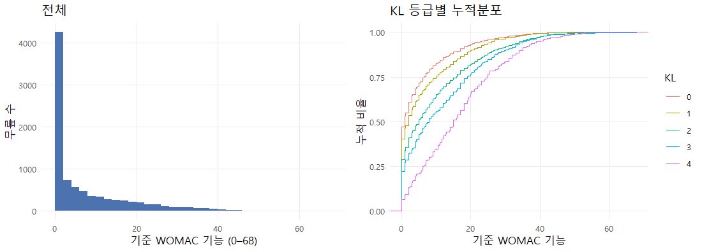
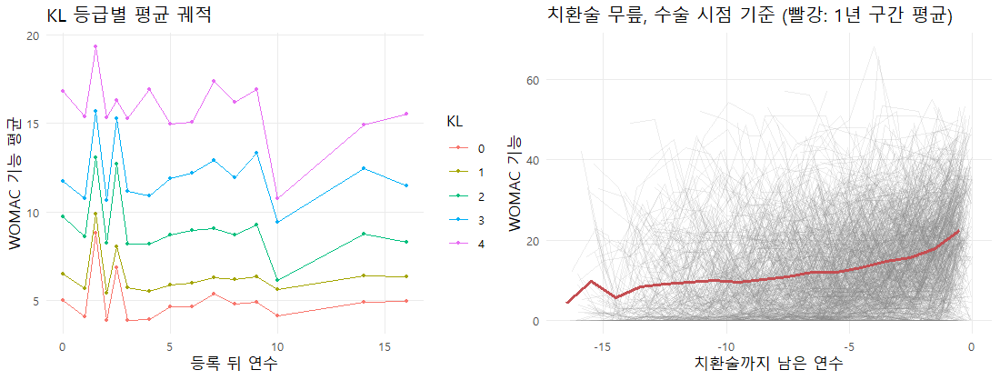
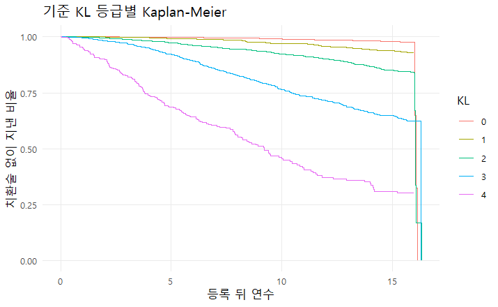

# 무릎 기능 궤적과 인공관절 치환술 — 첫 분석


- [1. 변수 대조](#1-변수-대조)
- [2. 분석용 표](#2-분석용-표)
- [3. 기준 WOMAC 기능의 분포](#3-기준-womac-기능의-분포)
- [4. 궤적](#4-궤적)
- [5. 치환술까지의 시간: Kaplan-Meier](#5-치환술까지의-시간-kaplan-meier)
- [6. Cox 모형](#6-cox-모형)
- [7. 결합모형 (JMbayes2)](#7-결합모형-jmbayes2)
- [8. 다음 단계](#8-다음-단계)

질문: WOMAC 기능 점수의 궤적이 무릎 인공관절 치환술(TKR) 위험을 얼마나 예측하는가.

- 데이터는 Osteoarthritis Initiative(OAI)다. 파일과 변수는 `docs/oai-variables.md`에 있다.
- `data/raw/`에 OAI 파일이 있으면 그것을 읽고, 없으면 `data/synthetic/`에 같은 꼴의 모의 데이터를 만들어 읽는다. 모의 데이터의 결과는 OAI의 결과가 아니다.
- 기술 분석, 세 가지 Cox 근사, JMbayes2 결합모형의 첫 적합까지 한다.

데이터: OAI 원데이터

## 1. 변수 대조

`R/oai.R`의 `VARIABLES`에 적은 꼴을 실제 열 이름과 맞춘다. `found`가 비어 있으면 `hints`의 열을 OAI 데이터 사전과 대조해 `VARIABLES`를 고친다. 사건 부호는 3(판정 확정)만 사건으로 센다. 참고로 `Outcomes99.txt`의 `V99E` 열을 모두 보여 준다.

| concept    | file              | expected    | found      | hints |
|:-----------|:------------------|:------------|:-----------|:------|
| sex        | Enrollees.txt     | P02SEX      | P02SEX     |       |
| age        | AllClinical00.txt | V00AGE      | V00AGE     |       |
| bmi        | AllClinical00.txt | P01BMI      | P01BMI     |       |
| kl         | kXR_SQ_BU00.txt   | V00XRKL     | V00XRKL    |       |
| womac_func | AllClinical00.txt | V00WOMADL?R | V00WOMADLR |       |
| womac_func | AllClinical00.txt | V00WOMADL?L | V00WOMADLL |       |
| womac_pain | AllClinical00.txt | V00WOMKPR   | V00WOMKPR  |       |
| tkr_event  | Outcomes99.txt    | V99ERKRPCF  | V99ERKRPCF |       |
| tkr_days   | Outcomes99.txt    | V99ERKDAYS  | V99ERKDAYS |       |

    Outcomes99의 V99E 열: V99ERKDATE V99ERKFLDT V99ERKRPCF V99ERKTLPR V99ERKTPPR V99ERKBLRP V99ERKVSRP V99ERKPODX V99ERKDAYS V99ERKVSPR V99ERKVSAF V99ERKRPSN V99ERKXRPR V99ERKXRAF V99ELKDATE V99ELKFLDT V99ELKRPCF V99ELKTLPR V99ELKTPPR V99ELKBLRP V99ELKVSRP V99ELKPODX V99ELKDAYS V99ELKVSPR V99ELKVSAF V99ELKRPSN V99ELKXRPR V99ELKXRAF V99ERHDATE V99ERHFLDT V99ERHRPCF V99ERHPODX V99ERHDAYS V99ERHVSPR V99ERHVSAF V99ERHRPSN V99ERHXRPR V99ERHXRAF V99ERHVSRP V99ERHBLRP V99ELHDATE V99ELHFLDT V99ELHRPCF V99ELHPODX V99ELHDAYS V99ELHVSPR V99ELHVSAF V99ELHRPSN V99ELHXRPR V99ELHXRAF V99ELHVSRP V99ELHBLRP V99EXLVSQD V99ERXIOA V99ERXIOAN V99ERXNOA V99ERXNOAN V99ERKLOA V99ERKLOAN V99ELXIOA V99ELXIOAN V99ELXNOA V99ELXNOAN V99ELKLOA V99ELKLOAN V99ERXJSNM V99ERXJSNL V99ELXJSNM V99ELXJSNL V99ERJSFP V99ERJSLP V99ERNJSLP V99ERJSTFP V99ERJSFW V99ERJSLW V99ERNJSLW V99ERJSTFW V99ELJSFP V99ELJSLP V99ELNJSLP V99ELJSTFP V99ELJSFW V99ELJSLW V99ELNJSLW V99ELJSTFW V99EDDCF V99EDDDATE V99EDDFLDT V99EDDYEAR V99EDDVSPR V99EDCOD V99EDCODR V99EDCODR2 

## 2. 분석용 표

- `knees`: 무릎 하나에 한 줄. 기준 공변량, 사건(`event`), 사건 또는 중도절단 개월(`time`)
- `long`: 무릎·방문 하나에 한 줄. 치환술 뒤 측정은 뺐다
- `tv`: 시간가변 Cox용 (start, stop\] 구간. 직전 방문의 WOMAC 기능(`func`)을 다음 방문까지 유지한다

정의는 `docs/oai-variables.md` 5장을 따른다.

| 항목                   |   값 |
|:-----------------------|-----:|
| 사람                   | 4494 |
| 무릎                   | 8917 |
| 치환술 무릎            |  884 |
| 무릎당 방문 수(중앙값) |   11 |
| 추적 개월(중앙값)      |  168 |

|  KL | 무릎 | 치환술 | 기준기능_평균 | 치환술_비율 |
|----:|-----:|-------:|--------------:|------------:|
|   0 | 3436 |     65 |          4.99 |       0.019 |
|   1 | 1593 |     80 |          6.47 |       0.050 |
|   2 | 2365 |    265 |          9.73 |       0.112 |
|   3 | 1231 |    316 |         11.74 |       0.257 |
|   4 |  292 |    158 |         16.80 |       0.541 |

## 3. 기준 WOMAC 기능의 분포

WOMAC 기능은 0~68의 정수이고 클수록 나쁘다. 0에 질량이 몰리면(바닥 효과) 정규 오차의 선형 혼합모형은 궤적을 왜곡한다. 결합모형의 종단 쪽을 무엇으로 둘지 정하는 근거가 이 그림이다.



기준 점수가 0인 무릎: 36.4%

## 4. 궤적

왼쪽은 KL 등급별 방문 평균이다. 오른쪽은 치환술을 받은 무릎을 수술 시점에 맞춰 거꾸로 놓은 것이다. 수술 직전에 기능이 빠르게 나빠지는지가 결합모형이 잡아야 할 신호다.



## 5. 치환술까지의 시간: Kaplan-Meier

기준 KL 등급별 치환술 없이 지낸 비율이다. 사망은 첫 분석에서 중도절단으로 둔다(`docs/oai-variables.md` 5장).



## 6. Cox 모형

세 모형을 나란히 둔다. 표준오차는 모두 사람 번호로 군집 강건하게 구한다(한 사람의 두 무릎).

- 모형 A: 기준 공변량과 기준 WOMAC 기능
- 모형 B: 직전 방문의 WOMAC 기능을 시간가변 공변량으로. 측정오차와 방문 사이 변화를 무시하므로 효과가 0 쪽으로 줄어든다
- 모형 C: 2단계. 선형 혼합모형으로 무릎별 기울기(연간 변화)를 추정해 Cox에 넣는다. 추적 전체로 기울기를 구하므로 미래 정보가 섞이고, 추정 불확실성을 무시한다

B와 C의 한계를 함께 푸는 것이 7절의 결합모형이다.

모형 A — 기준 공변량

| 항          |     HR |   하한 |   상한 |     p |
|:------------|-------:|-------:|-------:|------:|
| age         |  0.999 |  0.990 |  1.008 | 0.873 |
| female      |  1.105 |  0.932 |  1.311 | 0.251 |
| bmi         |  1.003 |  0.986 |  1.022 | 0.714 |
| factor(kl)1 |  2.669 |  1.907 |  3.735 | 0.000 |
| factor(kl)2 |  5.974 |  4.423 |  8.070 | 0.000 |
| factor(kl)3 | 16.616 | 12.274 | 22.494 | 0.000 |
| factor(kl)4 | 48.340 | 34.776 | 67.195 | 0.000 |
| func0_10    |  1.242 |  1.169 |  1.319 | 0.000 |

모형 B — 시간가변 WOMAC 기능(10점당)

| 항          |     HR |   하한 |   상한 |        p |
|:------------|-------:|-------:|-------:|---------:|
| age         |  1.006 |  0.996 |  1.015 | 2.34e-01 |
| female      |  0.974 |  0.814 |  1.165 | 7.73e-01 |
| bmi         |  0.982 |  0.964 |  1.001 | 6.01e-02 |
| factor(kl)1 |  2.523 |  1.800 |  3.537 | 1.00e-07 |
| factor(kl)2 |  5.093 |  3.758 |  6.901 | 0.00e+00 |
| factor(kl)3 | 11.504 |  8.439 | 15.682 | 0.00e+00 |
| factor(kl)4 | 28.216 | 19.994 | 39.821 | 0.00e+00 |
| func_10     |  1.771 |  1.680 |  1.868 | 0.00e+00 |

모형 C — 2단계, 무릎별 연간 기울기

| 항          |     HR |   하한 |   상한 |      p |
|:------------|-------:|-------:|-------:|-------:|
| age         |  1.000 |  0.991 |  1.009 | 0.9390 |
| female      |  1.174 |  0.986 |  1.397 | 0.0715 |
| bmi         |  1.000 |  0.982 |  1.018 | 0.9570 |
| factor(kl)1 |  2.610 |  1.869 |  3.646 | 0.0000 |
| factor(kl)2 |  5.691 |  4.218 |  7.679 | 0.0000 |
| factor(kl)3 | 13.829 | 10.174 | 18.798 | 0.0000 |
| factor(kl)4 | 40.622 | 29.127 | 56.655 | 0.0000 |
| func0_10    |  1.369 |  1.285 |  1.460 | 0.0000 |
| slope       |  2.139 |  1.861 |  2.459 | 0.0000 |

## 7. 결합모형 (JMbayes2)

종단 쪽은 선형 혼합모형이다. KL 등급마다 수준과 기울기가 다르고(`year * kl`), 무릎마다 무작위 절편·기울기를 둔다. 생존 쪽은 기준 공변량에 더해 그 시점의 참 기능 점수(`value`)와 변화율(`slope`)을 넣는다. 시간 단위는 연이다.

KL 등급을 종단 쪽에 넣는 것이 중요하다. 빼면 무작위 절편이 KL의 차이를 떠안고, 생존 쪽의 KL 계수와 `value` 계수가 같은 정보를 나눠 가지느라 MCMC가 섞이지 않는다.

이 첫 적합에는 한계가 셋 있다. 한 사람의 두 무릎을 독립으로 둔다. 종단 오차를 정규로 두어 3절의 바닥 효과를 무시한다. 사망을 중도절단으로 둔다.

적합에 수십 분이 걸리므로 이 문서 안에서 돌리지 않는다. `R/fit-jm.R`이 적합하고 요약을 `outputs/jm-01.rds`에 저장하며, 이 절은 그 파일을 읽는다. 데이터를 바꾸면 스크립트를 다시 돌린다.

``` bash
Rscript R/fit-jm.R
```

주의: 저장된 적합과 이 문서가 읽은 데이터가 다르다. 스크립트를 다시 돌린다.

적합: 2026-11-19 00:38 \| 데이터: 모의 데이터 \| 무릎 2994, 치환술 134, 관측 23710 \| 반복 15000(버림 3000) \| 58분

생존 쪽 계수를 위험비로 바꾼 것이다. `value(womac_func)`는 기능 1점당, `slope(womac_func)`는 연간 변화 1점당 위험비다. 모형 B의 시간가변 WOMAC 계수(10점당)와 견주려면 `value`를 10제곱한다.

| 항                |    HR |  하한 |  상한 |  Rhat |
|:------------------|------:|------:|------:|------:|
| age_c             | 1.005 | 0.975 | 1.036 | 1.000 |
| female            | 1.077 | 0.736 | 1.598 | 1.001 |
| bmi_c             | 0.993 | 0.958 | 1.029 | 1.000 |
| kl1               | 2.390 | 1.074 | 5.557 | 1.001 |
| kl2               | 3.830 | 1.930 | 8.312 | 1.004 |
| kl3               | 3.215 | 1.474 | 7.271 | 1.007 |
| kl4               | 2.385 | 0.951 | 6.181 | 1.013 |
| value(womac_func) | 1.087 | 1.049 | 1.127 | 1.029 |
| slope(womac_func) | 0.765 | 0.527 | 1.106 | 1.020 |

종단 쪽 계수다.

| 항          |   추정 |   하한 |   상한 |  Rhat |
|:------------|-------:|-------:|-------:|------:|
| (Intercept) |  2.310 |  2.028 |  2.592 | 1.001 |
| year        |  0.244 |  0.182 |  0.305 | 1.002 |
| kl1         |  1.754 |  1.245 |  2.264 | 1.001 |
| kl2         |  5.368 |  4.900 |  5.834 | 1.001 |
| kl3         | 10.241 |  9.706 | 10.779 | 1.001 |
| kl4         | 16.407 | 15.653 | 17.169 | 1.001 |
| year:kl1    |  0.377 |  0.265 |  0.488 | 1.002 |
| year:kl2    |  0.841 |  0.740 |  0.944 | 1.001 |
| year:kl3    |  1.207 |  1.090 |  1.325 | 1.001 |
| year:kl4    |  1.552 |  1.385 |  1.721 | 1.000 |
| sigma       |  3.356 |  3.323 |  3.391 | 1.001 |

수렴 진단(Rhat)이 1.05를 넘는 항이 있으면 반복 수를 늘려 스크립트를 다시 돌린다(`Rscript R/fit-jm.R 20000 4000`). `value`와 `slope`는 서로 상관이 높아 가장 늦게 섞인다.

모의 데이터의 참값은 기능 1점당 위험비 exp(0.07) ≈ 1.073이고 기울기 효과는 없다(위험비 1). 결합모형이 둘 다 신뢰구간 안에 담는지가 이 적합의 점검이다. 모형 B의 시간가변 계수가 0 쪽으로 줄어드는 것과 견주어 본다.

## 8. 다음 단계

1.  원데이터로 다시 돌린다. `data/raw/`에 OAI 파일을 두면 이 문서가 그것을 읽는다. 1절의 대조가 통과할 때까지 `R/oai.R`의 `VARIABLES`를 고친다.
2.  바닥 효과. 3절의 0 질량이 크면 종단 쪽을 검열 정규(Tobit)나 절단 분포로 바꾼다. JMbayes2의 `censored normal` 계열부터 보고, 맞지 않으면 Stan으로 직접 짠다.
3.  한 사람의 두 무릎. 사람 단위 무작위 효과를 더하거나, 무릎 하나를 고르는 민감도 분석을 한다.
4.  사망을 경쟁 위험으로 다룬다.
5.  동적 예측. 방문마다 향후 2년 치환술 확률을 갱신하고, 시간의존 AUC와 보정(calibration)으로 평가한다. 물리치료 쪽에 가장 쓸모 있는 결과물이 이것이다.
