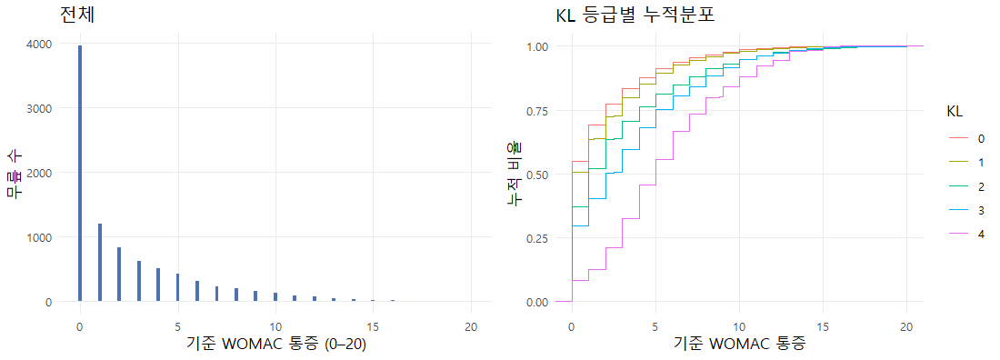
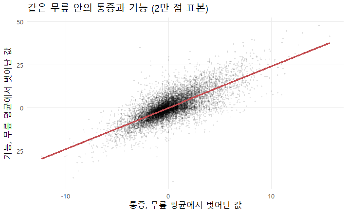
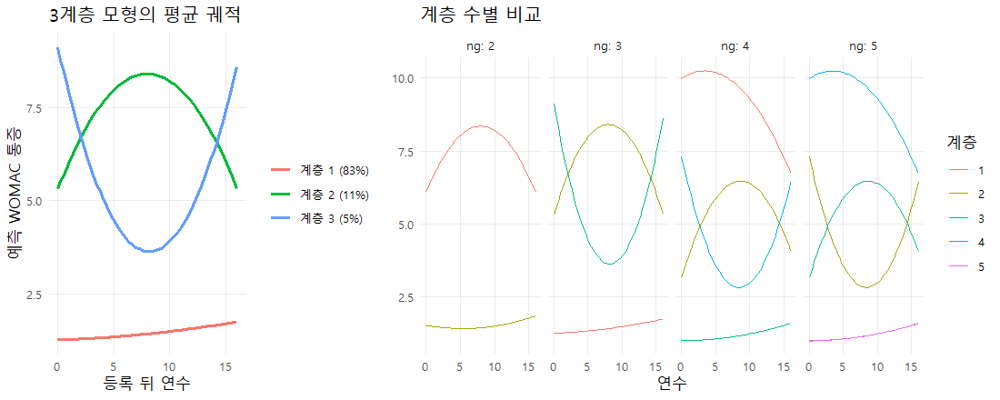
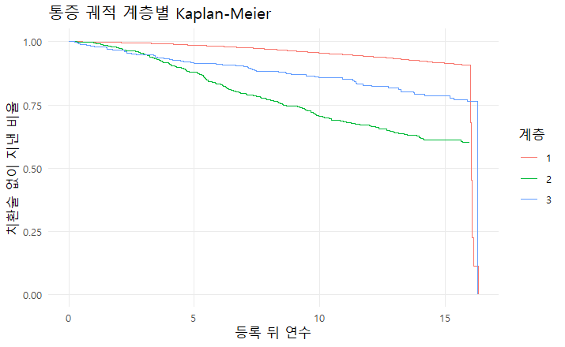

# 무릎 통증의 궤적 — 구조와 통증, 통증 궤적의 계층


- [1. 분석용 표](#1-분석용-표)
- [2. 기준 통증의 분포](#2-기준-통증의-분포)
- [3. 구조와 통증의 어긋남](#3-구조와-통증의-어긋남)
- [4. 통증과 기능](#4-통증과-기능)
- [5. 통증 궤적의 계층](#5-통증-궤적의-계층)
- [6. 계층의 기준 특성](#6-계층의-기준-특성)
- [7. 계층과 치환술](#7-계층과-치환술)
- [8. 한계와 다음 단계](#8-한계와-다음-단계)

질문은 셋이다.

- 무릎의 구조 손상(KL 등급)과 통증은 얼마나 어긋나는가.
- 통증과 기능은 같은 무릎 안에서 함께 움직이는가.
- 통증의 장기 궤적에는 몇 갈래의 전형이 있고, 그 갈래가 치환술과 어떻게 이어지는가.

데이터와 정의는 첫 분석(`01-function-trajectory-tkr`)과 같다. 통증은 WOMAC 통증(0~20, 클수록 나쁨)이다.

데이터: OAI 원데이터

## 1. 분석용 표

| 항목                  |    값 |
|:----------------------|------:|
| 무릎                  |  8917 |
| 기준 통증이 있는 무릎 |  8916 |
| 통증 관측             | 90667 |
| 치환술 무릎           |   884 |

## 2. 기준 통증의 분포

통증은 기능보다 바닥 효과가 더 크다. 문항이 다섯 개(0~20)뿐이라 한 문항만 “약간”이어도 1점이 되고, 아프지 않은 무릎은 모두 0에 모인다.



기준 통증이 0인 무릎: 44.4% (기능이 0인 무릎: 36.4%)

## 3. 구조와 통증의 어긋남

KL 등급별로 기준 통증의 구간을 나눈 비율이다. 각 행의 합이 1이다.

|  KL |     0 |   1–4 |   5–9 |   10+ | 무릎 |
|----:|------:|------:|------:|------:|-----:|
|   0 | 0.549 | 0.327 | 0.101 | 0.023 | 3436 |
|   1 | 0.506 | 0.345 | 0.121 | 0.029 | 1592 |
|   2 | 0.370 | 0.393 | 0.168 | 0.068 | 2365 |
|   3 | 0.297 | 0.386 | 0.234 | 0.084 | 1231 |
|   4 | 0.082 | 0.373 | 0.387 | 0.158 |  292 |

구조 손상이 큰데(KL 3–4) 통증이 없는 무릎: 25.5%

구조 손상이 거의 없는데(KL 0–1) 통증이 5점 이상인 무릎: 13.2%

KL 등급과 기준 통증의 순위 상관(Spearman): 0.266

## 4. 통증과 기능

기준 시점의 상관은 무릎 사이의 차이를 본다. 같은 무릎 안에서 통증이 오를 때 기능도 나빠지는지는 무릎 평균을 뺀 값끼리의 상관으로 본다.

무릎 사이 상관(기준 시점): 0.854

무릎 안 상관(평균을 뺀 값): 0.749



## 5. 통증 궤적의 계층

잠재계층 혼합모형(`lcmm::hlme`)이다. 모든 무릎이 같은 꼴(연수의 2차식)의 궤적을 따르되, 계층마다 계수가 다르고 무릎마다 무작위 절편과 기울기를 둔다. 계층 수가 2 이상이면 무작위 초기값 10개로 시작해 국소 최댓값을 피한다.

적합은 `R/fit-lcmm.R`이 하고 요약을 `outputs/lcmm-02.rds`에 저장한다. 이 절은 그 파일을 읽는다.

``` bash
Rscript R/fit-lcmm.R
```

적합: 2026-11-20 13:16 \| 무릎 8917, 관측 90667 \| 계층 1–5 \| 204분

계층 수를 고르는 기준은 셋이다. BIC가 작을 것, 가장 작은 계층이 무릎의 5% 이상일 것, 상대 엔트로피가 높을 것(1에 가까울수록 무릎이 한 계층에 분명히 속한다). 아래에서는 앞의 두 조건으로 고르고 엔트로피는 함께 본다.

| 계층 | 수렴 |  로그우도 | 모수 |      BIC | 엔트로피 | 최소계층비율 |
|-----:|-----:|----------:|-----:|---------:|---------:|-------------:|
|    1 |    1 | -204370.0 |    7 | 408803.6 |       NA |        1.000 |
|    2 |    1 | -202549.4 |   11 | 405198.9 |    0.900 |        0.132 |
|    3 |    1 | -201587.0 |   15 | 403310.5 |    0.906 |        0.052 |
|    4 |    1 | -200672.1 |   19 | 401517.1 |    0.893 |        0.049 |
|    5 |    2 | -200672.1 |   23 | 401553.5 |    0.761 |        0.000 |

고른 계층 수: 3



고른 모형의 평균 궤적을 몇 시점에서 읽은 값이다. 계층의 뜻은 기준 통증의 높이보다 궤적의 방향(악화, 호전, 유지)에서 갈린다. 추적 10년 뒤에는 관측이 V13·V14 두 번뿐이라, 2차식이 그 구간에서 다시 휘는 것은 데이터보다 함수 꼴에서 나온 것일 수 있다.

| 연수 | 계층1 | 계층2 | 계층3 |
|-----:|------:|------:|------:|
|    0 |  1.27 |  5.33 |  9.10 |
|    2 |  1.29 |  6.67 |  6.76 |
|    4 |  1.32 |  7.64 |  5.07 |
|    8 |  1.42 |  8.41 |  3.64 |
|   12 |  1.57 |  7.64 |  4.82 |
|   16 |  1.75 |  5.33 |  8.61 |

## 6. 계층의 기준 특성

| 계층 | 무릎 | 나이 |  여성 |  BMI | KL_평균 | KL3이상 | 기준통증 | 기준기능 | 소속확률_평균 |
|-----:|-----:|-----:|------:|-----:|--------:|--------:|---------:|---------:|--------------:|
|    1 | 7442 | 61.2 | 0.570 | 28.1 |    1.11 |   0.132 |     1.44 |     5.03 |         0.976 |
|    2 | 1014 | 60.8 | 0.617 | 30.9 |    2.04 |   0.399 |     5.51 |    19.00 |         0.880 |
|    3 |  461 | 60.4 | 0.681 | 30.9 |    1.88 |   0.297 |     9.70 |    28.40 |         0.855 |

## 7. 계층과 치환술

계층별 치환술 없이 지낸 비율과, 기준 공변량을 보정한 Cox 모형이다. 계층은 추적 전체의 통증으로 정했으므로 치환술 직전의 통증 악화가 계층에 이미 섞여 있다. 그래서 이 위험비는 예측의 근거가 아니라 계층이 무엇을 뜻하는지 읽는 기술 통계다.



| 항          |     HR |   하한 |   상한 |
|:------------|-------:|-------:|-------:|
| age         |  1.001 |  0.992 |  1.010 |
| female      |  1.092 |  0.921 |  1.295 |
| bmi         |  0.997 |  0.980 |  1.015 |
| factor(kl)1 |  2.665 |  1.902 |  3.734 |
| factor(kl)2 |  5.903 |  4.367 |  7.980 |
| factor(kl)3 | 15.027 | 11.050 | 20.434 |
| factor(kl)4 | 40.097 | 28.507 | 56.400 |
| class_f2    |  2.960 |  2.466 |  3.553 |
| class_f3    |  1.660 |  1.247 |  2.210 |

기준 계층은 평균 통증이 가장 낮은 계층이다.

## 8. 한계와 다음 단계

1.  바닥 효과. 통증의 0 질량이 기능보다 크다. 정규 오차의 `hlme` 대신 `lcmm()`의 비선형 연결(스플라인)이나 검열 모형으로 다시 적합해 계층이 바뀌는지 본다.
2.  한 사람의 두 무릎을 독립으로 다룬다. 사람 단위로 계층을 정하거나, 무릎 하나만 고르는 민감도 분석을 한다.
3.  통증과 구조의 어긋남(3절)은 KL 등급 하나로만 본다. MRI 판독(골수 병변, 활막염)을 붙이면 “구조와 무관한 통증”의 정체를 더 좁힐 수 있다.
4.  통증 궤적을 첫 분석의 결합모형에 넣는다. 기능 대신 통증, 또는 둘을 함께(다변량 결합모형) 넣어 어느 쪽이 치환술을 더 잘 예측하는지 비교한다.
