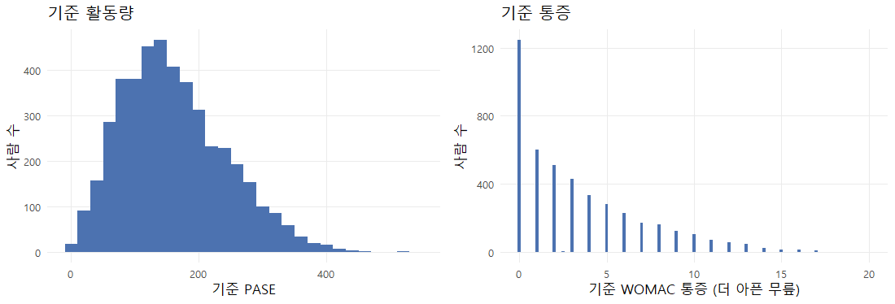
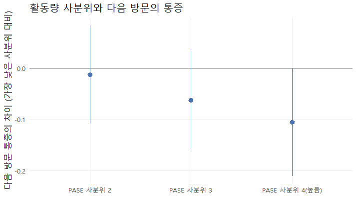

# 신체활동과 무릎 통증 — PASE로 본 활동량과 통증의 관계

- [1. 분석용 표](#1-분석용-표)
- [2. 활동량과 통증의 분포](#2-활동량과-통증의-분포)
- [3. 기준 시점의 단면 관계](#3-기준-시점의-단면-관계)
- [4. 사람 사이의 차이와 사람 안의 변화](#4-사람-사이의-차이와-사람-안의-변화)
- [5. 시간의 순서](#5-시간의-순서)
- [6. 활동량의 수준에 따른 차이](#6-활동량의-수준에-따른-차이)
- [7. 읽는 법과 한계](#7-읽는-법과-한계)

질문은 셋이다.

- 활동적인 사람은 무릎이 덜 아픈가, 더 아픈가.
- 같은 사람 안에서 활동량이 늘어난 해에 통증은 어떻게 달라지는가.
- 활동량이 이후의 통증을 예고하는가, 통증이 이후의 활동량을 예고하는가.

활동량은 PASE(Physical Activity Scale for the Elderly) 총점이다. 지난 7일의 여가 활동, 집안일, 일을 묻는 자기 보고 척도이고 클수록 활동적이다. 통증은 두 무릎 가운데 더 아픈 쪽의 WOMAC 통증(0~20, 클수록 나쁨)이다. 분석 단위는 무릎이 아니라 사람이다. PASE가 사람 단위의 측정이기 때문이다. 어느 한쪽 무릎이라도 치환술을 받은 뒤의 방문은 뺐다. 자료는 `R/oai.R`의 `activity_table`이 만든다.

이 문서의 결과는 모두 관찰된 연관이다. 활동량을 바꾸면 통증이 달라진다는 인과적 결론의 근거가 되지 못한다. 그 이유는 7절에 적었다.

데이터: OAI 원데이터

## 1. 분석용 표

| 항목                      | 값                             |
|:--------------------------|:-------------------------------|
| 사람                      | 4502                           |
| 사람·방문 관측            | 28895                          |
| 한 사람의 방문 수(중앙값) | 7                              |
| PASE가 있는 방문(개월)    | 0, 12, 24, 36, 48, 72, 96, 168 |

## 2. 활동량과 통증의 분포

방문별 평균이다. 활동량은 해가 갈수록 줄어든다. 통증의 평균은 기준 방문 뒤로 거의 변하지 않는데, 치환술을 받은 사람이 빠져나가고 남은 사람들의 평균이라는 점을 감안해야 한다.

| 개월 | 사람 | PASE 평균 | PASE 중앙값 | 통증 평균 | 통증 0점 비율 |
|-----:|-----:|----------:|------------:|----------:|--------------:|
|    0 | 4475 |    161.76 |       151.0 |      3.39 |          0.28 |
|   12 | 4267 |    157.32 |       146.0 |      2.97 |          0.34 |
|   24 | 3991 |    153.18 |       142.0 |      2.89 |          0.35 |
|   36 | 3854 |    151.05 |       141.5 |      2.86 |          0.36 |
|   48 | 3646 |    154.36 |       143.0 |      2.80 |          0.36 |
|   72 | 3282 |    151.77 |       140.0 |      2.98 |          0.36 |
|   96 | 3112 |    147.55 |       134.0 |      2.93 |          0.36 |
|  168 | 2268 |    127.46 |       116.5 |      2.90 |          0.37 |

기준 방문의 PASE: 평균 162, 표준편차 82, 사분위 100 / 151 / 213

## 3. 기준 시점의 단면 관계

기준 방문에서 활동량을 사분위로 나누고 통증을 비교한다. 첫째 표는 보정하지 않은 값이다. 둘째 표는 나이, 성별, BMI, KL 등급(두 무릎 가운데 높은 쪽)을 넣은 회귀에서 PASE 50점의 계수다. 50점은 기준 표준편차의 약 0.6배다.

| PASE 사분위 | 사람 | PASE 범위 | 나이 | 여성 비율 | BMI | KL 2 이상 비율 | 통증 평균 | 통증 5점 이상 비율 |
|:---|---:|:---|---:|---:|---:|---:|---:|---:|
| 1(낮음) | 1137 | 0–100 | 64.00 | 0.65 | 29.21 | 0.61 | 3.86 | 0.35 |
| 2 | 1118 | 101–151 | 63.23 | 0.61 | 28.36 | 0.58 | 3.22 | 0.29 |
| 3 | 1106 | 152–213 | 61.27 | 0.60 | 28.24 | 0.55 | 3.11 | 0.27 |
| 4(높음) | 1114 | 214–531 | 56.10 | 0.46 | 28.52 | 0.52 | 3.34 | 0.29 |

| 모형                     |   계수 | 표준오차 |   하한 |   상한 |
|:-------------------------|-------:|---------:|-------:|-------:|
| 보정 없음                | -0.095 |    0.036 | -0.165 | -0.025 |
| 나이, 성별, BMI, KL 보정 | -0.074 |    0.037 | -0.146 | -0.002 |

기준 시점의 PASE와 통증의 상관: -0.042

활동량이 낮은 사람은 나이가 많다. 나이는 활동량과도 통증과도 연관되므로 보정 전후의 계수가 달라질 수 있다.

## 4. 사람 사이의 차이와 사람 안의 변화

단면 관계는 서로 다른 사람을 비교한 것이다. 같은 사람이 더 활동적이었던 해에 통증이 어땠는지는 다른 질문이다. PASE를 그 사람의 평균과 평균에서 벗어난 값으로 나누어 혼합모형에 함께 넣는다.

$$\text{통증}_{it} = \beta_0 + \beta_B\,\overline{\text{PASE}}_i + \beta_W\,(\text{PASE}_{it} - \overline{\text{PASE}}_i) + \beta_t\,t + x_i^\top\gamma + b_{0i} + b_{1i}t + \varepsilon_{it}$$

$\beta_B$는 평소 활동량이 50점 많은 사람의 통증 차이, $\beta_W$는 같은 사람이 평소보다 50점 더 활동적이었던 방문의 통증 차이다. 무작위 효과는 사람별 절편과 기울기다.

| 항                             |   계수 | 표준오차 |   하한 |   상한 |
|:-------------------------------|-------:|---------:|-------:|-------:|
| 사람 사이 (평균 PASE 50점)     | -0.177 |    0.036 | -0.248 | -0.106 |
| 사람 안 (평균에서 50점 벗어남) | -0.042 |    0.013 | -0.067 | -0.017 |
| 시간 (1년)                     |  0.022 |    0.005 |  0.013 |  0.031 |

관측 28895, 사람 4502 \| 무작위 절편의 표준편차 2.70, 잔차의 표준편차 2.10

PASE의 분산 가운데 사람 사이의 몫: 0.61

사람 안에서의 상관(둘 다 평균을 뺀 값, 방문 2번 이상): -0.033

## 5. 시간의 순서

같은 방문에서 잰 활동량과 통증의 연관은 방향을 가리지 못한다. 덜 움직여서 아픈 것일 수도 있고 아파서 덜 움직이는 것일 수도 있다. 연속한 두 방문을 짝지어 앞 방문의 값으로 뒤 방문의 값을 예측한다. 뒤 방문의 통증을 앞 방문의 통증과 활동량으로, 뒤 방문의 활동량을 앞 방문의 활동량과 통증으로 설명한다. 간격이 1~2년인 짝만 쓴다(0→12, 12→24, 24→36, 36→48, 48→72, 72→96개월). 표준오차는 사람 단위로 군집한 강건 표준오차다.

| 결과 | 항 | 계수 | 표준오차 | 하한 | 상한 |
|:---|:---|---:|---:|---:|---:|
| 뒤 방문의 통증 (점) | 앞 방문의 통증 (1점) | 0.629 | 0.009 | 0.611 | 0.647 |
| 뒤 방문의 통증 (점) | 앞 방문의 PASE (50점) | -0.024 | 0.012 | -0.047 | -0.001 |
| 뒤 방문의 PASE (50점 단위) | 앞 방문의 PASE (50점) | 0.529 | 0.009 | 0.512 | 0.546 |
| 뒤 방문의 PASE (50점 단위) | 앞 방문의 통증 (1점) | -0.013 | 0.003 | -0.019 | -0.007 |

방문 짝 21663개, 사람 4457명

표준편차 단위로 바꾼 교차 계수: 활동량 → 통증 -0.011, 통증 → 활동량 -0.028

첫 행은 앞 방문의 통증이 같을 때 활동량이 50점 많았던 사람의 다음 방문 통증 차이다. 넷째 행은 앞 방문의 활동량이 같을 때 통증이 1점 높았던 사람의 다음 방문 활동량 차이다(50점 단위이므로 50을 곱하면 PASE 점수다).

## 6. 활동량의 수준에 따른 차이

활동량과 통증의 관계가 직선이 아닐 수 있다. 너무 적게 움직이는 것과 너무 많이 움직이는 것이 모두 나쁠 수 있기 때문이다. 5절의 첫 모형에서 PASE를 사분위로 바꾸어 넣는다. 기준은 가장 낮은 사분위다.

| 항                  |   계수 | 표준오차 |   하한 |  상한 |
|:--------------------|-------:|---------:|-------:|------:|
| PASE 사분위 2       | -0.013 |    0.048 | -0.108 | 0.082 |
| PASE 사분위 3       | -0.063 |    0.051 | -0.163 | 0.037 |
| PASE 사분위 4(높음) | -0.105 |    0.054 | -0.210 | 0.000 |

사분위 경계(PASE): 0 / 94 / 146 / 208 / 580

| 대상                  |   계수 | 표준오차 |   하한 |   상한 |
|:----------------------|-------:|---------:|-------:|-------:|
| 앞 방문 통증 0점      | -0.037 |    0.014 | -0.064 | -0.009 |
| 앞 방문 통증 1점 이상 | -0.018 |    0.017 | -0.051 |  0.014 |

## 7. 읽는 법과 한계

**인과가 아니다.** 5절의 시차 모형은 시간의 순서를 맞추었을 뿐이다. 활동량과 이후의 통증에 함께 영향을 주는 요인(전반적 건강, 우울, 직업, 다른 관절의 문제)을 보정하지 않았다. 앞 방문의 통증을 보정해도 그 방문의 통증으로 잡히지 않는 무릎 상태가 남는다.

**활동량은 자기 보고다.** PASE는 지난 7일을 기억으로 답한 값이고 측정오차가 크다. 측정오차는 4절의 사람 안 계수와 5절의 활동량 계수를 0 쪽으로 끌어당긴다. 연관이 작게 나온 것이 연관이 없다는 뜻은 아니다. OAI의 일부 대상자에게는 가속도계 자료가 있으나 이 분석에는 쓰지 않았다.

**활동의 종류를 가리지 않는다.** PASE 총점은 걷기, 집안일, 직업 활동을 합친 값이다. 무릎에 부담을 주는 활동과 그렇지 않은 활동이 같은 점수로 들어간다.

**남은 사람들의 자료다.** 치환술을 받은 사람은 그 뒤의 방문에서 빠진다. 통증이 심해진 사람이 먼저 빠져나가므로 뒤로 갈수록 통증이 덜한 사람들만 남는다.

**통증의 바닥 효과.** 통증이 0점인 관측이 많다. 선형모형은 0점 아래로 내려갈 수 없다는 제약을 반영하지 않는다.

**한 사람의 두 무릎을 하나로 줄였다.** 더 아픈 쪽의 통증만 썼다. 어느 무릎이 아픈지, 한쪽만 아픈지는 구분하지 않았다.
