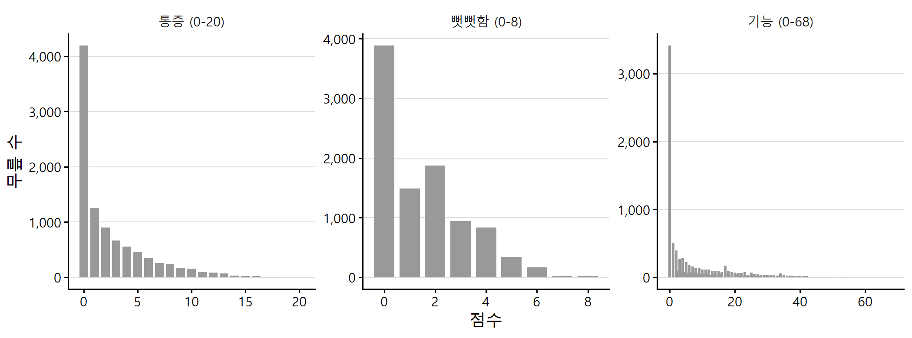

# 데이터 1장. 데이터와 측정 — OAI는 누구를 무엇으로 측정했는가

- [I. 코호트 설계](#i-코호트-설계)
- [II. 분석 단위](#ii-분석-단위)
- [III. 척도](#iii-척도)
- [IV. 추적과 결측](#iv-추적과-결측)
- [V. 정리: 뒤 장을 위한 결론](#v-정리-뒤-장을-위한-결론)
- [참고문헌](#참고문헌)

이 장은 뒤의 장들이 공통으로 쓰는 데이터를 다룬다. Osteoarthritis Initiative(OAI)가 누구를 등록했고, 무릎을 어떤 척도로 측정했으며, 16년의 추적 동안 무엇이 빠져나갔는지를 본다. 데이터를 설명하는 장이지만 방법이 셋 들어 있다. 첫째는 한 사람의 두 무릎처럼 묶여 있는 관측을 다루는 법(급내상관과 설계효과), 둘째는 척도의 성질을 점검하는 법(순서 척도, 합산 척도, 바닥 효과), 셋째는 추적 중의 결측을 분류하고 그 영향을 점검하는 법(결측의 기제, 탈락 분석, 생존자 편향)이다. 세 가지 모두 뒤 장의 모형을 고를 때 근거가 된다.

데이터는 OAI 공개 데이터 가운데 등록자 파일(`Enrollees`), 방문별 임상 파일(`AllClinical00`\~`AllClinical14`), 기준 X선 판독 파일(`kXR_SQ_BU00`), 사건 파일(`Outcomes99`)이다. 읽는 함수는 `R/oai.R`의 `cohort_data`이고, 변수 이름과 부호는 `docs/oai-variables.md`에 있다.

## I. 코호트 설계

### 1. 전향적 코호트

관찰 연구(observational study)의 설계는 언제 무엇을 측정하는지에 따라 나뉜다. 횡단면 연구(cross-sectional study)는 한 시점에 노출과 결과를 함께 측정한다. 환자-대조군 연구(case-control study)는 결과가 생긴 사람과 생기지 않은 사람을 모은 뒤 과거의 노출을 거꾸로 확인한다. 전향적 코호트(prospective cohort)는 결과가 생기기 전에 사람을 등록하고, 같은 사람을 정해진 간격으로 다시 측정하면서 결과가 생기는 것을 기다린다. 전향적 코호트만이 노출이 결과보다 먼저 측정되었음을 설계로 보장하고, 결과의 발생률(얼마나 많은 사람이 얼마 동안에 결과에 이르는가)을 직접 추정할 수 있다. 대가는 시간과 탈락이다. 결과가 드물거나 느리게 생기면 오래 따라가야 하고, 그동안 일부는 연구를 떠난다. IV장이 그 탈락을 다룬다.

OAI는 무릎 골관절염(osteoarthritis)을 대상으로 한 전향적 코호트다. 2004\~2006년에 45\~79세 4,796명을 등록했고, 등록 방문(0개월) 뒤 거의 해마다 다시 불러 같은 문진과 검사를 되풀이했다(Nevitt et al., 2006). 등록자는 세 하위 코호트로 나뉜다. 진행 코호트는 등록 시점에 적어도 한쪽 무릎에 증상이 있는 방사선학적 골관절염이 있는 사람이고, 발생 코호트는 그런 무릎은 없지만 비만, 무릎 손상이나 수술의 과거력, 가족력 같은 위험 요인이 있는 사람이다. 비노출 대조 코호트는 골관절염도 위험 요인도 없는 소수의 사람이다. 하위 코호트는 등록 기준이므로, 분석에서 등록자 전체를 한 모집단의 표본으로 보면 안 된다. 등록자는 미국 45\~79세 인구가 아니라 골관절염이 있거나 생길 위험이 높은 사람 쪽으로 기울어 있다.

### 2. 등록자의 특성

표 1은 하위 코호트별 등록자의 기준 특성이다. 나이와 BMI는 평균(표준편차)이다. KL 2 이상은 두 무릎 가운데 높은 쪽의 Kellgren-Lawrence 등급이 2 이상(골극이 확실함)인 사람의 비율이다. 통증은 두 무릎 가운데 더 아픈 쪽의 WOMAC 통증(0\~20)이고, PASE는 지난 7일의 신체활동 점수다. 두 척도는 III장에서 설명한다.

**표 1. 하위 코호트별 등록자의 기준 특성**

| 하위 코호트 | 등록자 | 나이 | 여성(%) | BMI | KL 2 이상(%) | 통증 평균 | PASE 평균 |
|:---|---:|:---|---:|:---|---:|---:|---:|
| 진행 | 1,390 | 61.4 (9.1) | 57.1 | 30.2 (4.9) | 87.4 | 5.9 | 157.5 |
| 발생 | 3,284 | 61.3 (9.2) | 59.0 | 28.1 (4.6) | 45.9 | 2.6 | 161.6 |
| 비노출 대조 | 122 | 55.0 (7.7) | 61.5 | 24.3 (3.1) | 3.3 | 0.1 | 178.6 |
| 전체 | 4,796 | 61.2 (9.2) | 58.5 | 28.6 (4.8) | 56.6 | 3.5 | 160.8 |

표 1에서 하위 코호트는 구조 손상과 통증에서 뚜렷하게 구분된다. 진행 코호트는 87%가 KL 2 이상이고 통증 평균이 5.9점인 반면, 발생 코호트는 각각 46%와 2.6점이다. 진행 코호트의 기준이 방사선학적 골관절염인데도 KL 2 이상이 100%가 아니고, 발생 코호트에도 KL 2 이상이 적지 않다. 설명은 둘이다. 하나는 진행 코호트의 기준이 증상과 방사선 소견을 함께 요구했다는 점이다. X선 소견은 있어도 증상 기준을 채우지 못한 사람은 발생 코호트로 들어갔다. 다른 하나는 판독의 차이다. 등록을 정할 때는 각 기관이 X선을 읽었고, 이 장의 KL 등급은 등록 뒤의 중앙 판독(`kXR_SQ_BU00`)이므로 두 판독이 어긋난 사람이 있을 수 있다. 이 장의 데이터로는 두 설명의 몫을 구분하지 못한다. 구조와 증상이 이렇게 어긋나는 현상은 회귀 1장의 주제다. 비노출 대조 코호트는 다른 둘보다 젊고 BMI가 낮으며, 사람 수가 적어 이 책의 분석에서 따로 다루지 않는다.

### 3. 방문 일정

표 2는 방문마다 WOMAC 통증을 측정한 사람과 무릎의 수다. 치환술(total knee replacement)을 받은 무릎의 수술 뒤 측정은 세지 않았다. 18개월과 30개월 방문은 일부 대상자만 받았고, 108개월 뒤로는 방문 간격이 벌어져 168개월(14년)과 192개월(16년) 방문이 마지막이다.

**표 2. 방문별 WOMAC 통증을 측정한 사람과 무릎**

| 방문 | 개월 |  사람 |  무릎 | 등록자 대비 사람(%) |
|:-----|-----:|------:|------:|--------------------:|
| 00   |    0 | 4,796 | 9,589 |               100.0 |
| 01   |   12 | 4,473 | 8,921 |                93.3 |
| 02   |   18 |   288 |   572 |                 6.0 |
| 03   |   24 | 4,304 | 8,544 |                89.7 |
| 04   |   30 |   493 |   965 |                10.3 |
| 05   |   36 | 4,243 | 8,389 |                88.5 |
| 06   |   48 | 4,212 | 8,288 |                87.8 |
| 07   |   60 | 3,899 | 7,626 |                81.3 |
| 08   |   72 | 3,768 | 7,337 |                78.6 |
| 09   |   84 | 3,725 | 7,212 |                77.7 |
| 10   |   96 | 3,814 | 7,351 |                79.5 |
| 11   |  108 | 3,327 | 6,390 |                69.4 |
| 12   |  120 | 2,213 | 4,315 |                46.1 |
| 13   |  168 | 2,632 | 4,981 |                54.9 |
| 14   |  192 | 2,257 | 4,250 |                47.1 |

표 2에서 측정된 사람의 비율은 대체로 방문마다 줄어든다. 96개월(8년) 방문에서 등록자의 80%, 마지막 방문에서 47%가 측정되었다. 120개월 방문은 예외다. 측정된 사람이 46%로 앞뒤 방문보다 적은데, 이 방문의 파일에는 등록자 일부(3,002명)의 줄만 있다. IV.4절에서 보듯이 이 방문에서 측정된 사람들은 구성도 다르므로, 120개월 방문을 다른 방문과 동일한 표본으로 다루지 않는다. 줄어든 몫이 누구인지는 IV장에서 본다.

## II. 분석 단위

### 1. 사람과 무릎

OAI의 임상 파일은 한 사람에 한 행이고, 무릎마다 다른 값은 오른쪽과 왼쪽 열로 따로 적는다(예: `V00WOMKPR`, `V00WOMKPL`). 이렇게 한 단위의 반복을 옆으로 늘어놓은 형식을 넓은 형식(wide format)이라 하고, 반복 하나를 한 행으로 내려 적은 형식을 긴 형식(long format)이라 한다. 무릎을 분석 단위(unit of analysis)로 삼으려면 넓은 형식을 무릎 하나에 한 행으로 바꾸고, 방문을 반복으로 다루려면 다시 무릎·방문 하나에 한 행으로 바꾼다. 이 장의 무릎·방문 표는 98,254줄이고, 무릎 9,592개의 기록을 담는다.

어떤 측정은 무릎마다 다르고 어떤 측정은 사람마다 하나다. KL 등급과 WOMAC은 무릎마다 따로 측정했고, 나이, BMI, PASE는 사람의 값이다. 분석 단위는 질문이 정한다. 무릎의 구조와 그 무릎의 통증을 비교하거나(회귀 1장) 무릎의 치환술을 결과로 삼을 때(생존 분석 1장)는 무릎이 단위이고, 사람의 활동량과 통증을 비교할 때(인과 추론 1장)는 사람이 단위다.

### 2. 한 사람의 두 무릎은 독립이 아니다

무릎을 단위로 삼으면 한 사람이 관측 두 개를 낸다. 두 무릎은 같은 몸무게를 지고 같은 일상을 살며, 통증을 보고하는 같은 사람의 기준을 공유한다. 그래서 두 무릎의 값은 서로 닮는다. 이 닮음을 측정하는 척도가 급내상관(intraclass correlation)이다. 사람 $p$의 무릎 $k$의 값을 다음과 같이 둔다.

$$y_{pk} = \mu + u_p + e_{pk}, \qquad u_p \sim N(0, \sigma_u^2), \quad e_{pk} \sim N(0, \sigma_e^2)$$

$u_p$는 그 사람의 두 무릎이 함께 갖는 몫이고 $e_{pk}$는 무릎마다 다른 몫이다. 급내상관은 전체 분산 가운데 사람 몫의 비율이다(Shrout and Fleiss, 1979).

$$\rho = \frac{\sigma_u^2}{\sigma_u^2 + \sigma_e^2}$$

$\rho$는 같은 사람의 두 무릎 값의 상관과 같다. $\rho = 0$이면 두 무릎은 서로 다른 사람의 무릎처럼 독립이고, $\rho = 1$이면 두 무릎의 값이 같아 무릎 둘이 사람 하나만큼의 정보만 준다. 관측이 묶여 있으면 표본의 정보량이 관측 수보다 작다. 한 군집(cluster)에 관측이 $m$개씩 있을 때 평균의 분산은 독립 표본의 분산보다 설계효과(design effect)만큼 커진다(Kish, 1965).

$$\mathrm{DEFF} = 1 + (m - 1)\rho$$

두 무릎이면 $m = 2$이므로 $\mathrm{DEFF} = 1 + \rho$이고, 무릎 $n$개는 독립인 관측 $n / \mathrm{DEFF}$개만큼의 정보를 준다. 이것을 무시하고 무릎을 독립으로 다루면 평균의 표준오차가 작게 나오고 신뢰구간이 지나치게 좁아진다. 회귀 계수에서는 설명변수가 두 무릎 사이에서 얼마나 닮았는지도 함께 작용한다. 나이와 BMI처럼 사람마다 하나인 변수의 계수는 평균과 같이 분산이 커지므로 독립을 가정한 표준오차가 작다. 두 무릎 사이에서 값이 달라지는 변수일수록 이 몫이 줄고, 두 무릎의 차이처럼 한 사람 안에서만 변하는 변수는 독립을 가정한 표준오차가 오히려 크게 나올 수 있다. 회귀 1장의 사람 안 설계가 이 성질을 이용한다.

표 3은 기준 방문에서 두 무릎이 모두 측정된 사람으로 척도마다 $\rho$를 추정한 것이다. 분산 성분은 선형 혼합모형(linear mixed model)을 제한 최대가능도(restricted maximum likelihood, REML)로 피팅해 구했다(Bates et al., 2015). 가능도(likelihood)는 우도라고도 한다. 실효 무릎 수는 무릎 수를 설계효과로 나눈 값이다. KL 등급은 순서 척도(ordinal scale)이지만 비교를 위해 0\~4의 수로 넣었다.

**표 3. 기준 방문에서 두 무릎의 급내상관과 설계효과**

| 척도         |  사람 |  무릎 | 급내상관 | 설계효과 | 실효 무릎 수 |
|:-------------|------:|------:|---------:|---------:|-------------:|
| WOMAC 통증   | 4,793 | 9,586 |     0.48 |     1.48 |        6,488 |
| WOMAC 뻣뻣함 | 4,790 | 9,580 |     0.53 |     1.53 |        6,275 |
| WOMAC 기능   | 4,768 | 9,536 |     0.64 |     1.64 |        5,816 |
| KL 등급      | 4,447 | 8,894 |     0.52 |     1.52 |        5,870 |

표 3에서 두 무릎이 가장 닮은 것은 WOMAC 기능이다(급내상관 0.64). 통증과 X선의 KL 등급은 그보다 낮다(각각 0.48, 0.52). KL 등급에서 두 무릎의 등급이 같은 사람은 53%, 등급의 차이가 1 이하인 사람은 82%다. 기능의 급내상관이 통증보다 높은 것은 척도의 내용으로 설명할 수 있다. WOMAC 기능은 계단 오르기, 양말 신기, 장보기처럼 두 다리를 함께 쓰는 일상 동작의 곤란을 묻는다. 무릎마다 따로 물었어도 응답은 그 무릎보다 그 사람의 전반적인 활동 능력을 더 많이 반영할 것이다. 통증은 무릎에 더 국한된 증상이므로 사람 몫이 상대적으로 작을 것이다. 이 설명은 표의 차이에 대한 해석이고, 이 장의 데이터로 확인한 것은 아니다.

이 결과에서 두 가지 실무적 결론이 나온다. 첫째, 무릎을 단위로 삼는 모든 분석은 사람 단위의 군집을 고려해야 한다. 방법은 셋이다. 무릎을 독립으로 놓고 추정한 뒤 표준오차만 사람 단위로 보정하는 군집 강건 표준오차(cluster-robust standard error; 회귀 1장과 생존 분석 1장), 사람 몫을 무작위 효과(random effects)로 모형에 넣는 혼합모형(종단 분석 1장), 같은 사람의 두 무릎을 서로 비교해 사람 몫을 없애는 사람 안 설계(회귀 1장)다. 둘째, 기능 점수로 두 무릎을 구분하는 분석은 정보가 적다. 기능 점수의 분산 가운데 사람 몫이 64%이므로, 같은 사람의 두 무릎 사이의 차이에 남는 몫은 36%뿐이다.

## III. 척도

### 1. 순서 척도: Kellgren-Lawrence 등급

KL 등급은 X선 사진에서 골극(뼈 가장자리에 생긴 돌기)과 관절 간격(joint space)의 좁아짐을 보고 판독자가 매기는 0\~4의 등급이다(Kellgren and Lawrence, 1957). 0은 정상, 1은 의심스러운 골극(osteophyte), 2는 확실한 골극, 3은 여러 골극과 확실한 간격 좁아짐, 4는 큰 골극과 심한 간격 좁아짐, 뼈의 경화와 변형이다. 방사선학적 골관절염은 보통 KL 2 이상으로 정의한다.

KL 등급은 순서 척도다. 등급의 순서에는 뜻이 있지만 등급 사이의 간격이 같다는 보장은 없다. 1에서 2로 가는 변화(골극의 확실성)와 3에서 4로 가는 변화(관절의 변형)는 서로 다른 종류의 변화다. 그래서 KL 등급을 회귀의 공변량으로 넣을 때는 0\~4의 수 하나로 넣지 않고 등급마다 지시변수를 두는 범주형으로 넣는다. 수 하나로 넣으면 한 등급 올라갈 때의 효과가 어느 등급에서나 같다고 가정하는 셈이다. 표 4는 기준 방문의 무릎별 KL 등급의 분포다.

**표 4. 기준 방문의 무릎별 KL 등급**

| KL 등급   |  무릎 | 비율(%) |
|:----------|------:|--------:|
| 판독 없음 |   639 |     6.7 |
| 0         | 3,448 |    35.9 |
| 1         | 1,597 |    16.6 |
| 2         | 2,374 |    24.7 |
| 3         | 1,239 |    12.9 |
| 4         |   295 |     3.1 |

등록자의 무릎 9,592개 가운데 639개는 기준 판독이 없다. 이 가운데 580개는 두 무릎 모두 판독이 없는 290명의 무릎이어서, 판독은 무릎보다 사람 단위로 빠졌다. 판독이 없는 무릎 가운데 637개는 기준 WOMAC 통증이 측정되어 있다. 판독이 빠진 이유는 공개 파일에 적혀 있지 않다. 다만 두 무릎 모두 판독이 없는 290명 가운데 12개월 방문에서 통증이 측정된 사람은 87명뿐이어서, 이들은 대부분 기준 방문 뒤로 다시 측정되지 않은 사람이다. 이 점은 IV.3절의 탈락 분석에서 다시 문제가 된다. 판독이 있는 무릎에서는 KL 0이 3,448개로 가장 많고, KL 2가 2,374개로 KL 1(1,597개)보다 많으며, 2 위로는 등급이 높을수록 줄어든다. KL 0이 많은 것은 발생 코호트가 등록자의 다수이기 때문으로 보인다. KL 4는 수가 적으므로, 등급별로 결과를 나누어 볼 때 이 범주의 추정은 불확실성이 크다.

### 2. 합산 척도: WOMAC

WOMAC(Western Ontario and McMaster Universities Osteoarthritis Index)은 골관절염의 증상을 묻는 설문이다(Bellamy et al., 1988). 원판은 지난 48시간의 증상을 묻지만, OAI는 지난 7일의 증상을 묻고 같은 문항을 오른쪽과 왼쪽 무릎에 따로 물었다. 문항마다 0(없음)\~4(극심)의 다섯 단계로 답하고, 하위척도마다 문항 점수를 더한다. 통증은 5문항(걷기, 계단, 밤, 휴식, 체중 부하)으로 0\~20, 뻣뻣함은 2문항으로 0\~8, 기능은 17문항으로 0\~68이다. 모두 클수록 나쁘다.

합산 척도의 점수는 정수이고 양 끝이 막혀 있다. 그래서 두 가지를 먼저 확인해야 한다. 하나는 점수가 끝에 몰려 있는지다. 응답자의 상당수가 가장 낮은 점수에 있으면 바닥 효과(floor effect), 가장 높은 점수에 있으면 천장 효과(ceiling effect)라 한다. 측정 도구의 질을 평가하는 기준으로 흔히 쓰는 문턱은 응답자의 15%다(Terwee et al., 2007). 바닥에 몰린 사람들 사이의 차이는 척도가 구분하지 못하고, 그 사람들이 좋아져도 점수는 더 내려갈 곳이 없다. 다른 하나는 하위척도들이 서로 다른 것을 측정하는지다. 하위척도 사이의 상관이 매우 높으면 따로 분석해도 같은 결과가 되풀이된다.

표 5는 기준 방문의 무릎별 점수를 요약한 것이다. 바닥과 천장은 가장 낮은 점수(0)와 가장 높은 점수에 있는 무릎의 비율이다.

**표 5. 기준 방문의 WOMAC 하위척도 (무릎 단위)**

| 척도         |  무릎 | 평균 | 중위값 | 표준편차 | 바닥(%) | 천장(%) |
|:-------------|------:|-----:|-------:|---------:|--------:|--------:|
| 통증 (0\~20)  | 9,589 |  2.4 |      1 |      3.3 |    43.8 |     0.0 |
| 뻣뻣함 (0\~8) | 9,586 |  1.5 |      1 |      1.6 |    40.5 |     0.2 |
| 기능 (0\~68)  | 9,552 |  8.1 |      3 |     11.0 |    35.8 |     0.0 |

표 5에서 세 하위척도 모두 바닥 효과가 문턱을 넘는다. 기준 방문에서 통증이 0인 무릎은 43.8%, 기능이 0인 무릎은 35.8%다. 천장은 거의 비어 있다. 이 코호트에서 WOMAC은 아프지 않거나 거의 아프지 않은 무릎 사이의 차이를 구분하지 못하고, 그런 무릎이 전체의 상당 부분을 차지한다. 그림 1은 점수의 분포 전체다.

그림 1에서 세 분포는 모두 0에 가장 높은 막대가 있고 오른쪽으로 길게 늘어진다. 0을 뺀 나머지는 한 번 꺾이며 줄어드는 모양이어서, 0에 몰린 질량과 양의 값의 분포를 따로 생각하는 편이 자연스럽다. 회귀 1장에서 소개할 두 부분 모형(two-part model)이 이 생각을 모형으로 옮긴 것이다.

바닥 효과는 구조 손상과도 관련된다. 표 6은 기준 KL 등급별로 통증과 기능이 0인 무릎의 비율이다.

**표 6. 기준 KL 등급별 WOMAC 바닥 비율 (무릎 단위)**

| KL 등급 |  무릎 | 통증 0(%) | 기능 0(%) |
|--------:|------:|----------:|----------:|
|       0 | 3,448 |      54.7 |      47.2 |
|       1 | 1,597 |      50.6 |      40.4 |
|       2 | 2,374 |      36.9 |      29.0 |
|       3 | 1,239 |      29.6 |      22.0 |
|       4 |   295 |       8.1 |       6.5 |

표 6에서 KL 0인 무릎은 54.7%가 통증 0이지만, KL 3인 무릎도 29.6%, KL 4인 무릎도 8.1%가 통증 0이다. 바닥은 건강한 무릎만의 문제가 아니다. 구조 손상이 큰 무릎의 일부도 바닥에 있고, 0에 있는 무릎의 비율은 등급마다 다르다. 그래서 통증을 KL 등급에 대한 선형 모형으로 피팅하면 오차의 분산이 등급마다 다르고, 등급 사이의 평균 차이만으로는 0에 있는 무릎이 줄어드는 변화와 통증이 있는 무릎의 점수가 커지는 변화를 구분하지 못한다.

하위척도 사이의 관계는 순위상관(rank correlation)으로 본다. 표 7은 기준 방문의 무릎마다 세 하위척도의 점수를 짝지어 구한 스피어만 상관이다. 스피어만 상관은 값 대신 순위끼리의 피어슨 상관을 구한 것이어서, 점수가 정수이고 분포가 치우쳐 있어도 단조 관계의 강도를 나타낸다. 표는 대칭이고 대각선은 1이다. 무릎을 단위로 구했으므로 이 상관에는 두 무릎이 공유하는 사람 몫(II.2절)과 무릎마다 다른 몫이 함께 들어 있다.

**표 7. 기준 방문의 WOMAC 하위척도 사이의 스피어만 상관 (무릎 단위)**

| 척도   | 통증 | 뻣뻣함 | 기능 |
|:-------|-----:|-------:|-----:|
| 통증   | 1.00 |   0.69 | 0.82 |
| 뻣뻣함 | 0.69 |   1.00 | 0.76 |
| 기능   | 0.82 |   0.76 | 1.00 |

표 7에서 세 하위척도의 상관은 모두 높고, 통증과 기능의 상관이 가장 높다(0.82). 통증이 심한 무릎일수록 일상 동작이 어렵다는 당연한 관계지만, 상관이 1에서 먼 만큼 두 척도는 서로 다른 정보를 준다. 이 책은 통증을 주된 증상 척도로 쓰고(회귀, 종단 분석, 인과 추론의 장), 기능은 치환술의 분석(생존 분석 1장)에서 쓴다. 뻣뻣함은 문항이 2개뿐이라 점수의 단계가 거칠고, 168개월과 192개월 방문의 공개 파일에는 없다.

### 3. 신체활동: PASE

PASE(Physical Activity Scale for the Elderly)는 지난 7일 동안의 걷기, 여가 운동, 집안일, 일을 묻고, 활동마다 시간과 빈도에 정해진 가중치를 곱해 더한 점수다(Washburn et al., 1993). 위가 막혀 있지 않고 클수록 활동적이다. 자기 보고(self-report)이므로 기억과 응답 경향에 따른 측정오차(measurement error)가 크다. 오차가 참값과 독립인 고전적 측정오차이고 설명변수가 하나라면, 그 변수의 계수는 0 쪽으로 줄어든다. 설명변수가 여럿이면 다른 변수의 계수도 치우치고, 그 방향은 변수 사이의 상관에 따라 다르다. 인과 추론 1장에서 이 점을 다시 다룬다. PASE는 0, 12, 24, 36, 48, 72, 96, 168개월 방문에서만 측정했다.

기준 방문의 PASE는 4,767명이 응답했고 평균 161점, 표준편차 82점, 중위값 150점이다. 0점인 사람은 0.1%로 바닥 효과는 없다. 분포는 오른쪽으로 길게 늘어져 최댓값이 531점이다.

## IV. 추적과 결측

### 1. 결측의 기제

반복 측정 데이터의 결측은 피할 수 없다. 결측이 분석을 얼마나 해치는지는 결측이 얼마나 많은지보다 왜 생겼는지에 달려 있다. 사람 $i$의 방문 $j$에서 측정되었으면 1, 아니면 0인 지시변수를 $R_{ij}$라 하고, 측정되어야 했던 값 전체를 관측된 부분 $Y_{\mathrm{obs}}$와 관측되지 않은 부분 $Y_{\mathrm{mis}}$로 나눈다. 결측의 기제는 $R$이 무엇에 의존하는지로 셋으로 나뉜다(Rubin, 1976; Little and Rubin, 2019).

$$\text{MCAR:}\ P(R \mid Y_{\mathrm{obs}}, Y_{\mathrm{mis}}) = P(R), \qquad \text{MAR:}\ P(R \mid Y_{\mathrm{obs}}, Y_{\mathrm{mis}}) = P(R \mid Y_{\mathrm{obs}})$$

완전 무작위 결측(missing completely at random, MCAR)은 결측이 데이터와 무관한 경우다. 방문 날 차가 고장 난 것처럼 측정 여부가 그 사람의 상태와 아무 관계가 없다. 무작위 결측(missing at random, MAR)은 결측이 관측된 값에만 의존하는 경우다. 예를 들어 지난 방문에서 통증이 심했던 사람이 다음 방문에 덜 오더라도, 지난 방문의 통증이 관측되어 있고 지난 통증이 같은 사람 사이에서는 그날의 통증에 따라 오는지가 달라지지 않는다면 MAR이다. 이 둘이 아니면 비무작위 결측(missing not at random, MNAR)이다. 측정되지 않은 그날의 통증이 심해서 오지 않은 경우가 여기 해당한다.

기제에 따라 쓸 수 있는 분석이 달라진다. 값이 모두 관측된 사례만 쓰는 분석을 완전 사례 분석(complete-case analysis)이라 한다. 이 분석으로 평균을 내면 MCAR에서만 치우침이 없다. 회귀는 사정이 조금 다르다. 결측이 설명변수에만 달려 있으면 계수는 치우치지 않고, 결과 변수에 달려 있으면 치우친다(데이터 2장). 최대가능도로 피팅하는 혼합모형(종단 분석 1장)은 모형이 맞다면 MAR에서도 일치 추정량(consistent estimator, 표본이 커질수록 참값에 가까워지는 추정량)을 준다. 관측된 값이 결측된 값을 예측하는 정보를 가능도 안에서 쓰기 때문이다. 빠진 값을 관측된 값으로 예측해 여러 번 채운 뒤 결과를 합치는 다중 대체(multiple imputation)도 MAR을 가정하는 방법이고, 데이터 2장에서 다룬다. MNAR은 데이터만으로 확인할 수 없다. 결측을 일으키는 과정을 측정값과 함께 모형화하는 결합모형(joint model)이 한 방법이고(결합모형과 동적 예측 장), 여러 가정 아래 결과가 얼마나 바뀌는지 보는 민감도 분석(sensitivity analysis)도 필요하다. 데이터로 할 수 있는 일은 MCAR이 아닌지 확인하고, MAR이 그럴듯하려면 어떤 변수를 모형에 넣어야 하는지 찾는 것이다.

### 2. 무엇이 측정을 끝내는가

OAI에서 측정이 끝나는 길은 셋이다. 사람이 사망하거나, 연구를 떠나거나, 무릎이 치환술을 받는 것이다. 앞의 둘은 사람의 측정을 끝내고, 셋째는 그 무릎의 측정을 끝낸다. OAI는 치환술 뒤에도 WOMAC을 계속 물었지만, 인공관절의 통증은 골관절염 무릎의 통증과 다른 것을 측정하므로 이 책은 수술 뒤의 측정을 쓰지 않는다.

표 8은 등록자를 마지막 접촉 방문과 사망 판정으로 나눈 것이다. 사건 파일에는 마지막으로 연락이 닿은 방문을 적은 `V99RNTCNT`가 있지만, 이것만 쓰면 192개월 방문에서 WOMAC이 측정된 사람 가운데 167명이 그보다 이른 방문을 마지막 접촉으로 갖거나 기록이 없다. 그래서 마지막 접촉은 `V99RNTCNT`와 임상 파일에서 WOMAC이 마지막으로 측정된 방문 가운데 늦은 쪽으로 정했다. 생존 분석 1장의 중도절단 시각도 같은 방식으로 정한다. 사망은 판정으로 확인된 사망이고, 사망의 시점은 이 표에서 쓰지 않았다.

**표 8. 등록자의 추적 상태**

| 상태                  |  사람 | 마지막 접촉 개월(중위값) | 비율(%) |
|:----------------------|------:|-------------------------:|--------:|
| 192개월 방문까지 접촉 | 2,422 |                      192 |    50.5 |
| 그 밖의 추적 중단     | 1,685 |                      108 |    35.1 |
| 사망 판정             |   689 |                       96 |    14.4 |

표 8에서 마지막 방문까지 연락이 닿은 사람은 2,422명(51%)이고, 사망이 판정된 사람은 689명이다. 그 밖의 추적 중단이 1,685명이다. 무릎 쪽에서는 등록자의 무릎 9,592개 가운데 903개가 판정으로 확인된 치환술을 받았고, 수술 뒤의 WOMAC 측정이 3,471건 있다. 이 책의 분석은 그 측정을 버린다.

세 길은 결측의 기제에서 서로 다르다. 사망은 무릎 상태와 비교적 무관할 수 있지만 나이와 건강 상태에 강하게 의존한다. 치환술은 대개 통증과 기능이 나빠진 뒤에 결정되지만, 그 결정에는 의사의 판단, 수술에 대한 선호, 의료 접근성도 작용한다. 수술 전의 통증이 관측되어 있으므로, 수술이 관측된 통증의 경로에 따라 정해진다면 MAR에 가깝고, 관측되지 않은 악화에 따라 정해진다면 MNAR에 가깝다. 다만 수술 뒤에는 골관절염 무릎의 통증이라는 값 자체가 없다. 이 점에서 치환술과 사망은 결측이라기보다 측정 대상을 없애는 사건이다. 생존 분석 2장은 이 구조를 사망과 치환술의 관계에 적용해, 사망을 치환술의 경쟁 위험(competing risks)으로 다룬다. 그 밖의 중단은 이유가 기록되어 있지 않아 따로 점검해야 한다.

### 3. 누가 떠나는가

결측이 MCAR이 아님을 보이는 간단한 방법은 측정된 사람과 측정되지 않은 사람의 기준 특성을 비교하는 것이다. 여기서는 96개월(8년) 방문에서 WOMAC이 측정되지 않았다는 사건을 결과로 두고, 기준 특성으로 그 확률을 설명하는 로지스틱 회귀(logistic regression)를 피팅한다. 사람 $i$가 96개월 방문에서 측정되지 않았으면 $M_i = 1$이라 하면 모형은 다음과 같다.

$$\log \frac{P(M_i = 1)}{1 - P(M_i = 1)} = \beta_0 + x_i^\top \beta$$

$\exp(\beta_l)$는 다른 특성이 같을 때 $l$번째 특성 $x_l$이 한 단위 클 때의 측정되지 않을 오즈의 비(오즈비, odds ratio)다. 오즈비가 1에서 멀리 떨어진 특성이 있으면 결측은 MCAR이 아니다. 96개월 전에 사망한 사람은 측정될 수 없었으므로 이 분석에서 뺐다. 그 뒤에 사망한 사람은 96개월 방문에 올 수 있었으므로 남긴다. 사망자를 모두 빼면 표본이 추적 기간 전체를 살아남은 사람으로 좁혀지기 때문이다. 표 9가 그 결과다. 나이는 10세, BMI는 5, PASE는 50점 단위이고, 통증은 더 아픈 무릎의 기준 통증 1점 단위다. KL 등급은 두 무릎 가운데 높은 쪽으로 0\~1을 기준으로 한 범주다.

**표 9. 96개월 방문에서 측정되지 않을 오즈비 (96개월 전 사망자 제외)**

| 특성              | 오즈비 |  하한 |  상한 | p       |
|:------------------|-------:|------:|------:|:--------|
| 나이 (10세)       |  0.969 | 0.866 | 1.085 | 0.584   |
| 여성              |  0.899 | 0.740 | 1.093 | 0.287   |
| BMI (5)           |  1.055 | 0.952 | 1.169 | 0.307   |
| 기준 통증 (1점)   |  1.089 | 1.063 | 1.116 | \<0.001 |
| PASE (50점)       |  0.891 | 0.836 | 0.949 | \<0.001 |
| KL 2 (0-1 대비)   |  0.769 | 0.606 | 0.975 | 0.030   |
| KL 3-4 (0-1 대비) |  0.902 | 0.704 | 1.156 | 0.414   |

96개월 전에 사망한 207명과 사망은 판정되었으나 날짜가 없는 2명을 빼면 4,587명이 남고, 이 가운데 15%가 96개월 방문에서 측정되지 않았다. 96개월 뒤에 사망한 480명은 빼지 않았다. 모형은 특성이 모두 있는 4,298명으로 피팅했고, 이들 가운데 측정되지 않은 사람은 12%다. 특성이 빠져 제외된 289명은 68%가 측정되지 않았고, 이 가운데 260명은 III.1절에서 본 기준 KL 판독이 없는 사람이다. 즉 이 모형은 완전 사례 분석이어서 가장 많이 빠진 무리를 처음부터 제외하고, 표 9의 오즈비는 판독이 있는 사람 사이의 관련이다. 특성이 빠진 사람을 빼지 않고 분석하는 방법은 데이터 2장이 다룬다. 표 9에서 기준 통증이 1점 높을수록 측정되지 않을 오즈는 1.089배이고, PASE가 50점 높을수록 0.891배다. 오즈비의 방향은 통증이 심하고 덜 움직이는 사람이 더 많이 떠난다는 것이다. 통증과 활동량을 함께 넣으면 KL 등급과 측정 여부의 관련은 일관되지 않다. KL 2인 사람은 0\~1인 사람보다 덜 빠졌지만(오즈비 0.769), KL 3\~4에서는 그 차이가 뚜렷하지 않고(오즈비 0.902), 손상이 클수록 더 빠진다는 경향은 없다. 이 모형 안에서 측정 여부와 같은 방향으로 꾸준히 관련된 것은 X선의 손상보다 증상과 활동량이다. 따라서 결측은 MCAR이 아니고, 남아 있는 사람만으로 계산한 평균은 증상이 가벼운 쪽으로 치우친다. 이 특성들은 모두 관측되어 있으므로 모형에 넣으면 그 치우침의 일부를 MAR의 틀 안에서 다룰 수 있다. 얼마나 다룰 수 있는지는 기준 특성 말고 측정되지 않은 무엇이 결측에 관련되는지에 달려 있고, 이 분석으로는 알 수 없다.

### 4. 생존자 편향

결측의 치우침을 한눈에 보는 방법은 방문마다 측정된 사람들의 기준 특성을 보는 것이다. 같은 기준 방문의 값이므로, 방문마다 달라진다면 그것은 사람이 바뀌었기 때문이다. 표 10은 방문마다 그 방문에서 측정된 사람들(수술받지 않은 무릎이 하나라도 측정된 사람)의 기준 특성의 평균이다. 기준 방문에서는 등록자 모두가 측정되었으므로 0개월 행이 등록자 전체의 값이다.

**표 10. 방문별로 측정된 사람들의 기준 특성**

| 개월 |  사람 | 기준 통증 | KL 3 이상(%) | 진행 코호트(%) | 기준 나이 |
|:-----|------:|----------:|-------------:|---------------:|----------:|
| 0    | 4,796 |      3.48 |         26.3 |           29.0 |      61.2 |
| 12   | 4,473 |      3.35 |         26.3 |           28.3 |      61.2 |
| 24   | 4,304 |      3.30 |         26.3 |           27.9 |      61.2 |
| 36   | 4,243 |      3.28 |         25.8 |           27.4 |      61.2 |
| 48   | 4,212 |      3.27 |         25.5 |           27.5 |      61.2 |
| 60   | 3,899 |      3.23 |         25.3 |           27.5 |      61.0 |
| 72   | 3,768 |      3.17 |         25.0 |           27.0 |      60.9 |
| 84   | 3,725 |      3.16 |         24.6 |           26.9 |      60.8 |
| 96   | 3,814 |      3.18 |         24.5 |           26.6 |      60.8 |
| 108  | 3,327 |      3.07 |         23.5 |           25.2 |      60.5 |
| 120  | 2,213 |      2.48 |         11.4 |           14.9 |      59.6 |
| 168  | 2,632 |      2.86 |         20.4 |           23.2 |      59.6 |
| 192  | 2,257 |      2.72 |         19.4 |           22.5 |      59.1 |

표 10에서 방문이 뒤로 갈수록 측정된 사람들의 기준 통증과 KL 3 이상 비율이 낮아진다. 기준 방문에서 3.48점이던 기준 통증 평균은 192개월 방문에서 측정된 사람들 사이에서는 2.72점이고, KL 3 이상의 비율은 26.3%에서 19.4%로 낮아진다. 기준 나이의 평균도 61.2세에서 59.1세로 낮아진다. 나이가 많은 사람일수록 사망이 많기 때문으로 보인다. 표 9에서 96개월 전에 사망하지 않은 사람 사이에서는 나이와 96개월 방문의 결측 사이에 뚜렷한 관련이 없었다(오즈비 0.969, $p$값 0.584). 다만 기준 나이의 평균은 96개월 방문까지 60.8세로 조금만 낮아지고 대부분은 그 뒤에 낮아지는데, 표 9는 96개월 뒤의 탈락을 다루지 않는다. 그래서 나이의 변화가 탈락보다 사망에서 왔다는 해석은 96개월까지에만 근거가 있다. 120개월 방문은 이 흐름에서 벗어난다. 이 방문에서 측정된 사람들은 진행 코호트의 비율이 14.9%로 앞뒤 방문보다 훨씬 낮고, 기준 통증과 KL 3 이상 비율도 낮다. 이 방문의 대상자가 하위 코호트에 따라 다르게 정해졌을 가능성이 있지만, 공개 파일에서 그 기준은 확인하지 못했다. I.3절에서 이 방문을 다른 방문과 동일한 표본으로 다루지 않는다고 한 이유다.

이것이 생존자 편향(survivorship bias)이다. 무릎이 나빠 치환술을 받은 사람, 아파서 떠난 사람, 나이가 많아 사망한 사람이 차례로 빠지고, 뒤 방문의 표본은 처음부터 덜 아프고 덜 손상되고 더 젊었던 사람들로 채워진다. 방문마다 측정된 사람의 평균 통증을 이어 그린 곡선은 그래서 개인의 통증이 시간에 따라 어떻게 변하는지를 보여 주지 않는다. 곡선이 평평하다면 개인이 나빠지는 만큼 나빠진 사람이 빠져나가서일 수 있다. 종단 분석 1장은 사람마다의 궤적을 모형화해 이 문제를 다룬다.

## V. 정리: 뒤 장을 위한 결론

이 장의 결과에서 뒤 장의 모형을 고를 때 고려해야 할 점 네 가지가 나온다.

첫째, OAI 등록자는 골관절염이 있거나 생길 위험이 높은 사람으로 기울어 있다. 이 책의 추정은 이 코호트의 사람들에 대한 것이고, 일반 인구의 유병률이나 평균으로 옮겨 해석하지 않는다.

둘째, 무릎을 단위로 삼으면 한 사람의 두 무릎이 묶여 있다. 기능 점수는 특히 사람 몫이 크다. 회귀 1장과 생존 분석 1장은 군집 강건 표준오차로, 종단 분석 1장은 무작위 효과로 이 의존을 다룬다. 회귀 1장은 두 무릎의 차이를 이용해 사람 몫을 없애는 설계도 쓴다.

셋째, WOMAC은 바닥에 질량이 몰린 정수 척도다. 바닥은 구조 손상이 큰 무릎에도 있다. 회귀 1장은 바닥 효과를 직접 다루는 모형을 소개하고, 뒤 장의 선형 모형은 그 한계를 함께 적는다.

넷째, 추적 중의 결측은 MCAR이 아니다. 통증이 심하고 덜 활동적인 사람이 더 많이 떠나고, 치환술은 대개 무릎이 나빠진 뒤에 그 무릎의 측정을 끝낸다. 방문별 평균을 그대로 비교하는 분석은 생존자 편향으로 치우친다. 종단 분석 1장은 MAR 아래에서 타당한 혼합모형을, 데이터 2장은 빠진 값을 채우는 다중 대체를, 결합모형과 동적 예측 장은 측정을 끝내는 사건(치환술)과 측정값을 함께 모형화하는 결합모형을 쓴다.

## 참고문헌

Bates, D., Mächler, M., Bolker, B., and Walker, S. (2015). “Fitting linear mixed-effects models using lme4.” *Journal of Statistical Software* 67(1), 1–48.

Bellamy, N., Buchanan, W. W., Goldsmith, C. H., Campbell, J., and Stitt, L. W. (1988). “Validation study of WOMAC: A health status instrument for measuring clinically important patient relevant outcomes to antirheumatic drug therapy in patients with osteoarthritis of the hip or knee.” *The Journal of Rheumatology* 15(12), 1833–1840.

Kellgren, J. H., and Lawrence, J. S. (1957). “Radiological assessment of osteo-arthrosis.” *Annals of the Rheumatic Diseases* 16(4), 494–502.

Kish, L. (1965). *Survey Sampling*. Wiley.

Little, R. J. A., and Rubin, D. B. (2019). *Statistical Analysis with Missing Data* (3rd ed.). Wiley.

Nevitt, M. C., Felson, D. T., and Lester, G. (2006). *The Osteoarthritis Initiative: Protocol for the Cohort Study* (Version 1.1). National Institute of Arthritis and Musculoskeletal and Skin Diseases.

Rubin, D. B. (1976). “Inference and missing data.” *Biometrika* 63(3), 581–592.

Shrout, P. E., and Fleiss, J. L. (1979). “Intraclass correlations: Uses in assessing rater reliability.” *Psychological Bulletin* 86(2), 420–428.

Terwee, C. B., Bot, S. D. M., de Boer, M. R., van der Windt, D. A. W. M., Knol, D. L., Dekker, J., Bouter, L. M., and de Vet, H. C. W. (2007). “Quality criteria were proposed for measurement properties of health status questionnaires.” *Journal of Clinical Epidemiology* 60(1), 34–42.

Washburn, R. A., Smith, K. W., Jette, A. M., and Janney, C. A. (1993). “The Physical Activity Scale for the Elderly (PASE): Development and evaluation.” *Journal of Clinical Epidemiology* 46(2), 153–162.
