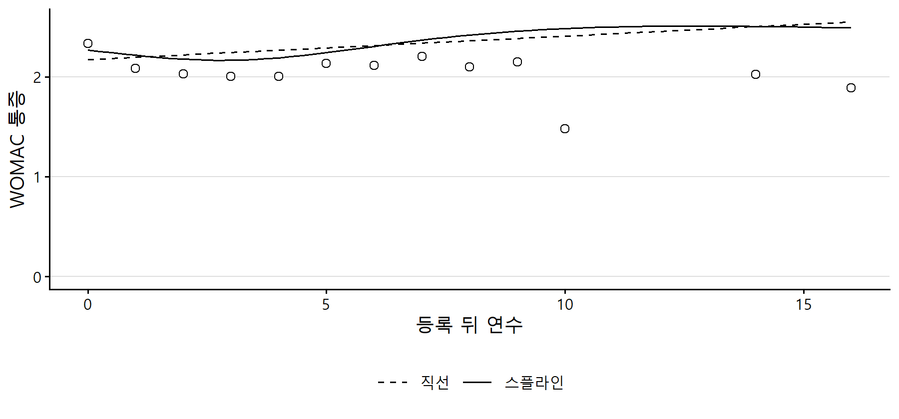
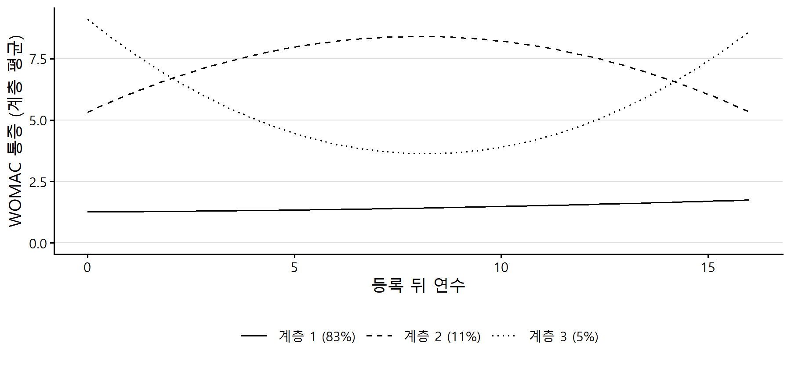

# 3장. 통증의 궤적 — 시간에 따라 어떻게 변하고 누가 나빠지는가

- [I. 방문별 평균의 문제](#i-방문별-평균의-문제)
- [II. 선형 혼합모형](#ii-선형-혼합모형)
- [III. 무릎마다의 궤적](#iii-무릎마다의-궤적)
- [IV. 탈락에 대한 점검](#iv-탈락에-대한-점검)
- [V. 잠재계층 궤적 모형](#v-잠재계층-궤적-모형)
- [VI. 정리와 한계](#vi-정리와-한계)
- [참고문헌](#참고문헌)

무릎 골관절염은 흔히 나빠지기만 하는 병으로 설명된다. 그러나 통증은 좋아졌다 나빠지기를 되풀이하고, 사람마다 경과가 크게 다르다. 재활에서 알고 싶은 것은 평균적인 경과와 함께 그 경과에서 벗어나는 사람, 특히 빠르게 나빠지는 사람이 누구인지다. 이 장은 OAI의 반복 측정으로 무릎 통증의 16년 궤적을 추정한다.

이 장이 소개하는 방법은 둘이다. 하나는 선형 혼합모형이다. 무릎마다 다른 출발점과 기울기를 무작위 효과로 두고, 평균 궤적과 무릎 사이의 흩어짐을 함께 추정한다(II\~IV장). 다른 하나는 잠재계층 궤적 모형이다. 궤적이 몇 개의 전형으로 나뉜다고 보고 그 전형을 데이터에서 찾는다(V장). 1장 IV장에서 본 결측과 생존자 선택이 이 장의 출발점이다. 방문마다 측정된 사람만 평균하면 궤적이 치우치는데, 혼합모형은 어떤 가정 아래에서 그 치우침을 피하는지 본다.

데이터는 기준 KL 판독, 기준 WOMAC, 나이, 성별, BMI가 있고 등록 전에 치환술을 받지 않은 무릎이다. 치환술을 받은 무릎은 수술 직전 방문까지의 측정만 쓴다. 무릎 8,909개(사람 4,490명)의 통증 관측 90,591개다. 통증은 그 무릎의 WOMAC 통증(0\~20)이고, 시간 $t$는 등록부터의 연수다.

## I. 방문별 평균의 문제

반복 측정 데이터의 궤적을 그리는 가장 쉬운 방법은 방문마다 측정된 값의 평균을 잇는 것이다. 표 1이 그 평균이다. 18개월과 30개월은 일부 대상자만 받은 방문이어서 뺐다.

**표 1. 방문별로 측정된 무릎의 평균 통증**

| 개월 |  무릎 | 평균 통증 | 통증 0(%) |
|-----:|------:|----------:|----------:|
|    0 | 8,908 |      2.33 |      44.4 |
|   12 | 8,630 |      2.08 |      48.9 |
|   24 | 8,246 |      2.03 |      49.2 |
|   36 | 8,093 |      2.00 |      49.8 |
|   48 | 7,998 |      2.00 |      50.3 |
|   60 | 7,410 |      2.13 |      48.7 |
|   72 | 7,121 |      2.11 |      49.8 |
|   84 | 6,975 |      2.20 |      47.6 |
|   96 | 6,702 |      2.10 |      49.3 |
|  108 | 6,176 |      2.15 |      48.3 |
|  120 | 4,232 |      1.48 |      59.4 |
|  168 | 4,669 |      2.02 |      51.0 |
|  192 | 3,934 |      1.89 |      53.1 |

표 1의 평균은 기준 방문의 2.33점에서 마지막 방문의 1.89점으로 낮아진다. 이것을 그대로 읽으면 무릎 통증은 16년 동안 조금 좋아진다. 그러나 1장 IV.4절에서 본 것처럼 뒤 방문의 무릎은 처음부터 덜 아팠던 무릎들이다. 통증이 심한 무릎은 치환술로 측정이 끝나고, 통증이 심하고 덜 활동적인 사람은 연구를 더 많이 떠난다. 방문별 평균의 하락이 무릎이 좋아져서인지 아픈 무릎이 빠져서인지를 이 표는 구분하지 못한다. 120개월 방문의 낮은 평균은 1장 I.3절에서 본 대로 그 방문의 표본 구성이 달랐기 때문이다.

구분하려면 같은 무릎이 시간에 따라 어떻게 변했는지를 모아야 한다. 무릎마다 궤적을 따로 그리면 각 궤적은 그 무릎이 측정된 기간만큼만 있고, 일찍 빠진 무릎의 궤적도 빠지기 전까지의 정보를 준다. 선형 혼합모형은 이 정보를 한 모형으로 모은다.

## II. 선형 혼합모형

### 1. 모형

무릎 $i$의 $j$번째 방문 시각을 $t_{ij}$, 그때의 통증을 $y_{ij}$라 하자. 가장 단순한 혼합모형은 무릎마다 직선의 궤적을 두되, 그 절편과 기울기가 무릎마다 다르다고 본다(Laird and Ware, 1982).

$$y_{ij} = (\beta_0 + b_{0i}) + (\beta_1 + b_{1i}) t_{ij} + \varepsilon_{ij}, \qquad b_i = (b_{0i}, b_{1i})^\top \sim N(0, D), \quad \varepsilon_{ij} \sim N(0, \sigma^2)$$

$\beta_0$과 $\beta_1$은 고정효과로, 모든 무릎의 평균 궤적의 절편과 기울기다. $b_{0i}$와 $b_{1i}$는 무작위 효과로, 무릎 $i$의 궤적이 평균 궤적에서 벗어난 정도다. 그 공분산행렬 $D$의 대각은 절편과 기울기의 분산 $d_{00}$, $d_{11}$이고 비대각은 둘의 공분산이다. $\varepsilon_{ij}$는 무릎의 궤적 주위에서 방문마다 흔들리는 몫이다. 무릎 $i$의 관측을 벡터 $y_i$로 모으면 그 주변분포는 다음과 같다.

$$y_i \sim N(X_i \beta, V_i), \qquad V_i = Z_i D Z_i^\top + \sigma^2 I$$

$X_i$와 $Z_i$는 고정효과와 무작위 효과의 설계행렬로, 여기서는 둘 다 1과 $t_{ij}$의 두 열이다. 같은 무릎의 관측은 무작위 효과를 공유하므로 서로 상관되고, 그 상관 구조가 $V_i$에 들어 있다. 이 모형은 두 가지를 동시에 준다. $\beta$는 평균 궤적이고, $D$는 무릎마다의 궤적이 얼마나 흩어지는지다.

### 2. 추정과 결측

$\beta$, $D$, $\sigma^2$은 위의 주변분포에서 나오는 우도를 최대화해 추정한다. 분산 성분을 비교할 때는 고정효과의 자유도를 보정하는 제한 최대우도(REML)를, 고정효과가 다른 모형을 우도비로 비교할 때는 최대우도(ML)를 쓴다(Verbeke and Molenberghs, 2000). 이 장은 모형 비교를 하므로 ML로 적합했다.

이 추정이 결측에 대해 갖는 성질이 이 장에서 가장 중요하다. 우도는 무릎마다 관측된 값만으로 계산되고, 관측되지 않은 방문은 그 무릎의 다른 관측과 $V_i$의 상관 구조를 통해 간접적으로 반영된다. 1장 IV.1절의 무작위 결측(MAR), 곧 측정 여부가 관측된 값에만 의존한다는 가정 아래에서는 결측의 기제를 모형화하지 않아도 이 우도에 기초한 추정이 치우치지 않는다(Little and Rubin, 2019). 지난 방문까지 통증이 심했던 무릎이 다음 방문에 빠지더라도, 그 높은 통증이 관측되어 있으면 모형은 그 무릎의 궤적을 그 값에 맞추어 추정한다. 방문별 평균은 이 성질이 없다. 다만 MAR은 데이터로 확인할 수 없는 가정이고, 치환술처럼 측정되지 않은 악화 때문에 측정이 끝나는 경우에는 성립하지 않는다. IV장과 5장에서 다시 본다.

### 3. 사람 수준을 더하기

무릎은 사람 안에 묶여 있다. 1장 II.2절에서 두 무릎의 통증의 급내상관이 0.5 가까이였다. 그래서 사람마다의 무작위 절편 $v_p$를 하나 더 둔다.

$$y_{ij} = (\beta_0 + v_{p(i)} + b_{0i}) + (\beta_1 + b_{1i}) t_{ij} + \varepsilon_{ij}, \qquad v_p \sim N(0, \tau^2)$$

$p(i)$는 무릎 $i$의 사람이다. 이제 무릎의 출발점은 사람 몫 $v_p$와 무릎 몫 $b_{0i}$로 나뉜다. 표 2는 두 모형의 분산 성분을 함께 제시한 것이다. 값은 표준편차이고, 마지막 행은 절편과 기울기의 상관이다.

**표 2. 혼합모형의 분산 성분 (표준편차)**

| 성분                      | 무릎만 | 사람과 무릎 |
|:--------------------------|-------:|------------:|
| 사람 절편                 |     NA |       2.174 |
| 무릎 절편                 |  2.629 |       1.560 |
| 무릎 기울기 (연)          |  0.158 |       0.159 |
| 잔차                      |  1.941 |       1.942 |
| 무릎 절편과 기울기의 상관 | -0.300 |      -0.621 |

표 2에서 사람 수준을 더하면 무릎 절편의 표준편차가 줄고(2.63에서 1.56), 그 몫이 사람 절편(표준편차 2.17)으로 옮겨 간다. 두 모형을 비교하는 우도비 통계량(자유도 1, 값 2,892.5)은 매우 크다. 분산 성분이 0인지를 검정하는 우도비는 귀무가설이 모수 공간의 경계에 있어 보통의 카이제곱 분포를 따르지 않지만, 그 경우 보통의 p값은 보수적이므로(Self and Liang, 1987) 이 크기의 통계량이면 결론은 같다. 기준 시점의 통증 변동 가운데 사람 몫은 43%다. 사람 몫이 무릎 몫보다 크다는 것은 통증의 수준이 무릎보다 사람에 더 많이 달려 있다는 뜻이다. 이후의 모형은 모두 사람 절편을 둔다.

### 4. 평균 궤적의 형태

직선이 평균 궤적의 형태로 충분한지는 시간을 더 유연한 함수로 넣어 비교한다. 여기서는 자연 3차 스플라인(자유도 3)을 쓴다. 스플라인은 시간 축을 매듭으로 나누고 구간마다 3차식을 잇되, 매듭에서 매끄럽게 이어지고 양 끝에서는 직선이 되도록 제약한 함수다. 다항식보다 양 끝에서 덜 휜다. 무작위 효과는 그대로 무릎마다의 직선으로 둔다.

스플라인 모형과 직선 모형을 비교하는 우도비 통계량(자유도 2, 값 80.3)은 크다. 통계적으로는 직선에서 벗어나지만, 그림 1에서 보듯 그 벗어남의 크기는 작다. 직선 모형의 평균 기울기는 연 0.023점(표준오차 0.002)이다. 16년 동안 0.38점이 늘어나는 셈이다.

그림 1은 방문별 평균(점, 표 1)과 두 모형이 추정한 평균 궤적(선)을 함께 그린 것이다. 모형의 평균 궤적은 무작위 효과가 0인 무릎, 곧 평균적인 무릎의 궤적이다.

그림 1에서 방문별 평균은 아래로 기울고, 모형의 평균 궤적은 평평하거나 조금 올라간다. 같은 데이터에서 방향이 다른 두 그림이 나온 것이다. 차이는 계산에 쓰인 무릎에서 온다. 방문별 평균은 그 방문에 남아 있는 무릎만 쓰고, 혼합모형은 모든 무릎의 관측을 무릎 안의 변화로 모은다. 혼합모형의 결론은 평균적인 무릎의 통증은 16년 동안 거의 변하지 않거나 아주 조금 나빠진다는 것이다. 방문별 평균의 하락은 대부분 아픈 무릎이 빠져나간 결과다.

### 5. 무엇이 변화 속도와 관련되는가

기준 특성이 궤적의 수준과 기울기에 어떻게 관련되는지는 특성과 시간의 상호작용을 넣어 본다. 기준 KL 등급, 나이, 성별, BMI를 절편 쪽과 기울기 쪽에 모두 넣는다.

$$y_{ij} = \beta_0 + w_i^\top \gamma_0 + (\beta_1 + w_i^\top \gamma_1) t_{ij} + v_{p(i)} + b_{0i} + b_{1i} t_{ij} + \varepsilon_{ij}$$

$\gamma_0$은 기준 시점의 통증 차이, $\gamma_1$은 연간 변화 속도의 차이다. 표 3은 KL 등급별로 기준 시점의 평균 통증과 연간 기울기를 다른 특성을 0(61세, BMI 28.5, 남성)에 놓고 계산한 것이다. 괄호 안은 표준오차다.

**표 3. 기준 KL 등급별 통증의 수준과 연간 기울기 (61세, BMI 28.5, 남성)**

| KL 등급 | 기준 통증   | 연간 기울기   | 16년 변화 |
|--------:|:------------|:--------------|----------:|
|       0 | 1.22 (0.06) | 0.024 (0.005) |      0.38 |
|       1 | 1.50 (0.07) | 0.037 (0.006) |      0.59 |
|       2 | 1.99 (0.07) | 0.028 (0.006) |      0.45 |
|       3 | 2.81 (0.08) | 0.090 (0.008) |      1.44 |
|       4 | 5.02 (0.13) | 0.049 (0.018) |      0.78 |

표 3에서 KL 등급에 따라 통증의 수준은 크게 달라지지만 기울기는 그보다 훨씬 작게 달라진다. 연간 기울기는 KL 0이 0.024점, KL 3이 0.090점으로, KL 3이 뚜렷하게 크다. 그래도 16년으로 늘린 차이는 1점 남짓이다. KL 4의 기울기가 KL 3보다 작은 것은 이 표만으로는 이상해 보이지만, IV장에서 보듯 빨리 나빠지는 무릎은 치환술로 먼저 빠지고, 그런 무릎이 KL 4에 많다. 남아서 측정된 KL 4 무릎의 기울기가 작게 추정되는 것이다. 나이, 성별, BMI와 시간의 상호작용은 모두 작다. III.2절에서 보듯 무릎 사이 기울기의 흩어짐은 등급 사이의 차이보다 훨씬 크므로, 빨리 나빠지는 무릎은 있되 그 무릎을 기준 시점의 X선이나 체격으로 미리 가려내기는 어렵다.

## III. 무릎마다의 궤적

### 1. 무작위 효과의 예측

혼합모형은 평균 궤적뿐 아니라 무릎마다의 궤적도 준다. 무릎 $i$의 무작위 효과를 관측값으로부터 예측한 값은 다음과 같다.

$$\hat b_i = \hat D Z_i^\top \hat V_i^{-1} (y_i - X_i \hat\beta)$$

이것을 최량 선형 불편 예측량(BLUP)이라 부른다(Robinson, 1991). 식의 뜻은 무릎 $i$의 관측이 평균 궤적에서 벗어난 정도 $y_i - X_i \hat\beta$를 그대로 그 무릎의 궤적으로 삼지 않고, 그 무릎의 정보량에 따라 0 쪽으로 줄인다는 것이다. 관측이 적거나 잡음 $\sigma^2$이 크면 $\hat V_i^{-1}$이 작아져 많이 줄이고, 관측이 많으면 적게 줄인다. 이것을 수축이라 한다. 무릎 하나의 몇 안 되는 관측만으로 직선을 그으면 우연한 흔들림이 기울기로 들어가는데, BLUP는 모든 무릎의 분포에서 얻은 정보로 그 흔들림을 줄인다.

표 4는 방문 수에 따라 무릎을 나누어, 무릎마다 최소제곱으로 그은 직선의 기울기와 BLUP 기울기($\hat\beta_1 + \hat b_{1i}$)의 표준편차를 비교한 것이다. 최소제곱 기울기는 측정이 3번 이상인 무릎만 구했다. 마지막 열은 두 기울기의 상관이다.

**표 4. 무릎마다의 연간 기울기: 최소제곱과 BLUP (방문 수별)**

| 방문 수 |  무릎 | 최소제곱 기울기 SD | BLUP 기울기 SD |  상관 |
|:--------|------:|-------------------:|---------------:|------:|
| 3-5     |   984 |              1.179 |          0.078 | 0.435 |
| 6-8     |   935 |              0.584 |          0.110 | 0.751 |
| 9-11    | 2,577 |              0.339 |          0.127 | 0.965 |
| 12 이상 | 4,160 |              0.162 |          0.102 | 0.996 |

표 4에서 최소제곱 기울기의 흩어짐은 방문이 적을수록 크다. 방문이 3\~5번인 무릎의 표준편차는 1.18점으로, 12번 이상인 무릎의 0.16점의 몇 배다. 방문이 적은 무릎일수록 실제로 기울기가 다양해서가 아니라, 점 몇 개로 그은 직선이 우연에 크게 흔들리기 때문이다. BLUP 기울기는 방문 수와 관계없이 흩어짐이 비슷하고, 방문이 적은 무릎에서 오히려 작다. 정보가 적은 무릎을 평균 쪽으로 강하게 수축한 결과다.

### 2. 기울기의 흩어짐

무릎 사이 기울기의 흩어짐은 BLUP가 아니라 분산 성분 $d_{11}$로 읽는다. BLUP는 수축되어 있어 그 표준편차가 실제 흩어짐보다 작기 때문이다. 표 2의 무릎 기울기 표준편차(0.159점)로 계산하면, 무릎의 95%는 연간 기울기가 -0.29\~0.33점 사이에 있다. 10년으로 늘리면 -2.9\~3.3점이다. 평균적인 무릎은 거의 변하지 않지만, 10년 동안 3점 가까이 나빠지는 무릎과 그만큼 좋아지는 무릎이 함께 있다. 평균의 평평함은 모든 무릎이 평평하다는 뜻이 아니다.

### 3. 출발점이 높은 무릎은 좋아진다

표 2에서 무릎 절편과 기울기의 상관은 음수다(-0.62). 기준 통증이 높은 무릎일수록 그 뒤에 통증이 줄어드는 경향이 있다는 뜻이다. 이것의 상당 부분은 평균으로의 회귀다(Barnett et al., 2005). 통증은 측정마다 흔들리므로, 어느 시점에 높게 측정된 무릎에는 그날 우연히 높게 나온 무릎이 섞여 있고, 그런 무릎은 다음 측정에서 원래 수준으로 돌아온다. 혼합모형은 방문마다의 흔들림 $\varepsilon_{ij}$를 따로 두어 이 효과를 일부 분리하지만, 통증의 실제 수준도 수개월 단위로 오르내리므로 완전히 분리하지는 못한다.

재활의 관점에서 이 점은 중요하다. 통증이 심할 때 치료를 시작하면 치료가 없었어도 통증은 어느 정도 줄어든다. 치료의 효과를 치료 전후의 차이로 판단하면 평균으로의 회귀를 효과로 잘못 읽게 된다. 대조군이 필요한 이유다.

## IV. 탈락에 대한 점검

II.2절의 추정은 MAR 가정에 기대고 있다. 이 가정을 데이터로 확인할 수는 없지만, 결과가 가정에 얼마나 민감한지는 볼 수 있다. 간단한 점검은 추적이 끝까지 된 무릎과 전체 무릎의 추정을 비교하는 것이다. 표 5는 II.3절의 모형을 세 표본에 적합한 결과다. 끝까지 추적된 무릎은 168개월 이후 방문에서 측정된 무릎이고, 치환술을 받은 무릎은 판정된 치환술로 측정이 끝난 무릎이다.

**표 5. 표본에 따른 평균 궤적의 추정**

| 표본               |  무릎 |  절편 | 연간 기울기 | 기울기 SE |
|:-------------------|------:|------:|------------:|----------:|
| 전체               | 8,909 | 2.172 |       0.023 |     0.002 |
| 끝까지 추적된 무릎 | 4,856 | 1.662 |       0.022 |     0.002 |
| 치환술을 받은 무릎 |   884 | 3.704 |       0.256 |     0.016 |

표 5에서 끝까지 추적된 무릎은 전체보다 절편이 낮다(1.66점과 2.17점). 처음부터 덜 아팠던 무릎이 끝까지 남는다는 1장의 결과와 같다. 그런데 연간 기울기는 두 표본에서 비슷하다(0.022점과 0.023점). 탈락의 선택은 주로 궤적의 수준에 걸려 있고 기울기에는 덜 걸려 있다는 뜻이다.

치환술을 받은 무릎은 사정이 다르다. 이 무릎들의 기울기는 연 0.256점으로, 전체의 몇 배다. 치환술은 통증이 나빠진 끝에 받는 것이므로, 이 무릎들의 측정이 끝나는 이유는 바로 그 악화다. 전체 무릎 가운데 이 무릎들의 비율은 10%로 작아서 평균 기울기를 크게 움직이지는 않지만, 이 무릎들에게 MAR은 성립하지 않는다. 마지막 측정 뒤 수술 직전까지 통증이 더 나빠졌을 가능성이 높기 때문이다. 측정을 끝내는 사건과 궤적을 함께 모형화하는 결합모형은 5장에서 다룬다.

## V. 잠재계층 궤적 모형

### 1. 모형

혼합모형은 무릎마다의 궤적이 하나의 정규분포 주위에 흩어져 있다고 본다. 잠재계층 궤적 모형은 무릎들이 몇 개의 보이지 않는 계층으로 나뉘고, 계층마다 평균 궤적이 다르다고 본다(Nagin, 2005; Proust-Lima et al., 2017). 계층이 $G$개이고 무릎 $i$가 계층 $g$에 속할 확률을 $\pi_g$라 하면, 계층 $g$ 안에서는 II장의 혼합모형이 성립한다.

$$y_{ij} \mid (c_i = g) = \beta_{0g} + \beta_{1g} t_{ij} + \beta_{2g} t_{ij}^2 + b_{0i} + b_{1i} t_{ij} + \varepsilon_{ij}, \qquad P(c_i = g) = \pi_g$$

$c_i$는 무릎 $i$의 계층으로, 관측되지 않는다. 계층마다 평균 궤적의 계수가 다르고(여기서는 연수의 2차식), 무작위 효과는 계층 안의 흩어짐을 받는다. 우도는 계층에 대한 혼합이다. 적합한 뒤에는 무릎마다 각 계층에 속할 사후확률을 계산하고, 가장 높은 계층에 그 무릎을 배정한다.

계층 수 $G$는 데이터가 정하지 않으므로 여러 값으로 적합해 비교한다. 이 장은 세 기준을 쓴다. 정보기준 BIC가 작을 것, 가장 작은 계층이 무릎의 5% 이상일 것, 상대 엔트로피가 높을 것이다. 상대 엔트로피는 사후확률이 0이나 1에 가까울수록 1에 가까워지는 값으로, 무릎이 한 계층에 분명하게 배정되는지를 잰다. 혼합모형의 우도는 국소 최댓값이 많으므로 무작위 초기값 여러 개에서 출발해 가장 나은 해를 고른다.

### 2. 적합

적합은 시간이 오래 걸려(계층 1\~5에 몇 시간) 이 문서 안에서 하지 않는다. `R/fit-lcmm.R`이 R 패키지 `lcmm`으로 적합하고 요약을 `outputs/lcmm-02.rds`에 저장하며, 이 절은 그 요약을 읽는다. 무작위 초기값은 10개를 썼다. 표본은 이 장의 다른 절과 같은 정의의 무릎이되 공변량이 없는 무릎도 포함한다.

적합: 2026-11-20 13:16 \| 무릎 8,917, 관측 90,667 \| 계층 1-5 \| 204분

**표 6. 계층 수별 잠재계층 궤적 모형의 적합**

| 계층 | 수렴 |   로그우도 | 모수 |       BIC | 엔트로피 | 가장 작은 계층(%) |
|-----:|-----:|-----------:|-----:|----------:|---------:|------------------:|
|    1 |    1 | -204,370.0 |    7 | 408,803.6 |       NA |             100.0 |
|    2 |    1 | -202,549.4 |   11 | 405,198.9 |    0.900 |              13.2 |
|    3 |    1 | -201,587.0 |   15 | 403,310.5 |    0.906 |               5.2 |
|    4 |    1 | -200,672.1 |   19 | 401,517.1 |    0.893 |               4.9 |
|    5 |    2 | -200,672.1 |   23 | 401,553.5 |    0.761 |               0.0 |

표 6에서 BIC는 계층이 늘수록 작아지다가 4계층에서 가장 작다. 그러나 그 모형은 가장 작은 계층이 무릎의 5%에 못 미친다. 두 조건을 함께 만족하는 모형 가운데 BIC가 가장 작은 것은 3계층 모형이다(상대 엔트로피 0.91). 계층이 5개인 모형은 수렴하지 않았거나 빈 계층이 생겨 비교에서 뺐다. 계층 수를 정하는 이런 절차에는 판단이 들어간다. 다른 기준을 쓰면 다른 수가 나올 수 있다.

그림 2는 3계층 모형의 계층별 평균 궤적이다. 괄호 안은 그 계층에 배정된 무릎의 비율이다.

**표 7. 계층별 기준 특성과 치환술 (배정된 계층 기준)**

| 계층 |  무릎 | 나이 | 여성(%) |  BMI | KL 3 이상(%) | 기준 통증 | 소속 확률 | 치환술(%) |
|-----:|------:|-----:|--------:|-----:|-------------:|----------:|----------:|----------:|
|    1 | 7,437 | 61.2 |    57.0 | 28.1 |         13.2 |      1.44 |      0.98 |       6.9 |
|    2 | 1,012 | 60.9 |    61.9 | 30.9 |         40.0 |      5.50 |      0.88 |      29.8 |
|    3 |   460 | 60.4 |    68.0 | 30.9 |         29.6 |      9.71 |      0.86 |      15.7 |

그림 2와 표 7을 함께 읽으면 계층은 다음과 같다. 가장 큰 계층(계층 1, 무릎의 83%)은 기준 통증이 1.44점으로 낮고 16년 내내 낮게 머문다. 나머지 계층은 통증이 있는 무릎을 궤적의 모양으로 나눈 것이다. 기준 통증이 가장 높은 계층(계층 3)은 처음에 높았다가 줄어드는 궤적이고, III.3절의 음의 절편-기울기 상관이 계층으로 나타난 것이다. 나머지 한 계층은 중간 수준에서 시작해 추적 전반부에 나빠졌다가 후반부에 줄어드는 궤적이다. 두 계층 모두 10년 뒤에 방향이 바뀌는데, V.3절에서 보듯 이 꺾임은 2차식의 형태에서 나왔을 수 있다. 치환술의 비율은 계층 2에서 29.8%로 가장 높다. 계층은 추적 전체의 통증으로 정해지므로 치환술 직전의 악화가 계층 배정에 이미 들어 있다. 그래서 이 치환술 비율은 계층이 치환술을 예측한다는 근거가 아니라 계층의 성격을 설명하는 기술 통계다.

### 3. 계층을 읽을 때의 주의

잠재계층 궤적의 계층을 실제로 존재하는 환자 유형으로 읽는 것은 조심해야 한다. 세 가지 이유가 있다. 첫째, 궤적의 분포가 정규분포가 아니기만 해도 혼합모형은 여러 계층을 찾는다. 하나의 치우친 분포를 정규분포 몇 개의 혼합으로 근사하는 것이므로, 계층이 나왔다는 사실이 유형이 있다는 증거가 되지 못한다(Bauer and Curran, 2003). 통증처럼 0에 몰리고 오른쪽으로 치우친 척도에서는 특히 그렇다. 둘째, 계층의 수와 모양은 평균 궤적의 함수 형태에 달려 있다. 2차식은 추적 끝에서 다시 휘는 경향이 있고, 168개월과 192개월 방문 두 번뿐인 10년 이후 구간의 휨은 데이터보다 함수 형태에서 나왔을 수 있다. 셋째, 같은 OAI 데이터로 한 선행 연구는 다른 표본 정의와 모형으로 다섯 계층을 보고했다(Collins et al., 2014). 계층의 수가 연구마다 다르다는 것 자체가 계층이 데이터의 고정된 성질이 아님을 보여 준다.

이런 한계에도 계층 모형은 쓸모가 있다. 혼합모형의 평균과 분산만으로는 보이지 않는 궤적의 모양, 곧 꾸준히 낮은 무릎이 대다수이고 통증이 있는 무릎 안에서 악화와 호전으로 나뉜다는 사실을 요약해 보여 준다. 계층은 이 요약의 도구로 쓰고, 계층 배정을 다른 분석의 변수로 쓸 때는 배정의 불확실성(표 7의 소속 확률)을 함께 고려한다.

## VI. 정리와 한계

이 장의 결과는 넷이다. 첫째, 방문별 평균은 통증이 줄어드는 것처럼 보이지만, 혼합모형으로 무릎 안의 변화를 모으면 평균적인 무릎의 통증은 16년 동안 거의 변하지 않는다. 방문별 평균의 하락은 생존자 선택이다. 둘째, 평균은 평평하지만 무릎마다의 기울기는 흩어져 있어, 10년 동안 몇 점씩 나빠지는 무릎과 좋아지는 무릎이 함께 있다. 셋째, 기준 시점의 KL 등급, 나이, 성별, BMI는 통증의 수준과는 크게 관련되지만 변화 속도와는 무릎 사이의 흩어짐에 비해 작게 관련된다. 넷째, 기준 통증이 높은 무릎은 그 뒤에 좋아지는 경향이 있고, 그 일부는 평균으로의 회귀다.

한계는 넷이다. 첫째, 통증의 바닥 효과다. 선형 혼합모형은 0에 몰린 통증을 정규 오차로 다룬다. 바닥에 있는 무릎은 좋아질 여지가 없으므로 기울기의 분포가 왜곡될 수 있다. `lcmm` 패키지는 척도를 비선형으로 변환하는 연결 함수를 지원하므로(Proust-Lima et al., 2017), 그 모형으로 다시 적합해 결론이 바뀌는지 보는 것이 다음 단계다. 둘째, 치환술로 끝난 측정에는 MAR이 성립하지 않는다. 5장에서 다룬다. 셋째, 무작위 기울기는 무릎마다 직선이다. 통증이 몇 년 단위로 오르내리는 궤적은 직선 하나로 요약되지 않는다. 넷째, 통증만 보았다. 기능의 궤적은 1장에서 본 것처럼 무릎보다 사람의 상태를 더 많이 반영하고, 5장에서 치환술의 예측에 쓴다.

## 참고문헌

Barnett, A. G., van der Pols, J. C., and Dobson, A. J. (2005). “Regression to the mean: What it is and how to deal with it.” *International Journal of Epidemiology* 34(1), 215–220.

Bauer, D. J., and Curran, P. J. (2003). “Distributional assumptions of growth mixture models: Implications for overextraction of latent trajectory classes.” *Psychological Methods* 8(3), 338–363.

Collins, J. E., Katz, J. N., Dervan, E. E., and Losina, E. (2014). “Trajectories and risk profiles of pain in persons with radiographic, symptomatic knee osteoarthritis: Data from the Osteoarthritis Initiative.” *Osteoarthritis and Cartilage* 22(5), 622–630.

Laird, N. M., and Ware, J. H. (1982). “Random-effects models for longitudinal data.” *Biometrics* 38(4), 963–974.

Little, R. J. A., and Rubin, D. B. (2019). 『Statistical Analysis with Missing Data』 (3rd ed.). Wiley.

Nagin, D. S. (2005). 『Group-Based Modeling of Development』. Harvard University Press.

Proust-Lima, C., Philipps, V., and Liquet, B. (2017). “Estimation of extended mixed models using latent classes and latent processes: The R package lcmm.” *Journal of Statistical Software* 78(2), 1–56.

Robinson, G. K. (1991). “That BLUP is a good thing: The estimation of random effects.” *Statistical Science* 6(1), 15–32.

Self, S. G., and Liang, K.-Y. (1987). “Asymptotic properties of maximum likelihood estimators and likelihood ratio tests under nonstandard conditions.” *Journal of the American Statistical Association* 82(398), 605–610.

Verbeke, G., and Molenberghs, G. (2000). 『Linear Mixed Models for Longitudinal Data』. Springer.
