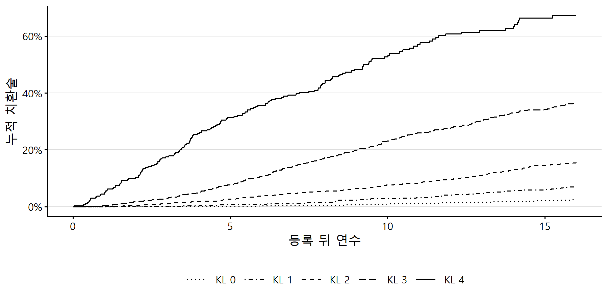

# 5장. 인공관절 치환술까지의 시간 — 누가 언제 수술에 이르고, 예측할 수 있는가

- [I. 사건 시간 자료](#i-사건-시간-자료)
- [II. Kaplan-Meier 추정](#ii-kaplan-meier-추정)
- [III. Cox 비례위험모형](#iii-cox-비례위험모형)
- [IV. 시간에 따라 바뀌는 공변량](#iv-시간에-따라-바뀌는-공변량)
- [V. 경쟁 위험](#v-경쟁-위험)
- [VI. 결합모형](#vi-결합모형)
- [VII. 동적 예측](#vii-동적-예측)
- [VIII. 정리와 한계](#viii-정리와-한계)
- [참고문헌](#참고문헌)

인공관절 치환술은 무릎 골관절염의 마지막 치료다. 재활의 관점에서 치환술은 두 가지 뜻을 갖는다. 하나는 보존적 치료가 더 이상 증상을 관리하지 못했다는 결과이고, 다른 하나는 수술 전후 재활이라는 새로운 시작이다. 누가 언제 수술에 이르는지를 알면 보존적 치료의 강도와 의뢰의 시점을 정하는 데 쓸 수 있다. 이 장은 OAI의 16년 추적에서 무릎마다 치환술까지의 시간을 분석한다.

이 장이 소개하는 방법은 생존분석의 기본에서 결합모형까지 이어진다. 사건 시간 자료와 중도절단(I장), Kaplan-Meier 추정(II장), Cox 비례위험모형(III장), 시간에 따라 바뀌는 공변량(IV장), 경쟁 위험(V장), 종단 측정과 사건 시간을 함께 다루는 결합모형(VI장), 그리고 방문마다 갱신되는 동적 예측(VII장)이다. 3장에서 치환술을 받은 무릎의 통증이 빠르게 나빠졌고, 그 무릎들에게는 무작위 결측이 성립하지 않는다는 것을 보았다. VI장의 결합모형이 그 문제에 대한 답이다.

## I. 사건 시간 자료

### 1. 시간, 사건, 중도절단

사건 시간 자료는 세 가지로 정의된다. 시간의 원점, 사건, 그리고 사건을 관측하지 못하게 되는 중도절단이다. 이 장의 원점은 등록 방문이고, 사건은 판정으로 확인된 그 무릎의 치환술이다. 무릎 $i$의 참 사건 시간을 $T_i^{\ast}$, 중도절단 시간을 $C_i$라 하면 관측되는 것은 둘 가운데 이른 시간 $T_i = \min(T_i^{\ast}, C_i)$와 사건 지시자 $\delta_i = I(T_i^{\ast} \le C_i)$다. 중도절단된 무릎은 사건이 없었던 것이 아니라 $C_i$ 이후를 모르는 무릎이다. 중도절단을 사건이 없는 것으로 세거나 분석에서 빼면 사건의 위험을 잘못 추정한다. 생존분석의 방법들은 모두 중도절단된 관측이 $C_i$까지 사건 없이 지냈다는 정보만 쓰도록 만들어져 있다.

이 장의 정의는 다음과 같다. 기준 KL 판독, 기준 WOMAC 기능, 나이, 성별, BMI가 있고 등록 전에 치환술을 받지 않은 무릎을 쓴다. 중도절단 시간은 그 사람의 마지막 접촉 방문과 그 무릎의 마지막 WOMAC 방문 가운데 늦은 쪽이다. 추적은 192개월(16년)에서 끝낸다. 사망은 V장에서 경쟁 사건으로 다루는데, 마지막 접촉 뒤 다음 예정 방문 전에 사망했을 때만 사건으로 센다. 그보다 늦은 사망은 그 사이의 치환술을 확인할 길이 없으므로 마지막 접촉에서 중도절단한다. 표 1은 이 정의에 따른 무릎의 결과다.

**표 1. 무릎의 추적 결과**

| 결과     |  무릎 | 추적 중앙값(년) | 비율(%) |
|:---------|------:|----------------:|--------:|
| 중도절단 | 7,480 |            16.0 |    83.9 |
| 치환술   |   875 |             7.7 |     9.8 |
| 사망     |   557 |             9.5 |     6.2 |

무릎 8,912개(사람 4,490명) 가운데 875개가 추적 중에 치환술을 받았고, 557개는 치환술 없이 그 사람이 사망했다.

## II. Kaplan-Meier 추정

### 1. 추정량

치환술 없이 지낸 비율 $S(t) = P(T^{\ast} > t)$는 Kaplan-Meier 추정량으로 추정한다(Kaplan and Meier, 1958). 서로 다른 사건 시각을 $\tau_1 < \tau_2 < \cdots$라 하고, 각 시각 직전에 아직 사건도 중도절단도 없이 남아 있는 무릎(위험집합)의 수를 $r_m$, 그 시각의 사건 수를 $d_m$이라 하면 다음과 같다.

$$\hat S(t) = \prod_{m:\ \tau_m \le t} \left(1 - \frac{d_m}{r_m}\right)$$

각 사건 시각에서 그때까지 남은 무릎 가운데 사건을 겪지 않은 비율을 곱해 나간다. 중도절단된 무릎은 중도절단 시각까지 위험집합에 들어 있다가 그 뒤로 빠진다. 분산은 Greenwood (1926)의 식으로 구한다. 이 추정량이 치우치지 않으려면 중도절단이 사건과 독립이어야 한다. 중도절단된 무릎이 같은 시점에 남은 무릎과 같은 위험을 가졌다는 가정이다. 1장 IV장에서 본 것처럼 통증이 심한 사람이 더 많이 떠나므로 이 가정은 근사일 뿐이다.

### 2. KL 등급별 추정

표 2는 기준 KL 등급별로 5년, 10년, 15년에 치환술을 받은 누적 비율 $1 - \hat S(t)$와 그 95% 신뢰구간이다. 그림 1은 같은 값을 시간에 따라 그린 것이다.

**표 2. 기준 KL 등급별 누적 치환술 비율 (Kaplan-Meier, %)**

| KL 등급 |  5년 | 10년 | 15년 |  무릎 | 치환술 |
|:--------|-----:|-----:|-----:|------:|-------:|
| 0       |  0.2 |  1.0 |  2.1 | 3,436 |     62 |
| 1       |  0.7 |  2.9 |  6.0 | 1,593 |     80 |
| 2       |  2.7 |  7.6 | 14.6 | 2,362 |    260 |
| 3       |  7.8 | 23.1 | 34.2 | 1,230 |    315 |
| 4       | 31.3 | 52.7 | 66.4 |   291 |    158 |

표 2와 그림 1에서 기준 KL 등급은 치환술을 강하게 가른다. 15년 동안 KL 0인 무릎의 2.1%가 치환술을 받은 반면, KL 3은 34.2%, KL 4는 66.4%가 받았다. KL 4 무릎의 치환술은 추적 초반에 몰려 있어 5년 안에 이미 31.3%다. 기준 시점에 이미 말기에 가까웠던 무릎이다.

## III. Cox 비례위험모형

### 1. 모형과 부분우도

여러 공변량을 함께 다루려면 회귀가 필요하다. Cox (1972)의 비례위험모형은 무릎 $i$의 위험함수를 다음과 같이 둔다.

$$h_i(t) = h_0(t) \exp(x_i^\top \beta)$$

위험함수 $h_i(t)$는 시각 $t$까지 사건이 없었던 무릎이 바로 다음 순간에 사건을 겪을 순간 확률이다. $h_0(t)$는 모양을 정하지 않은 기준 위험이고, 공변량은 그것을 일정한 비율로 키우거나 줄인다. $\exp(\beta_k)$는 다른 공변량이 같을 때 $x_k$가 한 단위 클 때의 위험비이며, 이 비가 시간에 따라 변하지 않는다는 것이 비례위험 가정이다. $\beta$는 부분우도를 최대화해 추정한다. 사건 시각 $\tau_m$의 위험집합을 $R(\tau_m)$이라 하면 다음과 같다.

$$L(\beta) = \prod_{i:\ \delta_i = 1} \frac{\exp(x_i^\top \beta)}{\sum_{l \in R(T_i)} \exp(x_l^\top \beta)}$$

각 사건 시각에 그 무릎이 위험집합의 다른 무릎을 제치고 사건을 겪을 조건부 확률의 곱이다. $h_0(t)$가 분자와 분모에서 약분되므로 기준 위험의 모양을 정하지 않고도 $\beta$를 추정할 수 있다. 같은 날의 사건은 Efron (1977)의 근사로 처리한다. 한 사람의 두 무릎은 2장 III장에서처럼 표준오차를 사람 단위로 군집 강건하게 구한다(Lin and Wei, 1989).

### 2. 기준 공변량 모형

모형 A는 기준 시점의 값만 쓴다. KL 등급(KL 0 기준), WOMAC 기능(10점 단위), 나이(10세), 성별, BMI(5 단위)다. 표 3이 그 위험비다.

**표 3. 모형 A: 기준 공변량의 위험비 (사람 단위 군집 강건 신뢰구간)**

| 항               | 위험비 |  하한 |  상한 | p       |
|:-----------------|-------:|------:|------:|:--------|
| KL 1             |   2.79 |  1.98 |  3.93 | \<0.001 |
| KL 2             |   6.23 |  4.58 |  8.48 | \<0.001 |
| KL 3             |  17.50 | 12.84 | 23.84 | \<0.001 |
| KL 4             |  49.15 | 35.11 | 68.79 | \<0.001 |
| 기준 기능 (10점) |   1.24 |  1.17 |  1.32 | \<0.001 |
| 나이 (10세)      |   0.97 |  0.88 |  1.05 | 0.430   |
| 여성             |   1.11 |  0.94 |  1.32 | 0.213   |
| BMI (5)          |   1.00 |  0.91 |  1.09 | 0.993   |

표 3에서 KL 등급의 위험비는 등급마다 크게 오른다. 다른 공변량이 같을 때 KL 4인 무릎의 치환술 위험은 KL 0의 49배이고 KL 3은 17배다. 같은 등급 안에서도 기준 기능 점수가 10점 나쁘면 위험이 1.24배다. 나이, 성별, BMI는 KL 등급과 기능을 통제하면 위험비가 1 가까이에 있다. BMI는 골관절염의 위험 요인이지만, 이미 그 결과인 구조 손상과 기능을 통제하면 치환술에 따로 더하는 것이 작다는 뜻이다.

### 3. 비례위험 가정의 점검

비례위험 가정은 Schoenfeld 잔차로 점검한다(Grambsch and Therneau, 1994). 각 사건 시각에서 사건이 난 무릎의 공변량과 위험집합의 가중 평균의 차이를 잔차로 두고, 그 잔차가 시간에 따라 추세를 보이는지 검정한다. 추세가 있으면 그 공변량의 위험비가 시간에 따라 변한다는 뜻이다. 모형 A의 전체 검정과 KL 등급의 검정은 모두 p값이 작다(각각 \<0.001, \<0.001).

KL 등급의 위험비가 시간에 따라 변한다는 증거가 있다. 그림 1에서 보듯 KL 4의 치환술은 초반에 몰려 있고 낮은 등급의 치환술은 뒤로 갈수록 늘어나므로, 등급 사이의 위험비는 추적 초반에 크고 뒤로 갈수록 작아졌을 것이다. 표 3의 위험비는 추적 기간 전체에 걸친 평균적인 비로 읽어야 한다. 위험비가 시간에 따라 변하는 것을 직접 모형화하려면 공변량과 시간의 상호작용을 넣거나 추적 기간을 나누어 따로 추정한다.

## IV. 시간에 따라 바뀌는 공변량

### 1. 계수 과정 표현

모형 A는 등록 시점의 기능 점수만 쓴다. 그러나 수술의 결정에 영향을 주는 것은 수술 직전의 상태다. 공변량이 시간에 따라 바뀌면 위험함수를 $h_i(t) = h_0(t)\exp(x_i(t)^\top \beta)$로 쓰고, 각 사건 시각에서 그때의 공변량 값을 부분우도에 넣는다. 실제 추정은 무릎마다 방문 사이의 구간 $(t_{ij}, t_{i,j+1}]$을 한 줄로 만드는 계수 과정 표현으로 한다(Andersen and Gill, 1982). 각 구간에서 공변량은 구간 시작 방문의 값으로 두고, 사건은 마지막 구간의 끝에만 표시한다. 모형 B는 이렇게 직전 방문의 WOMAC 기능을 다음 방문까지 유지해 넣는다.

### 2. 내부 공변량과 측정오차

모형 B에는 문제가 셋 있다. 첫째, 관측된 기능 점수에는 측정오차가 있고, 오차가 섞인 공변량의 계수는 0 쪽으로 줄어든다(Prentice, 1982). 4장 V장의 감쇠와 같은 현상이다. 둘째, 방문 사이의 변화를 무시한다. 방문 간격이 1\~4년이므로 직전 방문의 값은 수술 시점의 상태와 꽤 다를 수 있다. 셋째, 기능 점수는 무릎이 아직 치환술을 받지 않았어야 측정되는 내부 공변량이다(Kalbfleisch and Prentice, 2002). 내부 공변량에서는 위험함수에서 생존함수를 계산하는 관계가 성립하지 않으므로, 모형 B로는 개인별 치환술 확률을 예측할 수 없다.

모형 C는 다른 근사다. 먼저 3장의 선형 혼합모형으로 무릎마다의 기능 기울기(BLUP)를 구하고, 그것을 모형 A에 더한다. 측정오차는 줄지만 다른 문제가 생긴다. 기울기를 추적 전체의 관측으로 구하므로 시각 $t$의 위험을 설명하는 데 $t$ 뒤의 정보가 섞이고, 첫 단계의 불확실성이 둘째 단계에 전달되지 않는다(Ye et al., 2008).

**표 4. 기능 점수의 위험비: 기준 값, 시간가변 값, 2단계 기울기**

| 모형                  | 항                | 위험비 | 하한 | 상한 | p       |
|:----------------------|:------------------|-------:|-----:|-----:|:--------|
| A. 기준 기능          | 기능 (10점)       |   1.24 | 1.17 | 1.32 | \<0.001 |
| B. 직전 방문의 기능   | 기능 (10점)       |   1.76 | 1.66 | 1.86 | \<0.001 |
| C. 기준 기능 + 기울기 | 기능 (10점)       |   1.37 | 1.28 | 1.46 | \<0.001 |
| C. 기준 기능 + 기울기 | 연간 기울기 (1점) |   2.13 | 1.85 | 2.45 | \<0.001 |

표 4에서 직전 방문의 기능 점수(모형 B)는 기준 기능 점수(모형 A)보다 위험비가 크다. 직전 방문의 기능이 10점 나쁘면 위험이 1.76배다. 수술의 결정이 오래전의 상태보다 최근의 상태에 달려 있다는 당연한 결과다. 모형 C에서 연간 기울기가 1점 클 때의 위험비는 2.13배로, 기능이 나빠지는 속도가 그 수준과 별개로 치환술과 관련된다. 그러나 이 기울기는 수술 직전의 악화까지 포함해 계산된 것이므로 미래의 정보가 섞인 값이고, 이 위험비를 예측에 쓸 수는 없다.

## V. 경쟁 위험

### 1. 사망은 중도절단이 아니다

II장의 Kaplan-Meier는 사망을 중도절단으로 다루었다. 그러나 사망한 사람은 그 뒤에 치환술을 받을 수 없다. 사망을 중도절단으로 두면, 사망한 사람이 계속 살았다면 같은 위험으로 치환술을 받았을 것처럼 계산한다. 이렇게 하면 $1 - \hat S(t)$는 실제로 관측될 치환술의 누적 비율보다 크게 나온다(Putter et al., 2007; Austin et al., 2016). 사망처럼 관심 사건의 발생을 막는 사건을 경쟁 사건이라 한다.

경쟁 위험에서는 원인별 위험을 따로 둔다. 치환술의 원인별 위험 $h_1(t)$와 사망의 원인별 위험 $h_2(t)$가 있을 때, 치환술의 누적 발생률은 다음과 같다.

$$F_1(t) = \int_0^t S(s^-) h_1(s) ds, \qquad S(t) = \exp\left( -\int_0^t \left(h_1(s) + h_2(s)\right) ds \right)$$

$S(s^-)$는 시각 $s$ 직전까지 치환술도 사망도 없었을 확률이다. 사망이 많아질수록 $S$가 작아지고, 치환술의 누적 발생률은 $1 - \hat S(t)$보다 작아진다. 표본에서의 추정은 Aalen-Johansen 추정량으로 한다(Aalen and Johansen, 1978).

### 2. 누적 발생률

표 5는 KL 등급을 셋으로 묶어, 15년 시점의 누적 치환술 비율을 사망을 중도절단으로 둔 Kaplan-Meier($1 - \hat S$)와 사망을 경쟁 사건으로 둔 누적 발생률로 함께 제시한 것이다. 마지막 열은 같은 시점의 사망 누적 발생률이다.

**표 5. 15년 누적 치환술 비율: 사망을 중도절단으로 둘 때와 경쟁 사건으로 둘 때 (%)**

| 집단   |  무릎 | 1 - KM(%) | 누적 발생률(%) | 사망 누적 발생률(%) |
|:-------|------:|----------:|---------------:|--------------------:|
| 전체   | 8,912 |      12.0 |           11.7 |                 7.2 |
| KL 0-1 | 5,029 |       3.3 |            3.2 |                 7.4 |
| KL 2   | 2,362 |      14.6 |           14.1 |                 6.6 |
| KL 3-4 | 1,521 |      40.5 |           38.8 |                 7.9 |

표 5에서 사망을 중도절단으로 두면 치환술 비율이 모든 집단에서 더 크게 나온다. 차이는 전체에서 0.4%포인트, KL 3\~4에서 1.6%포인트다. 차이가 작은 것은 이 코호트가 등록 당시 비교적 젊어(평균 61세) 15년 동안의 사망 누적 발생률이 7% 안팎이기 때문이다. 차이는 치환술의 위험이 큰 집단에서 더 크다. 사망 위험이 큰 고령 환자 집단이라면 같은 계산의 차이가 훨씬 커진다. 이 코호트에서는 사망을 중도절단으로 둔 Kaplan-Meier도 실용적으로 큰 문제가 없지만, 그 이유가 자료의 성질에 있다는 것을 확인한 뒤에 쓰는 것이다.

### 3. 원인별 위험비와 부분분포 위험비

공변량의 효과에도 두 가지가 있다. 원인별 위험모형은 치환술의 원인별 위험 $h_1(t)$에 Cox 모형을 둔다. 사망한 무릎을 사망 시각에 중도절단하는 보통의 Cox 모형과 같고, 위험비는 아직 살아 있고 수술받지 않은 무릎 사이의 치환술 속도의 비다. Fine and Gray (1999)의 부분분포 위험모형은 누적 발생률 $F_1(t)$에 직접 연결되는 위험을 모형화한다. 사망한 무릎을 위험집합에 남겨 두고(가중치를 주어), 위험비가 누적 발생률의 차이로 바로 읽힌다. 원인을 묻는 질문에는 원인별 위험비가, 예측과 자원 계획에는 부분분포 위험비가 맞다(Austin et al., 2016).

**표 6. 원인별 위험비와 부분분포 위험비**

| 항 | 원인별 위험비 | 원인별 하한 | 원인별 상한 | 부분분포 위험비 | 부분분포 하한 | 부분분포 상한 |
|:---|---:|---:|---:|---:|---:|---:|
| KL 1 | 2.79 | 1.98 | 3.93 | 2.80 | 1.99 | 3.95 |
| KL 2 | 6.23 | 4.58 | 8.48 | 6.25 | 4.59 | 8.50 |
| KL 3 | 17.50 | 12.84 | 23.84 | 17.40 | 12.77 | 23.71 |
| KL 4 | 49.15 | 35.11 | 68.79 | 48.04 | 34.36 | 67.18 |
| 기준 기능 (10점) | 1.24 | 1.17 | 1.32 | 1.24 | 1.16 | 1.31 |
| 나이 (10세) | 0.97 | 0.88 | 1.05 | 0.93 | 0.85 | 1.01 |

표 6에서 두 위험비는 KL 등급과 기능에서 거의 같다. 표 5에서 보듯 사망의 누적 발생률이 KL 등급에 따라 크게 다르지 않기 때문이다. 나이에서만 작은 차이가 보인다(원인별 0.97, 부분분포 0.93). 방향은 예상과 같다. 나이가 많은 사람은 살아 있는 동안의 수술 속도가 크게 다르지 않더라도 사망이 먼저 오기 쉬워, 실제로 수술에 이르는 비율은 더 낮다. 다만 이 자료에서 그 차이는 신뢰구간에 견주어 작다. 사망 위험이 나이에 따라 크게 다른 고령 집단에서는 두 위험비가 더 벌어진다.

## VI. 결합모형

### 1. 구조

IV장의 두 근사는 각각 문제를 남겼다. 모형 B는 측정오차와 방문 사이의 변화를 무시했고, 모형 C는 미래의 정보를 썼다. 결합모형은 기능 점수의 궤적과 치환술의 위험을 공통의 무작위 효과로 묶어 한꺼번에 추정한다(Wulfsohn and Tsiatis, 1997; Rizopoulos, 2012). 종단 하위모형은 3장의 혼합모형이다. 관측된 기능 점수를 참 궤적 $m_i(t)$와 측정오차로 나누고, 참 궤적은 KL 등급마다 수준과 기울기가 다르며 무릎마다 무작위 절편과 기울기를 갖는다.

$$y_i(t) = m_i(t) + \varepsilon_i(t), \qquad m_i(t) = \beta_0 + \beta_{0k} + (\beta_1 + \beta_{1k}) t + b_{0i} + b_{1i} t$$

생존 하위모형은 시각 $t$의 위험을 그 시각의 참 기능 수준과 변화율에 연결한다.

$$h_i(t) = h_0(t) \exp\left( w_i^\top \gamma + \alpha_1 m_i(t) + \alpha_2 m_i'(t) \right)$$

$\exp(\alpha_1)$은 같은 시각에 참 기능 점수가 1점 나쁠 때의 위험비이고, $\exp(\alpha_2)$는 연간 악화 속도가 1점 빠를 때의 위험비다. 모형 B와 다른 점은 공변량 자리에 관측값 대신 참 값 $m_i(t)$가 들어간다는 것이다. $m_i(t)$에는 측정오차가 없고 방문 사이에서도 연속적으로 정의되며, 시각 $t$의 값은 $t$까지의 관측으로만 추정된다. 무릎 $i$의 우도 기여는 무작위 효과에 대한 적분이다.

$$p(y_i, T_i, \delta_i) = \int p(y_i \mid b_i) h_i(T_i \mid b_i)^{\delta_i} \exp\left( -\int_0^{T_i} h_i(s \mid b_i) ds \right) p(b_i) db_i$$

치환술로 인한 추적의 끝이 공유된 $b_i$를 통해 종단 하위모형과 연결되므로, 측정되지 않은 악화 때문에 측정이 끝나는 경우도 이 우도 안에서 다루어진다. 3장 IV장에서 남겨 둔 문제가 이것이다.

### 2. 추정

추정은 R 패키지 JMbayes2로 한다(Rizopoulos et al., 2026). 마르코프 연쇄 몬테카를로로 사후분포를 추출하며, 기준 위험은 B-스플라인으로 유연하게 둔다. 수렴은 연쇄 3개의 잠재 척도 축소 인자 $\hat R$로 진단하고 1.05를 기준으로 삼는다. 이 모형은 적합에 몇 시간이 걸려 이 문서 안에서 하지 않는다. `R/fit-jm.R`이 적합하고 요약을 `outputs/jm-01.rds`에 저장하며, 이 절은 그 요약을 읽는다. 결합모형의 표본과 중도절단은 3장과 같은 정의(마지막 WOMAC 방문에서 중도절단, 사망은 중도절단)이고 시간 단위는 연이다.

> 저장된 결합모형 적합과 이 문서가 읽은 데이터가 다르다. `Rscript R/fit-jm.R`로 다시 적합한다.

결합모형의 참 기능 수준 계수를 모형 B와 비교하면 측정오차의 영향을 볼 수 있다. 측정오차는 모형 B의 계수를 0 쪽으로 줄이므로, 결합모형이 측정오차를 제대로 분리했다면 참 수준의 위험비가 더 크게 나온다. 변화율의 계수는 해석에 주의가 필요하다. 수준과 변화율은 같은 무작위 효과에서 나오므로 사후 상관이 높고, 한쪽의 효과가 다른 쪽으로 옮겨 가기 쉽다.

## VII. 동적 예측

### 1. 방문마다 갱신되는 예측

결합모형의 쓸모가 가장 크게 드러나는 것은 예측이다. 시각 $t$까지 치환술 없이 지냈고 그때까지의 기능 점수 $\mathcal Y_i(t)$가 관측된 무릎에 대해, $u > t$까지 치환술 없이 지낼 확률은 다음과 같다(Rizopoulos, 2011).

$$\pi_i(u \mid t) = P\left(T_i^{\ast} > u \mid T_i^{\ast} > t, \mathcal Y_i(t)\right) = \int \frac{S_i(u \mid b_i)}{S_i(t \mid b_i)} p\left(b_i \mid T_i^{\ast} > t, \mathcal Y_i(t)\right) db_i$$

새 방문에서 점수가 하나 더 관측되면 $b_i$의 사후분포가 갱신되고 예측도 갱신된다. 같은 일을 더 단순하게 하는 방법이 랜드마크 분석이다(van Houwelingen, 2007). 예측 시점 $t$(랜드마크)에 사건 없이 남아 있는 무릎만 골라, 그때까지의 마지막 관측값을 공변량으로 하는 Cox 모형을 $t$부터 다시 적합한다. 측정오차와 궤적의 모양은 무시하지만 적합이 빠르고 가정이 적다.

### 2. 판별력의 비교

예측의 판별력은 시간의존 AUC로 잰다(Heagerty et al., 2000). 랜드마크 $t$에서 $t + \Delta$ 사이에 사건을 겪은 무릎(사례)과 $t + \Delta$까지 사건이 없었던 무릎(대조)을 무작위로 하나씩 뽑았을 때, 사례의 예측 위험이 더 높을 확률이다. 0.5는 동전 던지기와 같고 1은 완전한 판별이다. 그 사이에 중도절단된 무릎은 빼는 단순한 정의를 쓴다.

여기서는 랜드마크를 4년, 예측 기간을 2년으로 두고 세 가지 예측을 같은 무릎에서 비교한다. 첫째는 모형 A, 곧 등록 시점의 값만 쓴 예측이다. 둘째는 4년 시점의 랜드마크 Cox 모형으로, 4년까지의 마지막 WOMAC 기능을 기준 공변량과 함께 넣는다. 셋째는 결합모형의 동적 예측이다. 결합모형의 예측은 계산이 무거워 `R/fit-jm.R`이 4년 시점에 남은 무릎 가운데 무작위로 고른 2,500개에 대해서만 했고, 비교는 그 무릎들에서 한다.

**표 8. 4년 시점에서 2년 안의 치환술 예측의 판별력 (AUC)**

| 표본                 |  무릎 | 사례 | 모형 A | 랜드마크 Cox | 결합모형 |
|:---------------------|------:|-----:|-------:|-------------:|---------:|
| 4년에 남은 무릎 전체 | 7,625 |  139 |  0.838 |        0.885 |       NA |

4년 시점에 남아 있던 무릎 전체에서, 4년까지의 마지막 기능 점수를 쓴 랜드마크 Cox(AUC 0.885)는 등록 시점의 값만 쓴 예측(AUC 0.838)보다 판별력이 높다.

판별력의 차이를 읽을 때는 기준선이 이미 높다는 점을 함께 본다. KL 등급과 기능 점수만으로도 앞으로 2년 안에 수술받을 무릎과 그렇지 않은 무릎은 상당히 잘 구분된다. 최근의 기능 점수를 넣으면 그 위에 판별력이 더해진다. 결합모형은 측정오차를 분리하고 궤적 전체를 쓰지만, 그것이 판별력의 큰 향상으로 이어지는지는 이 비교로 판단한다. 결합모형의 강점은 판별력만이 아니라, 방문마다 일관된 확률 모형 안에서 예측을 갱신하고 그 불확실성을 함께 준다는 데 있다. 예측의 보정, 곧 예측 확률이 관측된 발생률과 맞는지는 이 장에서 다루지 않았다.

## VIII. 정리와 한계

이 장의 결과는 넷이다. 첫째, 기준 KL 등급은 치환술을 가장 강하게 가른다. KL 4 무릎은 15년 동안 절반 이상이 수술을 받았고, 그 대부분이 초반에 받았다. 둘째, 같은 등급 안에서도 기능 점수가 나쁠수록, 특히 수술 직전의 기능 점수가 나쁠수록 위험이 크다. 셋째, 사망을 경쟁 사건으로 다루면 수술에 이르는 비율은 조금 작아진다. 이 코호트는 비교적 젊어 그 차이가 작지만, 차이의 크기는 사망 위험에 따라 달라진다. 넷째, 측정오차와 궤적을 함께 다루는 결합모형은 기능 점수와 치환술의 관계를 측정오차 없이 추정하고, 방문마다 갱신되는 예측을 준다.

재활의 관점에서 가장 쓸모 있는 결과물은 VII장의 동적 예측이다. 방문마다 앞으로 2년 안의 수술 확률을 갱신해 주면, 확률이 낮은 환자에게는 보존적 치료를 이어 가고, 확률이 오르는 환자에게는 수술 전 재활과 의뢰를 준비하는 판단의 근거가 된다. 다만 이 확률을 진료에 쓰려면 보정의 점검과 다른 코호트에서의 외부 검증이 먼저다.

한계는 다섯이다. 첫째, 치환술의 결정은 증상만이 아니라 의사의 권고, 환자의 선호, 보험과 접근성에 달려 있고, 이 자료에는 그것이 없다. 둘째, 한 사람의 두 무릎을 모형 A\~C는 군집 강건 표준오차로만 다루었고, 결합모형은 독립으로 다루었다. 셋째, 결합모형의 종단 쪽은 정규 오차를 가정해 기능 점수의 바닥 효과를 무시한다. 넷째, 결합모형은 사망을 중도절단으로 다룬다. 경쟁 위험을 함께 넣는 결합모형은 JMbayes2가 지원하지만 이 장에서는 적합하지 않았다. 다섯째, 비례위험 가정이 KL 등급에서 성립하지 않으므로 위험비는 추적 기간 전체의 평균적인 비로 읽는다.

## 참고문헌

Aalen, O. O., and Johansen, S. (1978). “An empirical transition matrix for non-homogeneous Markov chains based on censored observations.” 『Scandinavian Journal of Statistics』 5(3), 141–150.

Andersen, P. K., and Gill, R. D. (1982). “Cox’s regression model for counting processes: A large sample study.” 『The Annals of Statistics』 10(4), 1100–1120.

Austin, P. C., Lee, D. S., and Fine, J. P. (2016). “Introduction to the analysis of survival data in the presence of competing risks.” 『Circulation』 133(6), 601–609.

Cox, D. R. (1972). “Regression models and life-tables.” 『Journal of the Royal Statistical Society: Series B』 34(2), 187–220.

Efron, B. (1977). “The efficiency of Cox’s likelihood function for censored data.” 『Journal of the American Statistical Association』 72(359), 557–565.

Fine, J. P., and Gray, R. J. (1999). “A proportional hazards model for the subdistribution of a competing risk.” 『Journal of the American Statistical Association』 94(446), 496–509.

Grambsch, P. M., and Therneau, T. M. (1994). “Proportional hazards tests and diagnostics based on weighted residuals.” 『Biometrika』 81(3), 515–526.

Greenwood, M. (1926). 『The Natural Duration of Cancer』. Reports on Public Health and Medical Subjects 33. His Majesty’s Stationery Office.

Heagerty, P. J., Lumley, T., and Pepe, M. S. (2000). “Time-dependent ROC curves for censored survival data and a diagnostic marker.” 『Biometrics』 56(2), 337–344.

Kalbfleisch, J. D., and Prentice, R. L. (2002). 『The Statistical Analysis of Failure Time Data』 (2nd ed.). Wiley.

Kaplan, E. L., and Meier, P. (1958). “Nonparametric estimation from incomplete observations.” 『Journal of the American Statistical Association』 53(282), 457–481.

Lin, D. Y., and Wei, L. J. (1989). “The robust inference for the Cox proportional hazards model.” 『Journal of the American Statistical Association』 84(408), 1074–1078.

Prentice, R. L. (1982). “Covariate measurement errors and parameter estimation in a failure time regression model.” 『Biometrika』 69(2), 331–342.

Putter, H., Fiocco, M., and Geskus, R. B. (2007). “Tutorial in biostatistics: Competing risks and multi-state models.” 『Statistics in Medicine』 26(11), 2389–2430.

Rizopoulos, D. (2011). “Dynamic predictions and prospective accuracy in joint models for longitudinal and time-to-event data.” 『Biometrics』 67(3), 819–829.

Rizopoulos, D. (2012). 『Joint Models for Longitudinal and Time-to-Event Data: With Applications in R』. Chapman and Hall/CRC.

Rizopoulos, D., Miranda-Afonso, P., and Papageorgiou, G. (2026). 『JMbayes2: Extended Joint Models for Longitudinal and Time-to-Event Data』. R package version 0.6-5.

van Houwelingen, H. C. (2007). “Dynamic prediction by landmarking in event history analysis.” 『Scandinavian Journal of Statistics』 34(1), 70–85.

Wulfsohn, M. S., and Tsiatis, A. A. (1997). “A joint model for survival and longitudinal data measured with error.” 『Biometrics』 53(1), 330–339.

Ye, W., Lin, X., and Taylor, J. M. G. (2008). “Semiparametric modeling of longitudinal measurements and time-to-event data: A two-stage regression calibration approach.” 『Biometrics』 64(4), 1238–1246.
