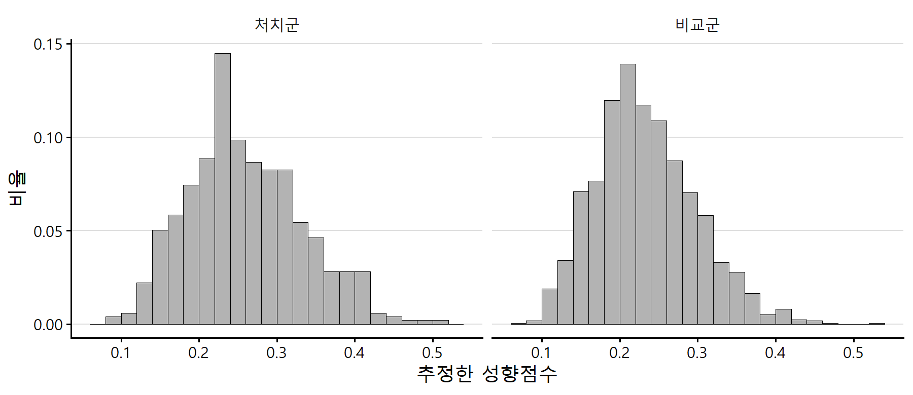

# 인과 추론 2장. 성향점수 — 근력운동을 시작하면 통증이 달라지는가


- [I. 질문과 설계](#i-질문과-설계)
- [II. 잠재 결과와 식별 가정](#ii-잠재-결과와-식별-가정)
- [III. 회귀 보정](#iii-회귀-보정)
- [IV. 성향점수](#iv-성향점수)
- [V. 짝짓기와 가중](#v-짝짓기와-가중)
- [VI. 균형과 겹침](#vi-균형과-겹침)
- [VII. 이중 강건 추정](#vii-이중-강건-추정)
- [VIII. 해석](#viii-해석)
- [IX. (선택) 관측하지 않은 교란의 점검](#ix-선택-관측하지-않은-교란의-점검)
- [X. 이 방법을 쓴 연구](#x-이-방법을-쓴-연구)
- [참고문헌](#참고문헌)

근력운동은 무릎 골관절염(osteoarthritis)의 운동치료(exercise therapy)에서 권고되는 요소이고, 무작위 대조 시험은 처방된 운동이 통증을 줄인다는 근거를 쌓아 왔다(Fransen et al., 2015). 관찰 데이터에서는 누가 운동을 할지를 연구자가 정하지 않는다. 운동을 시작한 사람과 시작하지 않은 사람은 운동 말고도 여러 면에서 다르고, 두 집단의 통증을 그대로 비교하면 그 차이가 운동의 효과와 섞인다. 1장은 이 문제를 회귀 보정(regression adjustment)과 고정효과(fixed effects)로 다루었다. 이 장은 같은 문제를 다른 순서로 다룬다. 누구와 누구를 비교하는지를 먼저 정하고, 그 비교가 무엇을 추정하는지를 잠재 결과(potential outcomes)로 정의한 다음, 두 집단을 비슷하게 만드는 방법을 하나씩 적용한다.

소개하는 방법은 넷이다. 결과를 공변량에 회귀하는 회귀 보정(III장), 처치를 받을 확률인 성향점수(IV장), 성향점수(propensity score)로 짝을 짓거나 가중하는 추정(V장), 그리고 결과 회귀와 성향점수를 함께 쓰는 이중 강건(doubly robust) 추정(VII장)이다. 같은 데이터에 네 방법을 차례로 적용하고 추정치를 표 하나에 모은다(VII.2절). 이 장의 목표는 추정치의 크기가 아니라 각 방법이 무엇을 가정하고 무엇을 계산하는지를 보이는 것이다.

## I. 질문과 설계

### 1. 무작위 시험이라면

관찰 데이터로 처치의 효과를 추정할 때는 같은 질문에 답하는 무작위 시험을 먼저 적어 본다(Hernán and Robins, 2016). 그 시험의 대상, 처치, 비교, 결과, 추적의 시작 시점을 정한 다음 관찰 데이터에서 각 요소에 해당하는 것을 찾는다. 이 절차는 비교의 대상을 분명하게 한다. 특히 추적이 언제 시작되는지를 정하게 하므로, 이미 오래 운동해 온 사람과 한 번도 하지 않은 사람을 비교하는 것과 같은 설계를 피하게 된다. 오래 운동해 온 사람은 운동을 계속할 수 있었던 사람이고, 그 사실 자체가 무릎의 상태와 관련된다.

이 장의 시험은 다음과 같다. 근력운동을 하지 않는 사람을 모아, 절반에게는 근력운동을 시작하게 하고 나머지는 하지 않게 한 뒤, 1년 뒤의 무릎 통증을 비교한다. 표 1은 이 시험의 요소와 OAI에서 그것에 대응시킨 것을 요소별로 제시한 것이다. OAI의 방문 셋을 쓴다. 기준 방문(0개월)은 대상을 정하고 공변량을 측정하는 시점, 12개월 방문은 처치를 확인하는 시점, 24개월 방문은 결과를 측정하는 시점이다.

**표 1. 무작위 시험의 요소와 OAI에서의 대응**

| 요소 | 무작위 시험이라면 | OAI에서 |
|----|----|----|
| 대상 | 근력운동을 하지 않는 사람 | 기준 방문의 PASE 근력운동 항목이 “지난 7일 동안 하지 않음”이고, 12개월까지 어느 무릎도 치환술을 받지 않은 사람 |
| 처치 | 근력운동을 시작한다 | 12개월 방문의 같은 항목이 주 1\~2일 이상 |
| 비교 | 시작하지 않는다 | 12개월 방문의 같은 항목이 “하지 않음” |
| 공변량 | 배정 전의 특성 | 기준 방문의 값 |
| 결과 | 1년 뒤의 통증 | 24개월 방문의 WOMAC 통증(두 무릎 가운데 더 아픈 쪽, 0\~20) |

처치를 확인하는 문항은 PASE(데이터 1장 III.3절)의 여섯째 항목으로, 지난 7일 동안 근력과 근지구력을 기르는 운동을 며칠 했는지를 묻는다. 대상은 2,428명이고 그 가운데 549명(22.6%)이 12개월 방문에서 근력운동을 한다고 답했다. 이들을 처치군, 나머지를 비교군이라 부른다.

### 2. 분석 표본

분석에는 24개월의 통증과 기준 방문의 공변량이 모두 관측된 사람만 쓴다. 24개월의 통증이 없는 179명(방문하지 않았거나 그 전에 치환술을 받은 사람)과 공변량 가운데 하나라도 없는 172명을 빼면 2,077명이 남고, 처치군이 497명, 비교군이 1,580명이다. 한 사람이 관측 하나이므로 회귀 1장과 종단 분석 1장에서 다룬 군집(cluster)의 문제는 없다. 결과가 없는 사람을 빼는 것이 추정에 주는 영향은 VIII.3절에서 다룬다.

공변량은 20개다. 인구학적 특성(나이, 성별, 인종, 교육), 무릎의 구조(KL 등급), 증상(WOMAC 통증, 기능, 뻣뻣함, KOOS 삶의 질), 전반적 건강(BMI, 동반질환 지수, CES-D, SF-12의 신체와 정신 요약 점수), 약물(통증 약, 소염진통제), 신체 수행(20m 보행 속도, 의자에서 일어서기), 활동(운동 삼아 걷기, PASE 총점)이다. 모두 기준 방문의 값이므로 근력운동을 시작하기 전에 측정되었다. 소득은 결측이 많아 넣지 않았고 교육 수준이 사회경제적 위치를 대신한다. 사람·시험 표는 `R/oai.R`의 `trial_table`이 만든다.

## II. 잠재 결과와 식별 가정

### 1. 잠재 결과

처치의 효과를 정의하려면 한 사람에게 두 가지 결과를 생각해야 한다. 사람 $i$가 근력운동을 시작했을 때의 24개월 통증을 $Y_i(1)$, 시작하지 않았을 때의 통증을 $Y_i(0)$이라 한다. 이 둘을 잠재 결과라 한다(Rubin, 1974). 사람 $i$에게 운동의 효과는 $Y_i(1) - Y_i(0)$이다. 그런데 한 사람은 시작했거나 시작하지 않았거나 둘 중 하나이므로 두 잠재 결과 가운데 하나만 관측된다. 처치를 $A_i$(시작하면 1, 아니면 0)라 하면 관측된 결과는 $Y_i = A_i Y_i(1) + (1 - A_i) Y_i(0)$이다. 개인의 효과는 어떤 데이터로도 계산할 수 없고, 추정의 대상은 집단의 평균이다.

평균을 누구에 대해 구하는지에 따라 추정 대상이 달라진다. 대상 전체에 대한 평균을 평균 처치 효과(average treatment effect, ATE), 실제로 처치를 받은 사람에 대한 평균을 처치군에서의 평균 처치 효과(average treatment effect on the treated, ATT)라 한다.

$$\tau_{\mathrm{ATE}} = E[Y(1) - Y(0)], \qquad \tau_{\mathrm{ATT}} = E[Y(1) - Y(0) \mid A = 1]$$

ATE는 근력운동을 하지 않는 사람 모두가 시작한다면 평균 통증이 얼마나 달라지는지를 묻고, ATT는 실제로 시작한 사람들이 시작하지 않았다면 어떠했을지를 묻는다. 효과가 사람마다 같으면 둘은 같다. 효과가 사람마다 다르고 효과가 큰 사람이 처치를 더 많이 고르면 둘은 달라진다. 아래에서 방법마다 어느 쪽을 추정하는지를 밝힌다.

### 2. 보정하지 않은 차이는 무엇을 추정하는가

두 집단의 평균을 그대로 뺀 값은 다음과 같이 나뉜다.

$$E[Y \mid A = 1] - E[Y \mid A = 0] = \tau_{\mathrm{ATT}} + \lbrace E[Y(0) \mid A = 1] - E[Y(0) \mid A = 0] \rbrace$$

오른쪽의 둘째 항은 처치군과 비교군이 둘 다 운동을 시작하지 않았더라도 통증이 달랐을 정도다. 이것을 선택 치우침이라 한다. 무작위 배정은 처치가 잠재 결과와 무관하게 정해지도록 하므로 이 항이 0이 되고, 평균의 차이가 그대로 효과의 추정치가 된다. 관찰 데이터에서는 이 항이 0이라는 보장이 없다. 표 2는 처치군과 비교군의 기준 방문 특성 일부와 24개월의 통증을 비교한 것이다. 마지막 열은 두 집단의 평균 차이를 두 집단 표준편차의 평균으로 나눈 표준화 평균 차이(standardized mean difference)다(VI.1절).

**표 2. 처치군과 비교군의 특성과 결과 (평균)**

| 특성                          | 처치군 | 비교군 | 표준화 평균 차이 |
|:------------------------------|-------:|-------:|-----------------:|
| 나이(세), 기준 방문           |  61.59 |  61.02 |             0.06 |
| 여성, 기준 방문               |   0.66 |   0.57 |             0.18 |
| KL 등급(높은 쪽), 기준 방문   |   1.52 |   1.64 |            -0.10 |
| BMI, 기준 방문                |  28.88 |  29.24 |            -0.07 |
| WOMAC 통증, 기준 방문         |   3.05 |   3.30 |            -0.07 |
| KOOS 삶의 질, 기준 방문       |  68.65 |  69.37 |            -0.03 |
| 20m 보행 속도(m/s), 기준 방문 |   1.33 |   1.31 |             0.11 |
| PASE 총점, 기준 방문          | 144.24 | 155.86 |            -0.15 |
| 24개월의 WOMAC 통증(결과)     |   2.90 |   2.89 |             0.00 |

표에서 24개월의 통증은 처치군이 비교군보다 0.01점 높다(표준오차 0.17). 이것이 보정하지 않은 차이다. 두 집단은 기준 방문에서 이미 다르다. 표준화 평균 차이의 절대값이 가장 큰 특성은 여성(0.18)이고 그다음이 PASE 총점(-0.15)이다. 이 특성들이 24개월의 통증과도 관련되면 보정하지 않은 차이에는 선택 치우침이 들어 있다. 치우침의 방향은 미리 알 수 없다. 운동을 더 많이 시작하는 집단이 원래 통증을 더 높게 보고하는 집단이라면 운동의 효과는 실제보다 나쁘게 보이고, 원래 통증이 낮은 집단이라면 실제보다 좋게 보인다. 공변량마다 방향이 다를 수 있고 그 합이 어느 쪽인지는 보정해 보아야 안다.

### 3. 식별 가정

관찰 데이터에서 평균 처치 효과를 추정하려면 세 가지를 가정한다(Hernán and Robins, 2020). 공변량의 벡터를 $X$라 한다.

첫째는 교환 가능성(exchangeability)이다. 공변량이 같은 사람들 안에서는 처치가 잠재 결과와 무관하게 정해졌다고 가정한다.

$$\lbrace Y(1), Y(0) \rbrace \perp A \mid X$$

공변량이 같은 사람들 안에서는 누가 운동을 시작했는지가 무작위 배정과 같다는 뜻이다. 처치와 결과 모두에 영향을 주는 변수가 $X$에 모두 들어 있어야 성립하므로 관측하지 않은 교란(confounding)이 없다는 가정이라고도 한다. 이 가정은 데이터로 검증할 수 없다.

둘째는 양의 확률(positivity)이다. 어떤 공변량 값에서도 처치를 받을 확률이 0이나 1이 아니어야 한다.

$$0 < P(A = 1 \mid X = x) < 1$$

공변량이 어떤 값인 사람이 모두 운동을 시작했다면 그 값에서 시작하지 않은 사람의 결과를 알 방법이 없다. 이 가정은 데이터로 점검할 수 있다(VI.2절).

셋째는 일관성(consistency)이다. 처치를 받은 사람의 관측 결과가 그 사람의 잠재 결과 $Y(1)$과 같다고 가정한다. 처치가 분명하게 정의되어 있어야 성립한다. 근력운동을 한다는 것은 종류와 강도와 빈도가 여러 가지인 행동이므로, 여기서 추정하는 것은 이 사람들이 실제로 한 여러 근력운동을 평균한 효과다.

세 가정이 성립하면 평균 처치 효과는 관측 데이터의 함수로 쓸 수 있다. 공변량이 같은 사람들 안에서 처치군과 비교군의 평균 차이를 구하고, 그것을 공변량의 분포에 대해 평균하면 된다.

$$\tau_{\mathrm{ATE}} = E\lbrace E[Y \mid A = 1, X] - E[Y \mid A = 0, X] \rbrace$$

공변량이 한두 개이고 범주형이면 이 식을 그대로 계산할 수 있다. 공변량이 20개이면 공변량이 모두 같은 사람이 거의 없다. 아래의 방법들은 이 식을 계산하는 서로 다른 방식이다.

## III. 회귀 보정

### 1. 방법

가장 익숙한 방식은 결과를 처치와 공변량에 회귀하는 것이다.

$$Y_i = \beta_0 + \tau A_i + X_i^\top \beta + \varepsilon_i$$

$\tau$의 추정치를 처치 효과의 추정치로 삼는다. 1장 II장에서 PASE의 계수를 해석한 방식과 같다. 이 추정이 II.3절의 식과 같아지려면 조건이 하나 더 필요하다. 조건부 평균 $E[Y \mid A, X]$가 실제로 위의 선형식이어야 한다. 공변량의 효과가 직선이 아니거나 처치의 효과가 공변량에 따라 다르면 모형이 틀린 것이고, 그 틀린 정도가 추정치에 들어간다.

회귀 보정에는 눈에 잘 띄지 않는 문제가 하나 더 있다. 처치군과 비교군의 공변량 분포가 겹치지 않는 영역이 있어도 회귀는 추정치를 낸다. 그 영역에서는 한쪽 집단의 데이터로 적합한 직선을 다른 쪽으로 연장해 비교하는 것이므로 추정치가 모형의 형태에 전적으로 기댄다. 회귀의 출력에는 이것을 알려 주는 것이 없다.

### 2. 추정

24개월의 통증을 처치와 공변량 20개에 회귀하면 처치의 계수는 0.15점(표준오차 0.13)이다. 보정하지 않은 차이 0.01점에서 0.14점 올라갔다. 같은 모형에서 기준 방문 통증 1점의 계수는 0.29점이며, 24개월의 통증을 가장 잘 예측하는 공변량은 기준 방문의 통증과 기능이다. 결과를 잘 예측하는 공변량을 넣으면 잔차의 분산이 줄어들어 처치 계수의 표준오차도 줄어든다. 보정하지 않은 차이의 표준오차가 0.17이었던 것과 비교할 수 있다.

## IV. 성향점수

### 1. 정의와 균형 성질

성향점수는 공변량이 주어졌을 때 처치를 받을 확률이다.

$$e(x) = P(A = 1 \mid X = x)$$

무작위 시험에서는 성향점수를 연구자가 정한다. 동전을 던져 배정하면 모든 사람의 성향점수가 0.5다. 관찰 데이터에서는 성향점수를 알지 못하므로 데이터에서 추정한다.

성향점수가 쓸모 있는 이유는 Rosenbaum and Rubin (1983)이 보인 두 가지 성질에 있다. 첫째, 성향점수가 같은 사람들 안에서는 처치군과 비교군의 공변량 분포가 같다. 이것을 균형 성질이라 한다.

$$X \perp A \mid e(X)$$

둘째, 공변량을 조건으로 교환 가능성이 성립하면 성향점수 하나만 조건으로 두어도 교환 가능성이 성립한다.

$$\lbrace Y(1), Y(0) \rbrace \perp A \mid e(X)$$

둘째 성질에 따라 20개 공변량이 모두 같은 사람을 찾는 대신 성향점수라는 숫자 하나가 같은 사람을 찾으면 된다. 차원이 20에서 1로 줄어든다. 첫째 성질은 추정한 성향점수가 쓸 만한지를 점검하는 수단이 된다. 성향점수로 보정한 뒤에 두 집단의 공변량이 비슷해졌는지를 보면 된다(VI.1절). 성향점수 모형은 처치를 잘 예측하는 것이 목적이 아니고 공변량의 균형을 맞추는 것이 목적이다.

성향점수는 관측하지 않은 교란에 대해서는 아무 일도 하지 않는다. 균형 성질은 성향점수 모형에 넣은 공변량에 대해서만 성립한다.

### 2. 추정

성향점수는 처치를 공변량에 회귀한 로지스틱 회귀(회귀 2장)로 추정한다.

$$\log \frac{e(X_i)}{1 - e(X_i)} = \alpha_0 + X_i^\top \alpha$$

**표 3. 성향점수 모형의 오즈비 (z 통계량의 절대값이 큰 여섯 공변량)**

| 공변량             | 오즈비 | 하한 | 상한 |
|:-------------------|-------:|-----:|-----:|
| 여성               |   1.51 | 1.20 | 1.88 |
| PASE 총점          |   0.84 | 0.75 | 0.94 |
| KOOS 삶의 질       |   0.81 | 0.69 | 0.95 |
| KL 등급(높은 쪽)   |   0.88 | 0.78 | 0.99 |
| 20m 보행 속도(m/s) |   1.14 | 1.01 | 1.29 |
| 나이(세)           |   1.11 | 0.98 | 1.26 |

표 3은 성향점수 모형의 계수를 오즈비(odds ratio)로 바꾸어 $z$ 통계량의 절대값이 큰 순서로 여섯 개만 제시한 것이다. 연속인 공변량은 1 표준편차가 클 때의 오즈비이고, 여성처럼 값이 둘인 공변량은 해당하는 사람과 아닌 사람의 오즈비다. 오즈비가 1보다 크면 그 값이 큰 사람이 근력운동을 더 많이 시작했다는 뜻이다.

표에 나온 공변량들이 누가 근력운동을 시작하는지와 관련된다. 추정된 성향점수의 범위는 처치군에서 0.09\~0.51(중위값 0.25), 비교군에서 0.08\~0.52(중위값 0.23)이다. 두 집단의 중위값이 가깝다는 것은 이 공변량들로는 누가 시작할지를 잘 가려내지 못한다는 뜻이다. 그것은 결함이 아니다. 성향점수가 두 집단을 완전히 구분한다면 비교할 상대가 없다는 뜻이므로 오히려 추정이 불가능해진다.

## V. 짝짓기와 가중

성향점수를 추정에 쓰는 방식은 여럿이다(Austin, 2011). 이 장은 가장 널리 쓰이는 둘을 다룬다. 성향점수가 비슷한 사람끼리 짝을 짓는 방법과 성향점수의 역수로 가중하는 방법이다.

### 1. 짝짓기

처치군의 각 사람에게 성향점수가 가장 가까운 비교군의 사람 하나를 짝지어 주고, 짝지어진 사람들만으로 평균의 차이를 구한다. 처치군의 사람마다 그 사람과 비슷한 비교 대상을 찾아 주는 것이므로 추정 대상은 ATT다. 짝을 찾는 규칙에는 선택할 것이 몇 가지 있다(Stuart, 2010). 여기서는 한 사람에 한 명을 짝짓고, 한 번 짝지어진 비교군의 사람은 다시 쓰지 않으며, 성향점수의 로짓(logit) 차이가 그 표준편차의 0.2배를 넘으면 짝짓지 않는다. 마지막 조건을 캘리퍼라 한다. 가까운 상대가 없는 처치군의 사람은 분석에서 빠지고, 그만큼 추정 대상이 처치군 전체에서 짝을 찾은 처치군으로 바뀐다.

처치군 497명 가운데 496명이 짝을 찾았다. 짝지어진 496쌍에서 24개월 통증의 평균 차이는 0.09점(표준오차 0.21)이다. 표준오차는 쌍 안의 차이의 표준편차에서 구했다. 짝짓기(matching)는 `MatchIt` 패키지(Ho et al., 2011)로 했다. 비교군 1,580명 가운데 1,084명은 쓰이지 않았다. 짝짓기는 비교가 분명하다는 장점이 있고 데이터의 일부를 버린다는 대가가 있다.

### 2. 역확률 가중

가중은 데이터를 버리지 않고 각 사람의 비중을 바꾼다. 처치군의 사람에게는 $1/e(X_i)$를, 비교군의 사람에게는 $1/(1 - e(X_i))$를 가중치로 준다. 자기가 속한 집단에 들어갈 확률의 역수이므로 역확률 가중(inverse probability weighting)이라 한다.

가중치의 뜻은 다음과 같다. 성향점수가 0.2인 사람이 운동을 시작했다고 하자. 이 사람과 공변량이 같은 사람 다섯 가운데 하나만 시작한 셈이므로, 이 사람이 시작하지 않은 넷까지 대표하도록 가중치 5를 준다. 그렇게 하면 가중한 처치군은 대상 전체가 모두 시작했을 때의 모습이 되고, 가중한 비교군은 대상 전체가 모두 시작하지 않았을 때의 모습이 된다. 두 가중 평균의 차이가 ATE의 추정치다.

$$\hat\tau_{\mathrm{IPW}} = \frac{\sum_i A_i Y_i / \hat e_i}{\sum_i A_i / \hat e_i} - \frac{\sum_i (1 - A_i) Y_i / (1 - \hat e_i)}{\sum_i (1 - A_i) / (1 - \hat e_i)}$$

분모를 사람 수가 아니라 가중치의 합으로 둔 것은 가중치의 합이 사람 수와 정확히 같지 않기 때문이며, 이렇게 하면 추정이 더 안정적이다(Lunceford and Davidian, 2004). 가중치를 바꾸면 추정 대상이 바뀐다. 처치군에는 1을, 비교군에는 $\hat e_i / (1 - \hat e_i)$를 주면 비교군이 처치군의 공변량 분포를 닮도록 가중되고 ATT를 추정한다. 짝짓기의 추정치와 비교할 수 있는 것은 이쪽이다.

역확률 가중으로 추정한 ATE는 0.27점(표준오차 0.15), ATT는 0.09점(표준오차 0.13)이다. 표준오차는 붓스트랩(bootstrap) 500회로 구했다. 성향점수를 추정했다는 사실이 추정량의 분산에 영향을 주므로, 표본을 다시 뽑을 때마다 성향점수 모형도 다시 적합했다. 가중치의 최댓값은 10.7이다. 한 사람이 11명 안팎을 대표하는 정도이며, 가중치가 수십을 넘는 사람이 있으면 그 몇 사람이 추정치를 좌우하게 된다.

## VI. 균형과 겹침

성향점수 방법에는 회귀 보정에 없는 점검 단계가 있다. 결과 변수를 보지 않고도 보정이 제대로 되었는지를 확인할 수 있다는 것이 성향점수 방법의 실용적인 이점이다.

### 1. 균형

IV.1절의 균형 성질에 따르면 성향점수로 짝짓거나 가중한 뒤에는 두 집단의 공변량 분포가 비슷해야 한다. 비슷한 정도는 표준화 평균 차이로 측정한다.

$$\mathrm{SMD} = \frac{\bar x_1 - \bar x_0}{\sqrt{(s_1^2 + s_0^2)/2}}$$

$\bar x_1$, $\bar x_0$은 처치군과 비교군의 평균(가중했으면 가중 평균)이고 $s_1^2$, $s_0^2$은 보정 전의 분산이다. 검정의 $p$값을 쓰지 않는 것은 $p$값이 표본 크기에 따라 달라지기 때문이다. 짝짓기로 표본이 줄어들면 차이가 그대로여도 $p$값은 커진다. 절대값이 0.1보다 작으면 균형이 맞았다고 보는 것이 관행이다(Austin and Stuart, 2015). 표 4는 공변량마다 보정 전, 짝지은 뒤, ATE 가중치로 가중한 뒤의 표준화 평균 차이를 제시한 것이다.

**표 4. 공변량의 표준화 평균 차이**

| 공변량               | 보정 전 | 짝지은 뒤 | 가중한 뒤 |
|:---------------------|--------:|----------:|----------:|
| 나이(세)             |   0.061 |     0.067 |    -0.013 |
| 여성                 |   0.180 |     0.037 |    -0.020 |
| 백인                 |   0.028 |     0.046 |    -0.023 |
| 교육 수준(0\~5)       |   0.059 |     0.033 |    -0.025 |
| KL 등급(높은 쪽)     |  -0.097 |    -0.039 |     0.010 |
| BMI                  |  -0.073 |    -0.044 |     0.018 |
| WOMAC 통증           |  -0.071 |     0.018 |     0.023 |
| WOMAC 기능           |  -0.032 |    -0.011 |     0.017 |
| WOMAC 뻣뻣함         |   0.004 |    -0.040 |     0.027 |
| CES-D                |   0.005 |    -0.021 |     0.021 |
| 동반질환 지수        |  -0.049 |     0.007 |     0.007 |
| KOOS 삶의 질         |  -0.034 |     0.061 |    -0.030 |
| 통증 약 사용         |   0.068 |    -0.063 |    -0.010 |
| 소염진통제 사용      |   0.062 |    -0.040 |    -0.016 |
| 20m 보행 속도(m/s)   |   0.108 |    -0.003 |    -0.015 |
| 의자 일어서기(회/초) |   0.069 |    -0.029 |    -0.015 |
| 운동 삼아 걷기(0\~3)  |   0.044 |    -0.002 |    -0.018 |
| PASE 총점            |  -0.154 |    -0.046 |     0.006 |
| SF-12 신체           |   0.029 |     0.110 |    -0.019 |
| SF-12 정신           |   0.005 |    -0.026 |    -0.019 |

표에서 보정 전에는 3개 공변량의 표준화 평균 차이가 절대값 0.1을 넘고 최댓값은 0.18이다. 짝지은 뒤의 최댓값은 0.11(0.1을 넘는 것 1개), 가중한 뒤의 최댓값은 0.03(0개)이다. 균형이 맞지 않으면 성향점수 모형을 고친다. 차이가 남은 공변량의 제곱항이나 교호작용을 넣고 다시 점검한다. 이 과정에서 결과 변수는 쓰지 않으므로, 원하는 추정치가 나올 때까지 모형을 고치는 일과는 구분된다.

이 데이터는 보정 전의 불균형이 크지 않다. 무작위 시험이 아닌데도 두 집단이 비슷하다는 것은 관측한 공변량에 한해서의 이야기다. 관측하지 않은 특성에서 두 집단이 얼마나 다른지는 이 표로 알 수 없다.

### 2. 겹침

양의 확률 가정은 추정한 성향점수의 분포로 점검한다. 그림 1은 처치군과 비교군의 성향점수 분포를 함께 그린 것이다. 가로축은 추정한 성향점수, 세로축은 각 집단 안에서의 비율이다. 두 분포가 같은 범위에 걸쳐 있으면 처치군의 사람마다 비슷한 비교군의 사람이 있고 그 반대도 성립한다.



그림에서 두 집단의 성향점수는 거의 같은 범위에 분포한다. 성향점수가 0.05보다 작거나 0.95보다 큰 사람의 비율은 0.0%다. 겹침이 부족한 데이터에서는 한쪽 집단에만 있는 범위의 사람을 분석에서 빼거나 가중치의 상한을 정한다. 그렇게 하면 추정 대상이 겹치는 범위의 사람들에 대한 효과로 바뀐다는 점을 함께 밝혀야 한다.

## VII. 이중 강건 추정

### 1. 방법

회귀 보정은 결과의 모형 $E[Y \mid A, X]$가 맞아야 하고, 역확률 가중은 성향점수의 모형 $e(X)$가 맞아야 한다. 어느 쪽이 맞는지는 알 수 없다. 이중 강건 추정량은 두 모형을 함께 써서 둘 가운데 하나만 맞아도 일치 추정이 되도록 만든 것이다(Robins et al., 1994; Bang and Robins, 2005). 처치군과 비교군에서 따로 적합한 결과 회귀의 예측값을 $\hat\mu_1(X)$, $\hat\mu_0(X)$이라 하면 추정량은 다음과 같다.

$$\hat\tau_{\mathrm{DR}} = \frac{1}{n}\sum_i \left[ \hat\mu_1(X_i) - \hat\mu_0(X_i) + \frac{A_i (Y_i - \hat\mu_1(X_i))}{\hat e_i} - \frac{(1 - A_i)(Y_i - \hat\mu_0(X_i))}{1 - \hat e_i} \right]$$

대괄호 안의 첫 두 항은 회귀 보정의 추정이다. 모든 사람에게 처치를 받았을 때와 받지 않았을 때의 결과를 예측해 그 차이를 평균한다. 뒤의 두 항은 그 예측의 잔차를 역확률로 가중한 것으로, 결과 회귀가 틀린 만큼을 바로잡는 항이다. 결과 회귀가 맞으면 잔차의 평균이 0이므로 뒤의 두 항은 성향점수가 틀려도 0에 가까워지고 회귀 보정의 추정이 남는다. 결과 회귀가 틀리고 성향점수가 맞으면, 역확률로 가중한 잔차가 결과 회귀의 치우침을 정확히 상쇄해 역확률 가중의 추정과 같아진다. 둘 다 틀리면 보장이 없다. 이 추정량을 덧붙인 역확률 가중(augmented inverse probability weighting, AIPW)이라고도 한다.

코드는 식을 그대로 옮기면 된다. `e`는 성향점수, `y`는 결과, `a`는 처치다.

``` r
mu1 <- predict(lm(y ~ ., data = x[a == 1, ]), x)
mu0 <- predict(lm(y ~ ., data = x[a == 0, ]), x)
mean(mu1 - mu0 + a * (y - mu1) / e - (1 - a) * (y - mu0) / (1 - e))
```

### 2. 추정

표 5는 이 장의 모든 추정치를 한곳에 모은 것이다. 행은 방법이고, 둘째 열은 그 방법이 추정하는 대상이다. 회귀 보정은 처치의 효과가 모든 사람에게 같다고 가정하므로 ATE와 ATT를 구분하지 않는다.

**표 5. 근력운동의 시작과 24개월의 WOMAC 통증: 방법별 추정치 (점)**

| 방법               | 추정 대상 | 추정치 | 표준오차 |  하한 | 상한 |
|:-------------------|:----------|-------:|---------:|------:|-----:|
| 보정하지 않은 차이 |           |   0.01 |     0.17 | -0.33 | 0.35 |
| 회귀 보정          | ATE와 ATT |   0.15 |     0.13 | -0.10 | 0.41 |
| 성향점수 짝짓기    | ATT       |   0.09 |     0.21 | -0.32 | 0.50 |
| 역확률 가중        | ATT       |   0.09 |     0.13 | -0.17 | 0.35 |
| 역확률 가중        | ATE       |   0.27 |     0.15 | -0.03 | 0.56 |
| 이중 강건          | ATE       |   0.20 |     0.14 | -0.08 | 0.48 |

표에서 보정한 다섯 추정치는 0.09\~0.27점의 범위에 있고, 95% 신뢰구간은 모두 0을 포함한다. 이중 강건 추정치는 0.20점(95% 신뢰구간 -0.08\~0.48)이다. ATT를 추정하는 짝짓기와 가중은 0.09점과 0.09점, ATE를 추정하는 가중과 이중 강건 추정은 0.27점과 0.20점이다. 방법에 따라 추정치가 0.18점까지 다르지만 그 차이는 각 추정치의 표준오차보다 작거나 비슷하다. 방법들이 같은 공변량으로 같은 대상을 추정하고 있고 균형이 처음부터 크게 어긋나 있지 않았으므로 예상할 수 있는 결과다.

## VIII. 해석

### 1. 추정치가 뜻하는 것

표 5의 이중 강건 추정치를 식별 가정(identification assumptions) 아래에서 해석하면 다음과 같다. 근력운동을 하지 않던 사람들이 모두 근력운동을 시작했을 때의 24개월 평균 통증은, 아무도 시작하지 않았을 때보다 0.20점 높다. 신뢰구간의 양 끝은 -0.08점과 0.48점이다. WOMAC 통증은 0\~20점이고 이 표본의 표준편차는 3.47점이므로, 신뢰구간의 어느 쪽 끝도 표준편차의 0.14배를 넘지 않는다.

신뢰구간이 0을 포함한다는 것은 효과가 없다는 증거가 아니다. 이 데이터와 이 가정 아래에서 신뢰구간 밖의 크기의 효과는 데이터와 맞지 않는다는 것이 결론이다. 신뢰구간이 좁으면 그 결론이 유용하다. 신뢰구간의 아래 끝이 -0.08점이라는 것은, 일상에서 스스로 시작한 근력운동이 1년 뒤의 통증을 그보다 크게 줄인다는 가설을 이 데이터가 지지하지 않는다는 뜻이다.

이 결과는 무작위 시험의 결과와 어긋나지 않는다. 질문이 다르기 때문이다. 시험의 처치는 처방되고 감독된 운동 프로그램이고, 여기서의 처치는 지난 7일에 근력운동을 하루 이상 했다고 답한 것이다. 1장 VII장에서 PASE 총점에 대해 적은 것과 같은 구분이다.

### 2. 관측하지 않은 교란

모든 추정치는 교환 가능성 가정에 기댄다. 표 4에서 균형이 맞았다는 것은 관측한 20개 공변량에 대해서다. 근력운동을 시작하는 사람이 관측되지 않은 면에서 다를 수 있는 경로는 여럿이다. 건강에 대한 관심과 동기, 의료 기관이나 운동 시설에 대한 접근, 다른 관절의 문제가 그 예다. 방향도 한쪽으로 정해지지 않는다. 건강에 관심이 많은 사람이 시작한다면 운동의 효과가 실제보다 좋게 보이고, 통증이 나빠지기 시작해서 의사의 권고로 시작한다면 실제보다 나쁘게 보인다.

공변량의 시점도 같은 문제를 만든다. 운동은 기준 방문과 12개월 방문 사이 어느 때에 시작되었고 공변량은 기준 방문의 값이다. 그 사이에 통증이 변했고 그 변화가 운동을 시작하게 했다면 그것은 보정되지 않았다. 12개월 방문의 통증을 공변량에 넣으면 이 문제가 풀리는 것처럼 보이지만, 12개월의 통증은 이미 시작한 운동의 영향을 받았을 수 있다. 처치의 영향을 받은 변수를 보정하면 효과의 일부가 함께 제거된다. 처치가 언제 시작되었는지를 알 수 없는 데이터에서는 이 두 문제 가운데 하나를 받아들여야 한다.

### 3. 처치의 측정과 탈락

처치는 지난 7일의 보고로 확인했다. 그 주에만 운동한 사람이 처치군에, 평소에 하지만 그 주에 쉰 사람이 비교군에 들어갔을 수 있다. 이런 오분류가 통증과 무관하게 일어난다면 두 집단의 차이를 줄이는 방향으로 작용하므로 추정치는 0 쪽으로 치우친다. 처치군이 12개월 뒤에도 운동을 계속했는지도 이 설계는 묻지 않는다. 추정한 것은 시작의 효과이고 지속의 효과가 아니다.

분석에서 24개월의 통증이 없는 179명을 뺐다. 빠진 사람이 처치와 통증 모두에 따라 달랐다면 남은 사람들의 비교는 치우친다. 예를 들어 운동을 시작한 뒤 통증이 심해진 사람이 방문을 그만두었다면 처치군에는 통증이 덜한 사람이 남는다. 데이터 1장 IV장에서 다룬 결측의 기제와 동일한 문제다. 이것을 다루는 한 방법은 역확률 가중을 한 번 더 쓰는 것이다. 결과가 관측될 확률을 공변량과 처치로 추정하고 그 역수를 가중치에 곱하면, 관측된 사람이 비슷한 특성의 빠진 사람까지 대표하게 된다.

공변량이 관측된 2,222명에서 결과가 관측될 확률을 로지스틱 회귀(logistic regression)로 추정해 가중치에 곱하면 역확률 가중의 ATE 추정치는 0.33점으로, 표 5의 0.27점과 0.06점 다르다. 이 보정도 탈락이 관측한 변수로 설명된다는 가정에 기댄다.

## IX. (선택) 관측하지 않은 교란의 점검

교환 가능성은 검증할 수 없지만 그 가정이 깨졌을 때의 영향을 가늠하는 방법은 있다. 둘을 소개한다.

### 1. 음성 대조 결과

처치가 영향을 줄 이유가 없는 결과를 골라 같은 방법으로 처치의 효과를 추정한다(Lipsitch et al., 2010). 효과가 없어야 하는 결과에서 효과가 추정된다면 그것은 남은 교란이나 다른 치우침의 신호다. 음성 대조 결과(negative control outcome)는 관심 있는 결과와 동일한 교란 구조를 가져야 쓸모가 있다. 여기서는 24개월 방문의 손 통증(어느 한 손이라도 통증이 있다고 표시하면 1)을 쓴다. 손 통증은 무릎 통증과 마찬가지로 자기 보고(self-report)이고 전반적 건강과 통증을 보고하는 성향의 영향을 받지만, 근력운동이 손의 통증을 바꿀 이유는 약하다.

비교군에서 24개월에 손 통증이 있는 사람은 28.2%다. 이중 강건 추정으로 구한 처치군과의 차이는 -4.2%포인트(표준오차 2.3)이다. 95% 신뢰구간이 0을 포함한다. 음성 대조에서 차이가 나타나지 않았다는 것은 통증을 보고하는 성향 같은 종류의 교란이 크게 남아 있지 않다는 것과 맞는 결과다. 음성 대조는 그것과 교란 구조를 공유하는 치우침만 드러낸다. 무릎에만 작용하는 교란, 예를 들어 무릎의 악화가 운동을 시작하게 하는 경로는 손 통증으로 드러나지 않는다.

같은 방식으로 양의 대조도 생각할 수 있다. 근력운동이 영향을 줄 것으로 기대되는 결과에서 효과가 추정되는지를 보는 것이다. 의자에서 다섯 번 일어서는 속도(회/초)를 결과로 두면 이중 강건 추정치는 -0.001(표준오차 0.006)이다. 의자에서 일어서는 동작은 다리의 근력에 기대는 수행 검사이며 자기 보고가 아니다. 효과가 기대되는 결과에서도 차이가 추정되지 않았다. 이것은 처치군과 비교군의 실제 운동량 차이가 작았을 가능성과 맞는 결과다. 처치를 지난 7일의 보고 하나로 확인했기 때문이다(VIII.3절). 그렇다면 통증에서 차이가 추정되지 않은 것도 운동의 효과가 없어서가 아니라 처치의 대비가 약해서일 수 있다.

### 2. E값

E값은 관측하지 않은 교란이 얼마나 강해야 추정치를 설명할 수 있는지를 하나의 숫자로 나타낸 것이다(VanderWeele and Ding, 2017). 관측하지 않은 교란 변수가 처치와 결과 각각에 대해 공변량을 보정한 뒤에도 위험비 $E$ 이상의 연관을 가져야 관측된 연관을 모두 설명할 수 있을 때, 그 $E$가 E값이다. 추정한 위험비를 $\mathrm{RR}$(1보다 작으면 역수)이라 하면 다음과 같다.

$$E = \mathrm{RR} + \sqrt{\mathrm{RR}(\mathrm{RR} - 1)}$$

연속인 결과에서는 추정치를 결과의 표준편차로 나눈 표준화 차이 $d$에서 $\mathrm{RR} \approx \exp(0.91 d)$로 근사한다.

이중 강건 추정치 0.20점의 E값은 1.29이다. 처치와 결과 모두에 위험비 1.29 정도의 연관을 가진 관측하지 않은 교란이 있으면 이 추정치가 0이 될 수 있다는 뜻이다. 신뢰구간에 대한 E값은 0에 가까운 쪽 끝으로 계산하며, 신뢰구간이 0을 포함하면 1이다. 여기서는 1.00이다. E값은 추정치가 0에서 멀리 있을 때 그것이 교란만으로 설명되기 어려운 정도를 말해 주는 도구다. 추정치가 0에 가까운 이 예에서는 E값이 작게 나오고, 약한 교란으로도 추정치의 부호가 바뀔 수 있다는 것을 알려 준다.

## X. 이 방법을 쓴 연구

OAI에서 신체활동과 무릎 증상의 관계를 다룬 연구는 많고, 방법은 회귀 보정에서 역확률 가중까지 걸쳐 있다. Lo et al. (2022)는 50세 이후에 운동 삼아 걸은 사람과 걷지 않은 사람을 비교해 걷는 사람에게서 새로운 잦은 무릎 통증이 적었다고 보고했고, Lo et al. (2024)는 평생의 근력운동 경험이 있는 사람에게서 잦은 무릎 통증과 방사선 골관절염이 적었다고 보고했다. 두 연구는 나이, 성별과 한두 개의 공변량을 넣은 로지스틱 회귀를 썼고, 운동 경험은 96개월 방문에서 과거를 돌아보는 설문으로 측정했다. 이 장의 분석과는 처치를 측정한 방식과 시점, 보정한 공변량의 범위가 다르다.

Mansournia et al. (2012)는 역확률 가중을 시간에 따라 바뀌는 처치로 넓힌 예다. OAI에서 무릎 골관절염이 있는 사람의 PASE 총점을 방문마다의 처치로 보고, 방문마다 그때까지의 통증과 기능을 조건으로 한 성향점수를 추정해 그 역수의 곱으로 가중했다. 이 방법을 주변 구조 모형이라 한다. 방문마다 처치가 바뀌고 앞선 처치가 뒤의 교란 변수에 영향을 주는 데이터에서는 이 장의 방법을 그대로 쓸 수 없으며, 주변 구조 모형이 그 경우를 다룬다. 이 장은 처치가 한 번 정해지는 경우만 다루었다.

## 참고문헌

Austin, P. C. (2011). “An introduction to propensity score methods for reducing the effects of confounding in observational studies.” *Multivariate Behavioral Research* 46(3), 399–424.

Austin, P. C., and Stuart, E. A. (2015). “Moving towards best practice when using inverse probability of treatment weighting (IPTW) using the propensity score to estimate causal treatment effects in observational studies.” *Statistics in Medicine* 34(28), 3661–3679.

Bang, H., and Robins, J. M. (2005). “Doubly robust estimation in missing data and causal inference models.” *Biometrics* 61(4), 962–973.

Fransen, M., McConnell, S., Harmer, A. R., Van der Esch, M., Simic, M., and Bennell, K. L. (2015). “Exercise for osteoarthritis of the knee: A Cochrane systematic review.” *British Journal of Sports Medicine* 49(24), 1554–1557.

Hernán, M. A., and Robins, J. M. (2016). “Using big data to emulate a target trial when a randomized trial is not available.” *American Journal of Epidemiology* 183(8), 758–764.

Hernán, M. A., and Robins, J. M. (2020). *Causal Inference: What If*. Chapman and Hall/CRC.

Ho, D. E., Imai, K., King, G., and Stuart, E. A. (2011). “MatchIt: Nonparametric preprocessing for parametric causal inference.” *Journal of Statistical Software* 42(8), 1–28.

Lipsitch, M., Tchetgen Tchetgen, E., and Cohen, T. (2010). “Negative controls: A tool for detecting confounding and bias in observational studies.” *Epidemiology* 21(3), 383–388.

Lo, G. H., Richard, M. J., McAlindon, T. E., Kriska, A. M., Price, L. L., Rockette-Wagner, B., Eaton, C. B., Hochberg, M. C., Kwoh, C. K., Nevitt, M. C., and Driban, J. B. (2024). “Strength training is associated with less knee osteoarthritis: Data from the Osteoarthritis Initiative.” *Arthritis & Rheumatology* 76(3), 377–383.

Lo, G. H., Vinod, S., Richard, M. J., Harkey, M. S., McAlindon, T. E., Kriska, A. M., Rockette-Wagner, B., Eaton, C. B., Hochberg, M. C., Jackson, R. D., Kwoh, C. K., Nevitt, M. C., and Driban, J. B. (2022). “Association between walking for exercise and symptomatic and structural progression in individuals with knee osteoarthritis: Data from the Osteoarthritis Initiative cohort.” *Arthritis & Rheumatology* 74(10), 1660–1667.

Lunceford, J. K., and Davidian, M. (2004). “Stratification and weighting via the propensity score in estimation of causal treatment effects: A comparative study.” *Statistics in Medicine* 23(19), 2937–2960.

Mansournia, M. A., Danaei, G., Forouzanfar, M. H., Mahmoodi, M., Jamali, M., Mansournia, N., and Mohammad, K. (2012). “Effect of physical activity on functional performance and knee pain in patients with osteoarthritis: Analysis with marginal structural models.” *Epidemiology* 23(4), 631–640.

Robins, J. M., Rotnitzky, A., and Zhao, L. P. (1994). “Estimation of regression coefficients when some regressors are not always observed.” *Journal of the American Statistical Association* 89(427), 846–866.

Rosenbaum, P. R., and Rubin, D. B. (1983). “The central role of the propensity score in observational studies for causal effects.” *Biometrika* 70(1), 41–55.

Rubin, D. B. (1974). “Estimating causal effects of treatments in randomized and nonrandomized studies.” *Journal of Educational Psychology* 66(5), 688–701.

Stuart, E. A. (2010). “Matching methods for causal inference: A review and a look forward.” *Statistical Science* 25(1), 1–21.

VanderWeele, T. J., and Ding, P. (2017). “Sensitivity analysis in observational research: Introducing the E-value.” *Annals of Internal Medicine* 167(4), 268–274.
