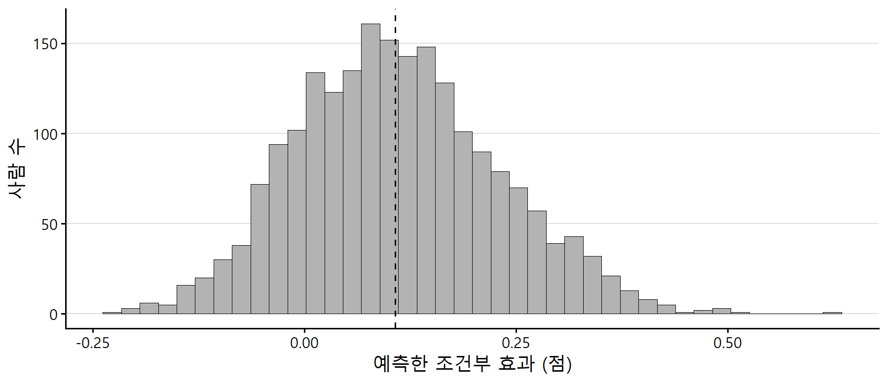

# 인과 추론 3장. 인과 기계학습 — 교차 적합과 인과 숲

- [I. 왜 기계학습인가](#i-왜-기계학습인가)
- [II. 교차 적합](#ii-교차-적합)
- [III. 평균 효과](#iii-평균-효과)
- [IV. 효과의 이질성](#iv-효과의-이질성)
- [V. 이질성이 실재하는가](#v-이질성이-실재하는가)
- [VI. 해석](#vi-해석)
- [VII. 이 방법을 쓴 연구](#vii-이-방법을-쓴-연구)
- [참고문헌](#참고문헌)

2장의 이중 강건 추정량은 두 가지 예측을 재료로 쓴다. 공변량에서 처치를 예측하는 성향점수와, 공변량에서 결과를 예측하는 결과 회귀다. 2장은 이 둘을 로지스틱 회귀와 선형 회귀로 적합했다. 어느 공변량을 넣고 어떤 형태로 넣을지는 분석하는 사람이 정했다. 이 장은 그 두 예측을 기계학습에 맡길 때 무엇이 달라지고 무엇을 지켜야 하는지를 다룬다.

다루는 것은 셋이다. 첫째, 기계학습의 예측을 그대로 넣으면 추정이 치우치는 이유와 그것을 막는 교차 적합(II장). 둘째, 교차 적합한 기계학습으로 구한 평균 처치 효과(III장). 셋째, 효과가 사람마다 다른지를 묻는 조건부 평균 처치 효과와 그것을 추정하는 인과 숲(IV장, V장)이다. 예는 2장과 같다. 근력운동을 하지 않던 사람이 12개월 방문에서 근력운동을 한다고 답했는지를 처치로, 24개월의 WOMAC 통증을 결과로 두며, 표본도 2장 I.2절의 2,077명(처치군 497명)과 공변량 20개 그대로다. 식별 가정(2장 II.3절)도 그대로다. 기계학습은 관측한 공변량을 더 유연하게 보정할 뿐이고 관측하지 않은 교란에 대해서는 2장의 방법과 똑같이 아무 일도 하지 못한다.

## I. 왜 기계학습인가

### 1. 모형의 형태를 정하는 문제

2장 II.3절의 식별 가정은 공변량이 같은 사람들 안에서 처치가 무작위와 같다고 말할 뿐, 결과나 처치가 공변량의 어떤 함수인지는 말하지 않는다. 선형 회귀와 로지스틱 회귀는 거기에 가정을 하나 더한다. 공변량의 효과가 정해 둔 식의 형태를 따른다는 것이다. 통증이 나이에 따라 직선으로 변하지 않거나, BMI의 영향이 KL 등급에 따라 다르면 그 식은 틀린 것이다. 이중 강건 추정량은 두 모형 가운데 하나가 맞으면 되지만 둘 다 조금씩 틀리는 경우가 더 흔하다.

분석하는 사람이 제곱항과 교호작용을 넣어 가며 모형을 고칠 수는 있다. 공변량이 20개이면 2차 교호작용만 190개이고, 어느 것을 넣을지를 추정치를 보면서 고르면 결과를 고르는 것과 구분하기 어려워진다. 기계학습은 이 선택을 데이터와 정해진 절차에 맡긴다. 랜덤 포레스트, 부스팅, 라쏘 같은 방법은 함수의 형태를 미리 정하지 않고 예측 오차가 작아지도록 형태를 찾는다.

### 2. 랜덤 포레스트

이 장은 기계학습 방법으로 랜덤 포레스트 하나만 쓴다(Breiman, 2001). 회귀 나무는 공변량 하나와 기준값 하나를 골라 데이터를 둘로 나누는 일을 되풀이하고, 마지막에 남은 마디 안의 평균을 예측값으로 삼는다. 나누는 기준은 나눈 뒤의 두 집단이 결과에서 가장 다르도록 고른다. 나무 하나는 데이터의 우연한 변동까지 따라가므로 불안정하다. 랜덤 포레스트는 데이터의 일부를 무작위로 뽑아 나무를 키우는 일을 수천 번 되풀이하고 나무들의 예측을 평균한다. 비선형 관계와 교호작용을 따로 지정하지 않아도 나무의 분할이 그것을 담는다. 추정에는 `grf` 패키지(Athey et al., 2019)를 쓴다.

기계학습이 선형 모형보다 언제나 잘 예측하는 것은 아니다. 관계가 실제로 직선에 가깝고 표본이 크지 않으면 선형 모형이 더 정확할 수 있다. 이 데이터에서 어느 쪽이 나은지는 II.3절에서 확인한다.

## II. 교차 적합

### 1. 그대로 넣으면 생기는 문제

기계학습의 예측을 2장 VII장의 식에 그대로 넣으면 두 가지 문제가 생긴다.

첫째는 과적합이다. 유연한 방법은 적합에 쓴 데이터를 지나치게 잘 맞힌다. 나무를 끝까지 키운 랜덤 포레스트로 처치를 예측하면, 처치군의 사람에게는 1에 가까운 성향점수가, 비교군의 사람에게는 0에 가까운 성향점수가 나온다. 그 사람 자신의 처치 여부가 예측에 들어갔기 때문이다. 이것은 처치를 받을 확률의 추정이 아니라 이미 일어난 일의 기록에 가깝다. 결과 회귀도 마찬가지로 자기 자신의 결과를 따라가므로 잔차 $Y_i - \hat\mu(X_i)$가 실제보다 작아진다. 이중 강건 추정량의 표준오차는 이 잔차로 계산하므로 표준오차도 실제보다 작게 나온다.

둘째는 규제(regularization)에서 오는 치우침이다. 규제는 모형이 데이터를 지나치게 따라가지 않도록 유연성을 제한하는 것을 통틀어 이르는 말이다. 벌점을 주어 계수를 줄이는 것, 나무의 깊이를 제한하는 것, 여러 나무의 예측을 평균하는 것이 모두 여기에 든다. 기계학습은 예측 오차를 줄이려고 분산과 치우침을 맞바꾼다. 예측값은 조금씩 평균 쪽으로 당겨져 있고, 그 치우침은 표본이 커져도 $1/\sqrt{n}$보다 느리게 줄어든다. 예측값을 식에 단순히 넣는 추정량, 예를 들어 결과 회귀의 예측값 차이를 평균하는 것만으로는 이 치우침이 그대로 처치 효과의 추정치에 들어간다.

### 2. 두 가지 처방

Chernozhukov et al. (2018)은 두 문제에 처방을 하나씩 대응시켰고 그 조합을 이중 기계학습이라 불렀다.

규제의 치우침에 대한 처방은 추정량의 형태다. 이중 강건 추정량에서는 성향점수의 오차와 결과 회귀의 오차가 곱의 형태로만 추정치에 들어간다. 2장 VII.1절에서 둘 가운데 하나가 맞으면 된다고 한 것이 이 성질이다. 두 예측이 각각 $n^{-1/4}$보다 빠르게 참값에 가까워지기만 하면 그 곱은 $n^{-1/2}$보다 빠르게 줄어들고, 추정량은 두 예측을 참값으로 넣은 것과 같은 분포를 따른다. 예측 하나하나가 느리게 수렴해도 처치 효과의 추정은 보통의 속도로 수렴한다. 이 성질을 네이만 직교성이라 한다.

과적합에 대한 처방이 교차 적합이다. 한 사람의 예측값을 만들 때 그 사람의 데이터를 쓰지 않는다. 절차는 다음과 같다.

1.  표본을 무작위로 $K$개 조각으로 나눈다.
2.  조각 하나를 빼고 나머지 $K-1$개 조각으로 성향점수와 결과 회귀를 적합한다.
3.  적합한 모형으로 빼 둔 조각의 사람들의 예측값을 구한다.
4.  조각을 바꾸어 가며 되풀이하면 모든 사람이 자기 데이터를 쓰지 않은 예측값을 갖는다.
5.  그 예측값을 이중 강건 추정량의 식에 넣는다.

모든 사람의 데이터가 적합에도 쓰이고 추정에도 쓰이므로 표본을 절반으로 나누어 한쪽을 버리는 것보다 효율적이다. 교차 적합한 이중 강건 추정량은 사람마다의 점수의 평균이므로 표준오차를 점수의 표준편차에서 바로 구할 수 있다. 사람 $i$의 점수를 $\hat\psi_i$라 하면 다음과 같다.

$$\hat\psi_i = \hat\mu_1(X_i) - \hat\mu_0(X_i) + \frac{A_i (Y_i - \hat\mu_1(X_i))}{\hat e(X_i)} - \frac{(1 - A_i)(Y_i - \hat\mu_0(X_i))}{1 - \hat e(X_i)}, \qquad \hat\tau = \frac{1}{n}\sum_i \hat\psi_i, \qquad \widehat{\mathrm{se}}(\hat\tau) = \frac{\mathrm{sd}(\hat\psi_i)}{\sqrt{n}}$$

2장은 표준오차를 붓스트랩으로 구했다. 위의 식은 두 예측의 오차가 추정량의 분포에 영향을 주지 않는다는 성질에 기대므로 교차 적합과 함께 쓸 때 정당하다.

### 3. 추정

표 1은 같은 데이터에 세 가지 방식으로 구한 이중 강건 추정을 함께 제시한 것이다. 첫 행은 2장의 선형 모형이다. 둘째 행은 나무를 끝까지 키운 랜덤 포레스트를 전체 데이터에 적합하고 같은 데이터에 예측한 것으로, 교차 적합을 하지 않았다. 셋째 행은 표본을 5조각으로 나누어 교차 적합한 랜덤 포레스트다. 성향점수의 중위값은 처치군과 비교군에서 따로 구했다. 결과 회귀의 $R^2$은 각 사람이 실제로 받은 처치에서의 예측값이 24개월의 통증을 설명하는 정도다.

**표 1. 교차 적합의 유무에 따른 이중 강건 추정 (24개월의 WOMAC 통증, 점)**

| 방식 | 성향점수 중위값, 처치군 | 성향점수 중위값, 비교군 | 결과 회귀의 R2 | 추정치 | 표준오차 |
|:---|---:|---:|---:|---:|---:|
| 선형 모형(2장) | 0.25 | 0.23 | 0.48 | 0.20 | 0.14 |
| 랜덤 포레스트, 교차 적합 없음 | 0.63 | 0.13 | 0.86 | 0.15 | 0.06 |
| 랜덤 포레스트, 교차 적합 | 0.24 | 0.24 | 0.44 | 0.10 | 0.13 |

표에서 교차 적합을 하지 않은 둘째 행은 과적합의 모습을 그대로 보여 준다. 성향점수의 중위값이 처치군 0.63, 비교군 0.13이어서 두 집단이 크게 벌어져 있다. 같은 데이터, 같은 공변량인데 선형 모형에서는 처치군 0.25, 비교군 0.23이었다. 숲이 처치를 잘 예측하게 된 것이 아니라 각 사람 자신의 처치 여부를 외운 것이다. 결과 회귀의 $R^2$도 0.86까지 올라가고, 그 결과 표준오차는 0.06이다. 선형 모형의 표준오차 0.14의 절반에 못 미친다. 이 표준오차를 믿으면 신뢰구간이 실제보다 좁아진다.

교차 적합한 셋째 행에서는 이 현상이 사라진다. 성향점수의 중위값은 처치군 0.24, 비교군 0.24이며 두 값이 가깝다. 결과 회귀의 $R^2$은 0.44이다. 이 값이 자기 데이터를 쓰지 않은 예측의 실제 정확도다. 선형 모형의 $R^2$ 0.48과 비교하면 이 데이터에서 랜덤 포레스트는 선형 모형보다 결과를 더 잘 예측하지 않는다. 선형 모형의 $R^2$은 적합에 쓴 데이터에서 구한 값이어서 조금 높게 나오지만, 공변량 20개에 표본 2,077명이므로 그 차이는 작다. 추정치는 0.10점(표준오차 0.13)으로 선형 모형의 0.20점(표준오차 0.14)과 0.10점 다르고, 그 차이는 표준오차보다 작다.

## III. 평균 효과

`grf` 패키지는 II장의 절차를 내부에서 처리한다. 나무마다 데이터의 일부만 뽑아 키우므로, 어떤 사람의 예측값을 구할 때 그 사람이 뽑히지 않은 나무들만 평균하면 그 사람의 데이터를 쓰지 않은 예측이 된다. 이것을 가방 밖 예측이라 하며 교차 적합과 동일한 역할을 한다. 조각을 나누어 여러 번 적합할 필요가 없다. `causal_forest`는 성향점수와 결과 회귀를 이 방식으로 먼저 구하고, `average_treatment_effect`는 그 예측값과 IV장에서 설명할 조건부 효과의 추정을 이중 강건 점수에 넣어 평균 효과와 표준오차를 낸다.

표 2는 평균 효과의 추정치를 방식별로 함께 제시한 것이다. 앞의 두 행은 표 1의 값이고, 뒤의 두 행은 인과 숲으로 구한 ATE와 ATT다.

**표 2. 근력운동의 시작과 24개월의 WOMAC 통증: 평균 효과의 추정치 (점)**

| 방식 | 추정 대상 | 추정치 | 표준오차 | 하한 | 상한 |
|:---|:---|---:|---:|---:|---:|
| 선형 모형의 이중 강건 추정(2장) | ATE | 0.20 | 0.14 | -0.07 | 0.48 |
| 교차 적합한 랜덤 포레스트의 이중 강건 추정 | ATE | 0.10 | 0.13 | -0.16 | 0.36 |
| 인과 숲 | ATE | 0.11 | 0.13 | -0.15 | 0.36 |
| 인과 숲 | ATT | 0.11 | 0.13 | -0.15 | 0.36 |

표에서 네 추정치는 0.10\~0.20점의 범위에 있고 95% 신뢰구간은 모두 0을 포함한다. 기계학습을 쓴 추정과 선형 모형을 쓴 추정이 0.10점 안에서 일치한다. 이것은 기계학습이 쓸모없었다는 뜻이 아니다. 선형 모형의 형태에 대한 가정을 빼고 추정해도 결론이 달라지지 않았으므로, 2장의 결과가 그 가정에 기대고 있지 않았다는 것을 확인한 것이다. 반대로 두 추정이 크게 달랐다면 선형 모형이 놓친 비선형 관계나 교호작용이 있다는 신호이고, 그때는 기계학습 쪽의 추정을 따르는 것이 맞다.

해석은 2장 VIII장과 같다. 식별 가정 아래에서, 근력운동을 하지 않던 사람들이 모두 시작했을 때와 아무도 시작하지 않았을 때의 24개월 평균 통증의 차이는 0.11점이고 신뢰구간은 -0.15\~0.36점이다.

## IV. 효과의 이질성

### 1. 조건부 평균 처치 효과

평균 효과가 0에 가깝다는 것은 모든 사람에게 효과가 없다는 것과 다르다. 어떤 사람에게는 통증을 줄이고 어떤 사람에게는 늘려서 평균이 0이 될 수도 있다. 재활에서는 이 구분이 중요하다. 누구에게 권할지를 정하려면 평균이 아니라 그 사람과 비슷한 사람들에서의 효과를 알아야 한다. 공변량이 $x$인 사람들에서의 평균 효과를 조건부 평균 처치 효과(CATE)라 한다.

$$\tau(x) = E[Y(1) - Y(0) \mid X = x]$$

2장 II.1절에서 본 대로 개인의 효과 $Y_i(1) - Y_i(0)$은 추정할 수 없다. $\tau(x)$는 개인의 효과가 아니라 공변량이 같은 사람들의 평균이다. 공변량이 같아도 효과는 사람마다 다를 수 있다.

전통적인 방법은 하위집단 분석이다. 성별이나 KL 등급으로 표본을 나누어 집단마다 효과를 추정한다. 이 방법의 문제는 나눌 수 있는 기준이 많다는 것이다. 공변량 20개마다 기준값을 바꾸어 가며 나누어 보면 우연만으로도 효과가 달라 보이는 집단이 나온다. 기계학습으로 $\tau(x)$를 추정하는 방법은 어느 공변량으로 어떻게 나눌지를 데이터가 정하게 하되, 그 과정에서 생기는 과적합을 II장과 동일한 원리로 통제한다.

### 2. 인과 숲

인과 숲(Wager and Athey, 2018; Athey et al., 2019)은 랜덤 포레스트를 $\tau(x)$의 추정에 맞게 바꾼 것이다. 출발점은 다음 식이다. $m(x) = E[Y \mid X = x]$를 처치를 구분하지 않은 결과의 조건부 평균이라 하면, 식별 가정 아래에서 다음이 성립한다(Robinson, 1988; Nie and Wager, 2021).

$$Y_i - m(X_i) = \tau(X_i) \lbrace A_i - e(X_i) \rbrace + \varepsilon_i, \qquad E[\varepsilon_i \mid X_i, A_i] = 0$$

왼쪽은 결과에서 공변량으로 예측되는 부분을 뺀 잔차이고, 오른쪽의 중괄호는 처치에서 공변량으로 예측되는 부분을 뺀 잔차다. 공변량으로 설명되지 않는 처치의 변동이 공변량으로 설명되지 않는 결과의 변동과 얼마나 함께 움직이는지가 처치의 효과다. $\tau$가 상수이면 결과의 잔차를 처치의 잔차에 회귀한 기울기가 그 값이다. 인과 숲은 그 회귀를 $x$의 근처에 있는 사람들에게 더 큰 가중치를 주어 하는 것이다.

$$\hat\tau(x) = \frac{\sum_i \alpha_i(x) \lbrace A_i - \hat e(X_i) \rbrace \lbrace Y_i - \hat m(X_i) \rbrace}{\sum_i \alpha_i(x) \lbrace A_i - \hat e(X_i) \rbrace^2}$$

가중치 $\alpha_i(x)$는 숲이 정한다. 나무마다 공변량 $x$가 떨어지는 마지막 마디를 찾고, 사람 $i$가 그 마디에 함께 들어 있는 나무의 비율이 $\alpha_i(x)$가 된다. 보통의 랜덤 포레스트와 다른 점은 둘이다. 첫째, 나무를 나누는 기준이 결과의 차이가 아니라 처치 효과의 차이다. 나눈 뒤의 두 집단에서 위의 기울기가 가장 다르도록 공변량과 기준값을 고른다. 둘째, 나무마다 데이터를 다시 둘로 나누어 한쪽으로는 분할을 정하고 다른 쪽으로는 마디 안의 효과를 추정한다. 분할을 정한 데이터로 효과까지 추정하면 우연히 효과가 커 보여서 나뉜 마디의 효과가 과대 추정되기 때문이다. 이것을 정직한 추정이라 하며, 교차 적합과 동일한 생각을 나무 안에 적용한 것이다.

### 3. 추정

III장에서 적합한 인과 숲(나무 4,000그루)은 사람마다의 $\hat\tau(X_i)$를 가방 밖 예측으로 낸다. 그림 1은 그 분포다. 가로축은 예측한 조건부 효과(WOMAC 통증의 점수), 세로축은 사람 수이고 세로 점선은 표 2의 평균 효과다.

그림에서 예측한 조건부 효과는 중위값 0.10점을 중심으로 5% 분위 -0.07점에서 95% 분위 0.32점까지 퍼져 있다. 이 퍼짐을 효과가 사람마다 다르다는 증거로 해석해서는 안 된다. 참 효과가 모든 사람에게 같아도 추정에는 오차가 있으므로 예측값은 퍼진다. 예측값이 퍼져 있다는 사실과 참 효과가 퍼져 있다는 사실을 구분하는 것이 V장의 일이다.

## V. 이질성이 실재하는가

예측한 조건부 효과의 퍼짐이 잡음인지를 판단하는 방법을 셋 소개한다. 어느 것도 개인별 예측값 하나하나의 신뢰구간에 기대지 않고, 예측값 전체가 실제 효과의 차이를 따라가는지를 묻는다.

### 1. 보정 검정

첫째 방법은 숲의 예측이 실제 효과를 얼마나 따라가는지를 회귀로 본다(Chernozhukov et al., 2025). 결과의 잔차를 두 변수에 회귀한다. 하나는 숲이 예측한 효과의 평균에 처치의 잔차를 곱한 것이고, 다른 하나는 각 사람의 예측 효과가 평균에서 벗어난 정도에 처치의 잔차를 곱한 것이다. 첫째 계수가 1에 가까우면 숲의 평균 예측이 맞다는 뜻이고, 둘째 계수가 0보다 크면 숲이 효과가 크다고 예측한 사람에게서 실제로 효과가 크다는 뜻이다. 둘째 계수가 0과 구분되지 않으면 예측한 효과의 차이가 실제 효과의 차이를 따라간다는 근거가 없다.

둘째 계수의 추정치는 -2.01(표준오차 1.07)이고, 계수가 0보다 크다는 방향의 한쪽 검정의 $p$값은 0.97이다. 숲이 예측한 효과의 차이가 실제 효과의 차이를 따라간다는 근거가 없다. 계수가 음수로 나온 것은 효과가 크다고 예측된 사람에게서 오히려 효과가 작았다는 뜻이며, 예측이 잡음일 때 나타나는 모습이다.

### 2. 예측 효과의 순위에 따른 비교

둘째 방법은 예측한 효과로 사람들의 순위를 매기고, 순위가 높은 집단에서 실제로 효과가 큰지를 본다. 여기에도 II장의 문제가 있다. 순위를 매긴 데이터로 그 집단의 효과까지 추정하면 과적합이 다시 들어온다. 그래서 표본을 무작위로 절반씩 나눈다. 한쪽 절반으로 인과 숲을 적합하고, 그 숲으로 다른 쪽 절반의 사람들의 효과를 예측해 사분위 집단으로 나눈 뒤, 다른 쪽 절반의 데이터만으로 집단별 평균 효과를 이중 강건 추정으로 구한다.

표 3은 그 결과다. 행은 예측 효과의 사분위 집단이고, 둘째 열은 첫 절반의 숲이 예측한 효과의 평균, 셋째 열부터는 둘째 절반에서 추정한 그 집단의 평균 효과다. 예측이 실제 효과를 따라간다면 추정치가 아래 행으로 갈수록 커져야 한다.

**표 3. 예측 효과의 사분위 집단별 평균 효과 (둘째 절반에서 추정, 점)**

| 예측 효과의 사분위 | 사람 | 예측한 효과의 평균 | 추정치 | 표준오차 |  하한 | 상한 |
|-------------------:|-----:|-------------------:|-------:|---------:|------:|-----:|
|                  1 |  260 |              -0.11 |  -0.45 |     0.38 | -1.20 | 0.30 |
|                  2 |  260 |              -0.03 |   0.22 |     0.36 | -0.49 | 0.93 |
|                  3 |  259 |               0.02 |   0.94 |     0.40 |  0.15 | 1.73 |
|                  4 |  260 |               0.12 |  -0.02 |     0.41 | -0.82 | 0.78 |

표에서 집단별 추정치는 예측한 효과의 순서대로 커지지 않는다. 가장 낮은 사분위의 추정치가 -0.45점, 가장 높은 사분위가 -0.02점이고, 한 집단이 260명 안팎이어서 표준오차가 0.36\~0.41점으로 크다. 네 집단 가운데 1개는 신뢰구간이 0을 포함하지 않는다. 그러나 추정치가 예측 효과의 순서를 따르지 않고, 네 집단을 동시에 보면 하나가 우연히 0에서 벗어날 확률이 5%보다 크다. 순서와 무관하게 일부 집단만 벗어난 것을 이질성의 근거로 삼지 않는다.

사분위로 나누는 것은 경계를 임의로 정한 것이다. 순위 가중 평균 처치 효과(RATE)는 경계를 정하지 않고 같은 질문에 답한다(Yadlowsky et al., 2025). 예측 효과가 높은 순서로 위에서부터 일정 비율의 사람을 골랐을 때 그들의 평균 효과가 전체 평균 효과보다 얼마나 큰지를 모든 비율에 대해 구하고 그것을 평균한 값이다. 순위가 실제 효과와 무관하면 0이다. 추정치는 -0.04(표준오차 0.21)이고 95% 신뢰구간은 0을 포함한다.

### 3. 미리 정한 특성에 대한 선형 투영

셋째 방법은 방향을 바꾼다. 숲이 찾은 차이를 검정하는 대신, 효과가 다를 것이라고 미리 생각한 특성을 정해 두고 조건부 효과가 그 특성에 따라 달라지는지를 본다. 조건부 효과를 특성 몇 개의 선형 함수로 근사한 것을 최적 선형 투영이라 한다(Semenova and Chernozhukov, 2021).

$$\tau(X_i) \approx \beta_0 + Z_i^\top \beta$$

추정은 II.2절의 이중 강건 점수 $\hat\psi_i$를 특성 $Z_i$에 회귀하는 것이다. 점수의 평균이 평균 효과이듯이, 점수를 특성에 회귀한 계수는 효과가 그 특성에 따라 얼마나 달라지는지를 추정한다. 특성은 결과를 보기 전에 넷으로 정했다. KL 등급, 기준 방문의 WOMAC 통증, BMI, 나이다. 구조 손상이 심한 무릎이나 통증이 이미 심한 사람에게서 운동의 효과가 다를 수 있다는 것이 그 이유다. 표 4는 그 계수다.

**표 4. 조건부 효과의 최적 선형 투영 (특성 한 단위당 효과의 변화, 점)**

| 특성       |   계수 | 표준오차 |   하한 |  상한 |     p |
|:-----------|-------:|---------:|-------:|------:|------:|
| 절편       |  1.295 |    1.317 | -1.287 | 3.878 | 0.326 |
| KL 등급    |  0.182 |    0.120 | -0.052 | 0.417 | 0.127 |
| WOMAC 통증 | -0.038 |    0.046 | -0.127 | 0.052 | 0.409 |
| BMI        | -0.012 |    0.030 | -0.070 | 0.047 | 0.697 |
| 나이       | -0.017 |    0.015 | -0.047 | 0.013 | 0.276 |

표에서 절편을 뺀 네 계수 가운데 95% 신뢰구간이 0을 포함하지 않는 것은 없다. 근력운동을 시작하는 것의 효과가 KL 등급, 기준 방문의 통증, BMI, 나이에 따라 달라진다는 근거는 이 데이터에 없다. 계수의 단위는 특성 한 단위당 통증 점수이므로 KL 등급의 계수는 등급이 하나 높을 때 효과가 달라지는 크기다.

## VI. 해석

### 1. 이질성이 검출되지 않았다는 것

V장의 세 방법은 같은 결론을 가리킨다. 예측한 조건부 효과의 차이가 실제 효과의 차이를 따라간다는 근거가 없다. 그림 1의 퍼짐은 추정의 잡음으로 설명된다.

이 결론을 “효과는 모든 사람에게 같다”로 해석해서는 안 된다. 이질성을 검출하는 데는 평균 효과를 추정하는 것보다 훨씬 큰 표본이 필요하다. 표 3의 집단별 표준오차는 표 2의 평균 효과의 표준오차의 3.0배쯤이다. 표본을 절반으로 나누고 그 절반을 다시 넷으로 나누면 집단마다 사람이 8분의 1이 되고 표준오차는 약 2.8배가 되기 때문이다. 집단 사이의 차이를 보려면 두 추정치의 차이를 보아야 하므로 불확실성은 더 커진다. 이 데이터가 배제하는 것은 그 신뢰구간보다 큰 규모의 체계적인 차이뿐이고, 그보다 작은 차이는 있어도 이 표본으로는 보이지 않는다.

이 결과는 평균 효과의 결과와 함께 본다. 2장 IX.1절에서 근력운동의 효과가 기대되는 의자 일어서기에서도 차이가 추정되지 않았다. 처치군과 비교군의 실제 운동량 차이가 작았다면 평균 효과도, 효과의 이질성도 나타나기 어렵다. 처치의 대비가 약한 데이터에서 이질성을 찾는 것은 신호가 약한 곳에서 신호의 변동을 찾는 일이다.

### 2. 개인별 예측값을 해석할 때

인과 숲은 사람마다 예측값 $\hat\tau(X_i)$를 내고, 패키지는 그 표준오차도 낸다. 그렇다고 그 값을 그 사람의 효과로 해석할 수는 없다. 세 가지 이유가 있다. 첫째, $\tau(x)$는 공변량이 같은 사람들의 평균이며 개인의 효과가 아니다(IV.1절). 둘째, V장의 검정을 통과하지 못한 예측값의 차이는 잡음이다. 예측 효과가 가장 큰 사람들을 골라 그들에게 운동을 권하는 규칙은 그 순위가 실제 효과를 따라갈 때만 뜻이 있다. 셋째, 모든 예측은 식별 가정에 기댄다. 관측하지 않은 교란이 공변량에 따라 다르게 작용하면 그것이 효과의 이질성처럼 나타난다.

숲이 분할에 자주 쓴 공변량을 변수 중요도로 보고하는 관행도 같은 주의가 필요하다. 변수 중요도는 숲이 나무를 나눌 때 그 공변량을 얼마나 썼는지를 센 것이고, 효과가 그 공변량에 따라 달라진다는 검정이 아니다. 이질성이 없어도 숲은 무언가로 나누어야 하므로 중요도는 언제나 계산된다. 효과가 어느 특성에 따라 다른지를 말하려면 표 4처럼 특성을 미리 정하고 그 계수의 신뢰구간을 본다.

### 3. 기계학습이 바꾸지 않는 것

이 장의 방법은 2장의 추정에서 모형의 형태에 대한 가정을 덜어 냈다. 식별 가정은 덜어 내지 못했다. 관측하지 않은 교란, 처치의 측정, 공변량의 시점, 탈락에 관한 2장 VIII장의 논의는 이 장의 모든 추정치에 그대로 적용된다. 공변량을 수백 개 넣고 가장 유연한 방법을 써도, 처치와 결과에 함께 영향을 주는 변수가 그 안에 없으면 추정은 치우친다. 기계학습은 통계적 추정의 문제를 다루고, 무엇을 측정하고 누구와 누구를 비교할지를 정하는 설계의 문제는 다루지 않는다.

## VII. 이 방법을 쓴 연구

OAI에서 기계학습을 인과 추정에 쓴 연구로는 Jafarzadeh et al. (2022)와 Kanai et al. (2026)이 있다. 두 연구는 처치가 방문마다 바뀌는 경우를 다루며, 성향점수와 결과 회귀를 여러 기계학습 방법의 조합으로 적합하고 이중 강건 추정량의 한 종류인 표적 최대가능도 추정을 썼다. Jafarzadeh et al. (2022)는 WOMAC 통증이 높을 때 그것을 1\~3점 낮추는 가상의 중재가 치환술의 위험을 얼마나 줄이는지를, Kanai et al. (2026)은 PASE 총점을 정한 수준으로 옮기는 가상의 처방이 96개월의 치환술 위험을 어떻게 바꾸는지를 추정했다. 이 장과 원리는 같다. 교란의 보정을 기계학습에 맡기고, 추정량의 형태와 교차 적합으로 기계학습의 치우침이 추정에 들어오지 않게 한다. 처치가 여러 시점에 걸친다는 점과 결과가 사건이라는 점이 다르다.

효과의 이질성을 기계학습으로 추정한 예로는 Dennis et al. (2025)가 있다. OAI가 아니라 운동 중재의 무작위 시험 둘을 합친 데이터에서, 여러 기계학습 방법으로 조건부 효과를 추정하고 기준 시점의 WOMAC 점수에 따라 효과가 다르다고 보고했다. 무작위 시험에서는 교환 가능성이 배정으로 보장되므로 이질성의 추정에 남는 문제가 표본 크기와 과적합뿐이다. 관찰 데이터에서 이질성을 추정하는 이 장의 분석에는 거기에 교란의 문제가 더해진다.

## 참고문헌

Athey, S., Tibshirani, J., and Wager, S. (2019). “Generalized random forests.” *The Annals of Statistics* 47(2), 1148–1178.

Breiman, L. (2001). “Random forests.” *Machine Learning* 45(1), 5–32.

Chernozhukov, V., Chetverikov, D., Demirer, M., Duflo, E., Hansen, C., Newey, W., and Robins, J. (2018). “Double/debiased machine learning for treatment and structural parameters.” *The Econometrics Journal* 21(1), C1–C68.

Chernozhukov, V., Demirer, M., Duflo, E., and Fernández-Val, I. (2025). “Fisher–Schultz Lecture: Generic machine learning inference on heterogeneous treatment effects in randomized experiments, with an application to immunization in India.” *Econometrica* 93(4), 1121–1164.

Dennis, P. A., Anderson, L., Coffman, C. J., Webb, S., and Allen, K. D. (2025). “Exploration of heterogeneity of treatment effects across exercise-based interventions for knee osteoarthritis.” *Osteoarthritis and Cartilage Open* 7(1), 100571.

Jafarzadeh, S. R., Neogi, T., White, D. K., and Felson, D. T. (2022). “The relationship of pain reduction with prevention of knee replacement under dynamic intervention strategies.” *Arthritis & Rheumatology* 74(10), 1668–1675.

Kanai, M., Cooray, U., Miki, T., Hagiwara, Y., Murakami, M., Osaka, K., and Ikeda, T. (2026). “Which matters more for preventing knee replacements: Reducing overactivity or combating inactivity?” *Aging Clinical and Experimental Research* 38(1), 104.

Nie, X., and Wager, S. (2021). “Quasi-oracle estimation of heterogeneous treatment effects.” *Biometrika* 108(2), 299–319.

Robinson, P. M. (1988). “Root-N-consistent semiparametric regression.” *Econometrica* 56(4), 931–954.

Semenova, V., and Chernozhukov, V. (2021). “Debiased machine learning of conditional average treatment effects and other causal functions.” *The Econometrics Journal* 24(2), 264–289.

Wager, S., and Athey, S. (2018). “Estimation and inference of heterogeneous treatment effects using random forests.” *Journal of the American Statistical Association* 113(523), 1228–1242.

Yadlowsky, S., Fleming, S., Shah, N., Brunskill, E., and Wager, S. (2025). “Evaluating treatment prioritization rules via rank-weighted average treatment effects.” *Journal of the American Statistical Association* 120(549), 38–51.
