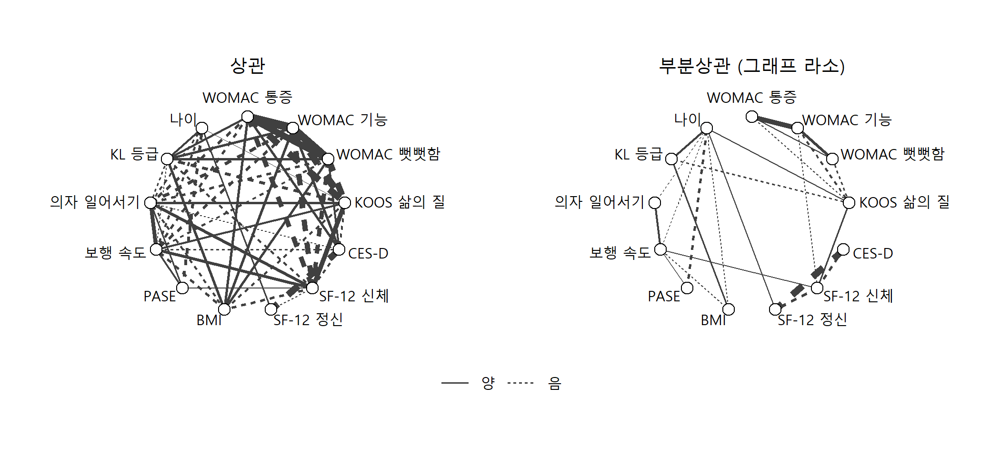

# 그래프 모형 1장. 부분상관 네트워크 — 통증, 기능, 우울은 서로 어떻게 연결되는가


- [I. 질문과 데이터](#i-질문과-데이터)
- [II. 부분상관](#ii-부분상관)
- [III. 정밀도 행렬](#iii-정밀도-행렬)
- [IV. 정규 그래프 모형](#iv-정규-그래프-모형)
- [V. 그래프 라쏘](#v-그래프-라쏘)
- [VI. 그래프를 읽는 법](#vi-그래프를-읽는-법)
- [VII. 노드를 고르는 일](#vii-노드를-고르는-일)
- [VIII. 해석](#viii-해석)
- [IX. (선택) 가정의 점검](#ix-선택-가정의-점검)
- [X. 이 방법을 사용한 연구](#x-이-방법을-사용한-연구)
- [참고문헌](#참고문헌)

지금까지의 장은 결과 변수 하나를 정하고 그것을 다른 변수로 설명했다. 통증을 구조 손상으로, 치환술(total knee replacement)을 기능으로, 통증을 운동으로 설명하는 식이다. 재활에서 다루는 변수들은 그렇게 한 방향으로만 놓이지 않는다. 통증은 기능을 떨어뜨리고, 기능이 떨어지면 활동이 줄고, 활동이 줄면 체중이 늘고, 체중은 다시 무릎에 부담을 준다. 우울은 이 모든 것과 얽혀 있다. 어느 하나를 결과로 정하지 않고 여러 변수 사이의 관계를 한꺼번에 보려면 다른 도구가 필요하다.

이 장은 그 도구로 그래프 모형(graphical model)을 소개한다. 변수를 점(노드)으로, 두 변수 사이의 관계를 선(엣지, edge)으로 나타낸다. 핵심은 엣지가 무엇을 뜻하는지다. 두 변수가 상관되어 있다는 것만으로는 엣지를 긋지 않는다. 나머지 변수를 모두 조건으로 둔 뒤에도 남는 연관이 있을 때만 엣지를 긋는다. 그 연관을 측정하는 것이 부분상관(partial correlation)이다. 부분상관의 정의(II장), 그것을 한꺼번에 구하는 정밀도 행렬(III장), 부분상관으로 그린 그래프와 그 검정(IV장), 약한 엣지를 0으로 만드는 그래프 라쏘(V장), 그래프를 읽는 법(VI장), 노드를 고르는 일이 결과를 어떻게 바꾸는지(VII장)의 순서로 간다.

## I. 질문과 데이터

### 1. 상관은 다른 변수를 거친 것일 수 있다

회귀 1장은 X선의 구조 손상(KL 등급)과 통증의 상관이 약하다는 것을 보였다. 약하지만 0은 아니다. 그 상관은 무엇을 거쳐 생기는가. 구조 손상이 직접 통증을 만든다면, 다른 조건이 모두 같은 두 사람 가운데 손상이 큰 쪽이 더 아플 것이다. 구조 손상이 기능을 떨어뜨리고 기능이 떨어진 사람이 통증을 더 보고하는 것이라면, 기능이 같은 두 사람 사이에서는 손상과 통증이 무관할 것이다. 두 경우에 손상과 통증의 상관은 같을 수 있다. 둘을 구분하려면 기능을 조건으로 둔 뒤의 연관을 보아야 한다.

변수가 셋이면 조건으로 둘 변수가 하나다. 변수가 13개이면 두 변수의 쌍이 78개이고, 쌍마다 나머지 11개를 조건으로 둔 연관을 물을 수 있다. 그래프 모형은 이 78개의 질문에 한꺼번에 답하고 그 답을 그림 하나로 요약한다.

### 2. 데이터

데이터는 OAI의 기준 방문이다. 사람 하나가 한 행이므로 회귀 1장과 종단 분석 1장에서 다룬 군집(cluster)의 문제는 없다. 무릎마다 측정한 값은 두 무릎 가운데 나쁜 쪽을 쓰고, KL 등급은 높은 쪽을 사용한다. 노드는 13개다. 무릎의 증상(WOMAC 통증, 기능, 뻣뻣함, KOOS 삶의 질), 심리(CES-D), 전반적 건강(SF-12의 신체와 정신 요약 점수, BMI), 활동과 수행(PASE 총점, 20m 보행 속도, 의자에서 다섯 번 일어서는 속도), 구조(KL 등급), 나이다. 척도의 뜻은 데이터 1장 III장에 있다. 노드가 모두 관측된 4,177명을 사용한다.

표 1은 노드마다 평균, 표준편차, 가장 낮은 값에 있는 사람의 비율을 제시한 것이다. 마지막 열은 그 척도에서 값이 클수록 상태가 나쁜지를 적었다. 엣지의 부호를 해석할 때 필요하다.

**표 1. 노드의 분포 (기준 방문)**

| 노드          |  평균 | 표준편차 | 최저값의 비율(%) | 값이 클수록 |
|:--------------|------:|---------:|-----------------:|:------------|
| WOMAC 통증    |   3.3 |      3.6 |             28.7 | 나쁨        |
| WOMAC 기능    |  10.0 |     11.5 |             24.7 | 나쁨        |
| WOMAC 뻣뻣함  |   1.9 |      1.7 |             29.7 | 나쁨        |
| KOOS 삶의 질  |  68.3 |     21.9 |              0.4 | 좋음        |
| CES-D         |   6.4 |      6.8 |             12.8 | 나쁨        |
| SF-12 신체    |  49.5 |      8.7 |              0.0 | 좋음        |
| SF-12 정신    |  53.7 |      7.9 |              0.0 | 좋음        |
| BMI           |  28.5 |      4.8 |              0.0 |             |
| PASE          | 162.8 |     81.0 |              0.1 | 활동적      |
| 보행 속도     |   1.3 |      0.2 |              0.0 | 좋음        |
| 의자 일어서기 |   0.5 |      0.2 |              0.0 | 좋음        |
| KL 등급       |   1.6 |      1.3 |             28.5 | 나쁨        |
| 나이          |  61.0 |      9.1 |              1.5 |             |

표에서 WOMAC의 세 점수는 가장 낮은 값인 0점에 많은 사람이 몰려 있다. 통증이 0점인 사람이 29%다. 데이터 1장에서 본 바닥 효과(floor effect)다. 이 장의 방법은 변수들이 다변량 정규분포를 따른다고 가정하므로 이 분포는 가정에 맞지 않는다. 그 영향은 IX장에서 점검한다. 변수마다 단위가 다르므로 아래의 계산은 모두 상관행렬에서 출발한다.

## II. 부분상관

### 1. 정의

두 변수 $X_j$, $X_k$와 조건으로 둘 변수들의 벡터 $Z$가 있다. $X_j$를 $Z$에 회귀한 잔차를 $e_j$, $X_k$를 $Z$에 회귀한 잔차를 $e_k$라 하자. 잔차는 그 변수에서 $Z$로 설명되는 부분을 뺀 나머지다. 두 잔차의 상관이 $Z$를 조건으로 둔 $X_j$와 $X_k$의 부분상관이다.

$$\rho_{jk \cdot Z} = \mathrm{Cor}(e_j, e_k), \qquad e_j = X_j - \hat E[X_j \mid Z], \quad e_k = X_k - \hat E[X_k \mid Z]$$

$Z$가 변수 하나일 때는 세 상관으로 바로 쓸 수 있다.

$$\rho_{jk \cdot z} = \frac{\rho_{jk} - \rho_{jz}\rho_{kz}}{\sqrt{(1 - \rho_{jz}^2)(1 - \rho_{kz}^2)}}$$

분자가 이 식의 뜻을 보여 준다. 두 변수의 상관 $\rho_{jk}$에서, 둘이 각각 $z$와 상관되어 있어서 생기는 몫 $\rho_{jz}\rho_{kz}$를 뺀다. $j$와 $k$의 상관이 모두 $z$를 거친 것이면 분자가 0이 된다.

부분상관은 회귀 계수와 동일한 정보를 담는다. $X_j$를 $X_k$와 $Z$에 회귀했을 때 $X_k$의 계수가 0이면 부분상관도 0이고, 부호도 같다. 인과 추론 1장 II장에서 PASE의 계수가 통제 변수를 늘릴수록 0으로 간 것을 부분상관으로 다시 말하면, 우울과 동반질환을 조건으로 둔 PASE와 통증의 부분상관이 0에 가깝다는 것이다. 차이는 대칭성이다. 회귀 계수는 어느 쪽을 결과로 두는지에 따라 값이 달라지지만 부분상관은 두 변수에 대칭이다.

### 2. 변수 셋의 예

통증, KL 등급, 기능 셋으로 계산해 본다. 통증과 KL 등급의 상관은 0.26이다. 통증과 기능의 상관은 0.85, KL 등급과 기능의 상관은 0.28이다. 통증을 기능에 회귀한 잔차와 KL 등급을 기능에 회귀한 잔차의 상관을 구하면 0.05이다. 위의 식에 세 상관을 넣어도 같은 값 0.05가 나온다.

통증과 KL 등급의 상관 0.26 가운데 기능을 조건으로 두고 남는 것은 0.05이다. 기능이 같은 사람들 사이에서는 X선 손상이 큰 사람이 통증을 더 보고하는 정도가 그만큼 약하다는 뜻이다. 이 결과를 “구조 손상은 통증에 직접 영향을 주지 않는다”로 해석할 수는 없다. 그 이유는 VII장과 VIII장에서 다룬다.

## III. 정밀도 행렬

### 1. 역행렬 하나로 모든 부분상관을 구한다

변수가 13개이면 쌍 78개마다 회귀를 두 번씩 해야 한다. 그럴 필요가 없다. 공분산 행렬의 역행렬에 모든 부분상관이 들어 있다. 공분산 행렬을 $\Sigma$, 그 역행렬을 $\Theta = \Sigma^{-1}$라 하고 $\Theta$의 원소를 $\theta_{jk}$라 하면, 나머지 변수를 모두 조건으로 둔 $j$와 $k$의 부분상관은 다음과 같다.

$$\rho_{jk \cdot \mathrm{rest}} = -\frac{\theta_{jk}}{\sqrt{\theta_{jj}\theta_{kk}}}$$

$\Theta$를 정밀도 행렬(precision matrix)이라 한다. 대각 원소 $\theta_{jj}$는 $X_j$를 나머지 모든 변수에 회귀한 잔차 분산의 역수다. 비대각 원소 $\theta_{jk}$는 그 회귀에서 $X_k$의 계수에 비례한다. 그래서 정밀도 행렬의 한 행은 그 변수를 나머지에 회귀한 결과를 담고 있고, 행렬 전체는 13개의 회귀를 한꺼번에 담고 있다. 부호가 음인 것에 주의한다. $\theta_{jk}$가 음수이면 부분상관이 양수다.

R에서는 두 줄이다. `R`은 상관행렬이다.

``` r
Theta <- solve(R)
partial <- -cov2cor(Theta)
```

### 2. 0인 원소와 조건부 독립

변수들이 다변량 정규분포를 따르면 $\theta_{jk} = 0$은 조건부 독립(conditional independence)과 같다(Lauritzen, 1996).

$$\theta_{jk} = 0 \iff X_j \perp X_k \mid X_{\mathrm{rest}}$$

나머지 변수의 값을 알고 나면 $X_k$가 $X_j$에 대해 더 알려 주는 것이 없다는 뜻이다. 정규분포가 아니면 부분상관이 0이라는 것은 선형 관계가 남지 않았다는 뜻일 뿐이고, 비선형 의존은 남아 있을 수 있다.

상관행렬과 정밀도 행렬은 서로 다른 질문에 답한다. 상관행렬의 원소가 0이면 두 변수가 주변적으로 무관하고, 정밀도 행렬의 원소가 0이면 조건부로 무관하다. 한쪽이 0이라고 다른 쪽이 0이 되지 않는다. 상관은 있는데 부분상관이 0일 수 있고(제3의 변수를 거친 연관), 상관은 0에 가까운데 부분상관이 클 수도 있다(IV.2절의 예).

## IV. 정규 그래프 모형

### 1. 그래프

정규 그래프 모형(Gaussian graphical model)은 정밀도 행렬의 0이 아닌 원소를 엣지로 그린 것이다. 노드는 변수이고, $\theta_{jk} \ne 0$이면 $j$와 $k$ 사이에 엣지를 긋는다. 엣지가 없는 두 노드는 나머지를 조건으로 두면 독립이다. 엣지에는 방향이 없다. 부분상관이 대칭이기 때문이다.

그래프에서 조건부 독립을 알아내는 규칙은 하나다. 두 노드 사이의 모든 경로가 어떤 노드 집합을 지나야 한다면, 그 집합을 조건으로 두었을 때 두 노드는 독립이다. 통증과 KL 등급 사이에 엣지가 없고 둘을 잇는 경로가 모두 기능을 지난다면, 기능을 알면 KL 등급은 통증에 대해 더 알려 주는 것이 없다.

### 2. 표본에서의 추정

표본에서는 정밀도 행렬의 원소가 정확히 0으로 나오지 않는다. 가장 단순한 방법은 표본 상관행렬의 역행렬로 부분상관을 모두 구하고, 하나씩 0인지 검정하는 것이다. 표본 부분상관 $r$에 Fisher 변환을 하면 근사적으로 정규분포를 따른다. $n$은 표본 크기, $p$는 변수의 수다.

$$z = \frac{1}{2}\log\frac{1 + r}{1 - r}, \qquad \sqrt{n - p - 1} \ z \ \sim \ N(0, 1)$$

**표 2. 부분상관의 절대값이 큰 10쌍**

| 두 노드                  |  상관 | 부분상관 |
|:-------------------------|------:|---------:|
| CES-D, SF-12 정신        | -0.70 |    -0.73 |
| WOMAC 통증, WOMAC 기능   |  0.85 |     0.57 |
| SF-12 신체, SF-12 정신   | -0.13 |    -0.39 |
| WOMAC 기능, WOMAC 뻣뻣함 |  0.76 |     0.33 |
| CES-D, SF-12 신체        | -0.21 |    -0.31 |
| PASE, 나이               | -0.33 |    -0.27 |
| KL 등급, 나이            |  0.22 |     0.26 |
| WOMAC 기능, KOOS 삶의 질 | -0.73 |    -0.25 |
| 보행 속도, 의자 일어서기 |  0.40 |     0.22 |
| BMI, KL 등급             |  0.25 |     0.21 |

표 2는 78쌍 가운데 부분상관의 절대값이 큰 순서로 10쌍의 상관과 부분상관을 함께 제시한 것이다. 부분상관은 나머지 11개 노드를 모두 조건으로 둔 값이다.

표에서 가장 굵은 연결은 같은 것을 다른 문항으로 측정하는 척도들 사이에 있다. CES-D와 SF-12 정신 점수의 부분상관은 -0.73, WOMAC 통증과 기능은 0.57이다. 통증과 기능의 상관은 0.85이지만 부분상관은 그보다 작다. 둘의 상관 가운데 일부는 뻣뻣함, 삶의 질과 함께 움직이는 몫이었다.

상관보다 부분상관이 큰 쌍도 있다. 가장 두드러진 쌍은 SF-12 신체, SF-12 정신이며 상관은 -0.13, 부분상관은 -0.39이다. 조건으로 둔 변수가 두 변수와 서로 반대 방향으로 관련되어 있으면, 그 변수를 조건으로 두기 전에는 두 변수의 연관이 가려져 있다가 조건으로 두면 드러난다. SF-12의 신체 점수와 정신 점수가 그 예다. 두 점수는 같은 12문항에 서로 다른 가중치를 주어 만들고, 서로 상관이 낮아지도록 설계되어 있다. 우울 점수를 조건으로 두면 그 설계가 만든 음의 관계가 드러난다. 이 엣지는 사람의 신체 건강과 정신 건강 사이의 관계가 아니라 점수를 만드는 방식에서 온 것이다.

78쌍을 하나씩 검정하면 5% 수준에서 0과 구분되는 것이 47쌍이고, 검정의 수를 Bonferroni 방법으로 보정해도 36쌍이다. 부분상관의 절대값이 0.1을 넘는 것은 24쌍이다. 유의한 쌍이 많은 것은 표본이 4,177명으로 크기 때문이다. 이 표본에서는 부분상관 0.030도 5% 수준에서 유의하다. 유의하다는 것과 크다는 것은 다르고, 엣지를 그을지를 유의성만으로 정하면 표본이 클수록 그래프가 빽빽해진다.

## V. 그래프 라쏘

### 1. 벌점을 준 추정

쌍마다 검정해서 엣지를 정하는 방법에는 두 가지 문제가 있다. 검정이 많아 기준을 정하기 어렵고, 표본이 작을 때는 표본 상관행렬의 역행렬 자체가 불안정하다. 변수의 수가 표본 크기에 가까워지면 역행렬의 원소가 크게 흔들리고, 변수가 표본보다 많으면 역행렬이 없다.

그래프 라쏘(graphical lasso; Friedman et al., 2008)는 정밀도 행렬을 추정할 때 비대각 원소의 절대값에 벌점을 준다. 표본 공분산 행렬을 $S$라 하면 다음을 최대화한다.

$$\hat\Theta_\lambda = \arg\max_{\Theta \succ 0} \left\lbrace \log\det\Theta - \mathrm{tr}(S\Theta) - \lambda \sum_{j \ne k} |\theta_{jk}| \right\rbrace$$

앞의 두 항은 다변량 정규분포의 로그가능도다. 셋째 항이 벌점이다. 절대값에 주는 벌점은 작은 원소를 0에 가깝게 줄이는 데서 그치지 않고 정확히 0으로 만든다. 선형 회귀(linear regression)의 라쏘가 계수를 0으로 만드는 것과 같은 원리다. $\lambda$가 0이면 벌점이 없는 추정이고, $\lambda$가 커질수록 엣지가 줄어들어 충분히 크면 엣지가 하나도 남지 않는다. 추정과 엣지의 선택이 한 번에 이루어진다.

### 2. 벌점의 크기를 고르기

$\lambda$는 정보 기준으로 고른다. 여러 $\lambda$에서 피팅하고, 적합도와 엣지의 수를 함께 반영한 기준이 가장 작은 것을 고른다. 그래프 모형에서는 확장 베이즈 정보 기준(EBIC)을 흔히 사용한다(Chen and Chen, 2008; Foygel and Drton, 2010). $\ell$은 로그가능도, $|E|$는 0이 아닌 엣지의 수다.

$$\mathrm{EBIC}_\gamma = -2\ell(\hat\Theta_\lambda) + |E| \log n + 4\gamma |E| \log p, \qquad \ell(\Theta) = \frac{n}{2}\left\lbrace \log\det\Theta - \mathrm{tr}(S\Theta) \right\rbrace$$

둘째 항까지가 보통의 BIC이고, 셋째 항은 후보가 되는 그래프의 수가 많다는 점을 반영해 엣지에 벌점을 더 준다. $\gamma$는 0에서 1 사이에서 정하며 0.5가 관행이다(Epskamp and Fried, 2018). $\gamma$가 클수록 성긴 그래프가 선택된다.

**표 3. 벌점의 크기에 따른 엣지의 수와 EBIC (전체 표본)**

|      λ | 엣지의 수 | 로그가능도 |   EBIC |
|-------:|----------:|-----------:|-------:|
| 0.5000 |         9 |    -23,586 | 47,293 |
| 0.1398 |        40 |    -17,571 | 35,680 |
| 0.0339 |        51 |    -15,841 | 32,369 |
| 0.0145 |        58 |    -15,658 | 32,097 |
| 0.0082 |        66 |    -15,612 | 32,112 |
| 0.0020 |        71 |    -15,580 | 32,117 |

표 3은 $\lambda$를 0.5에서 0.002까지 40단계로 줄여 가며 피팅한 결과 가운데 일부다. 엣지의 수는 정밀도 행렬의 비대각 원소 가운데 0이 아닌 것의 수이고, EBIC가 가장 작은 행이 선택된 모형이다.

표에서 $\lambda$가 작아질수록 엣지가 늘고 로그가능도가 커진다. EBIC는 $\lambda$ = 0.0145에서 가장 작고, 이때 78쌍 가운데 58쌍에 엣지가 남는다. 벌점이 없는 추정과 비교하면 부분상관의 가장 큰 차이가 0.07이다. 표본이 4,177명이고 변수가 13개이므로 벌점이 없는 추정도 이미 안정적이고, 그래프 라쏘는 0에 가까운 엣지를 지우는 일만 한다.

### 3. 표본이 작을 때

벌점이 왜 필요한지는 표본이 작을 때 드러난다. 전체 표본에서 무작위로 100명을 뽑아 벌점이 없는 추정과 그래프 라쏘를 각각 피팅하고, 전체 표본의 벌점 없는 추정을 기준값으로 삼아 비교한다. 이것을 100번 되풀이했다. 표 4는 그 평균이다. 첫 행은 78쌍의 부분상관이 기준값에서 벗어난 정도(평균제곱오차의 제곱근)이고, 둘째 행은 기준값의 절대값이 0.05보다 작은데 100명의 추정에서 0.15를 넘은 엣지의 수다. 없는 엣지를 있다고 그리게 되는 경우를 센 것이다.

**표 4. 100명의 부분 표본에서 두 추정의 비교 (100회 반복의 평균)**

| 지표                            | 벌점 없는 추정 | 그래프 라쏘 |
|:--------------------------------|---------------:|------------:|
| 부분상관의 오차(RMSE)           |          0.105 |       0.095 |
| 없는 엣지를 0.15 넘게 추정한 수 |            7.0 |         0.2 |
| 0이 아닌 엣지의 수              |             78 |        28.8 |

표에서 100명으로 추정하면 벌점이 없는 추정은 실제로는 0에 가까운 엣지 가운데 평균 7.0개를 0.15보다 크게 추정한다. 그래프 라쏘에서는 그 수가 0.2개다. 부분상관의 오차는 벌점 없는 추정이 0.105, 그래프 라쏘가 0.095이다. 그래프 라쏘가 남긴 엣지는 평균 29개다. 벌점은 표본이 감당할 수 있는 만큼만 엣지를 남긴다. 대가도 있다. 남은 엣지의 부분상관은 0 쪽으로 줄어들어 있고, 실제로 있는 약한 엣지는 지워진다. 그래프 라쏘로 그린 그래프에 엣지가 없다는 것은 그 표본으로는 엣지를 확인하지 못했다는 뜻이지 엣지가 없다는 증거가 아니다.

재활 연구의 표본은 100명 안팎인 경우가 많고, 문항 수준으로 내려가면 노드가 수십 개가 된다. 그런 데이터에서 벌점 없이 그린 그래프는 표 4의 첫 열과 동일한 상태에 있다.

## VI. 그래프를 읽는 법

### 1. 두 그래프

그림 1은 전체 표본의 두 그래프다. 왼쪽은 상관으로, 오른쪽은 그래프 라쏘가 추정한 부분상관으로 그렸다. 두 그래프 모두 절대값이 0.1 이상인 것만 선으로 그었고, 선의 굵기는 절대값에 비례한다. 실선은 양의 값, 점선은 음의 값이다. 노드는 원 위에 표 1의 순서대로 놓았다.



그림에서 상관 그래프는 78쌍 가운데 54쌍에 선이 있고, 부분상관 그래프는 24쌍에 선이 있다. 상관 그래프에서는 거의 모든 노드가 서로 이어져 있다. 무릎이 나쁜 사람은 통증, 기능, 삶의 질, 보행 속도가 함께 나쁘므로 이 변수들은 모두 서로 상관된다. 부분상관 그래프는 그 가운데 다른 노드를 거치지 않고 남는 연결만 보여 준다.

### 2. 읽을 때의 규칙

부분상관 그래프를 볼 때 지킬 것은 넷이다.

첫째, 엣지는 나머지 노드를 모두 조건으로 둔 연관이다. 통증과 기능 사이의 굵은 실선은 삶의 질, 우울, 보행 속도 등이 같은 사람들 사이에서도 통증이 높은 사람이 기능이 나쁘다는 뜻이다.

둘째, 부호는 척도의 방향과 함께 해석한다. 표 1의 마지막 열에서 보듯 WOMAC과 CES-D는 클수록 나쁘고 KOOS 삶의 질과 SF-12는 클수록 좋다. WOMAC 기능과 KOOS 삶의 질 사이의 점선은 기능이 나쁜 사람이 삶의 질이 낮다는 뜻이며, 방향이 반대인 두 척도 사이의 음의 관계는 예상한 것이다.

셋째, 노드의 위치와 노드 사이의 거리에는 뜻이 없다. 이 그림은 노드를 원 위에 정해진 순서로 놓았다. 네트워크 분석에서 흔히 쓰는 배치 알고리듬은 연결이 많은 노드를 가운데로 모으는데, 그 위치는 알고리듬과 난수에 따라 달라지고 그림을 그릴 때마다 바뀔 수 있다. 가까이 놓인 노드가 더 강하게 연결된 것이 아니다. 뜻이 있는 것은 엣지의 유무와 굵기와 부호뿐이다.

넷째, 엣지가 많은 노드를 중요한 노드로 해석하지 않는다. 노드에 붙은 엣지의 수나 굵기의 합을 중심성이라 부르고 그 값이 큰 노드를 개입의 표적으로 해석하는 관행이 있다. 중심성은 어떤 노드를 그래프에 넣었는지에 따라 달라지고(VII장), 표본에 따라서도 크게 흔들린다. 이 장은 중심성을 계산하지 않는다.

## VII. 노드를 고르는 일

### 1. 거의 같은 것을 측정하는 노드

II.2절에서 기능을 조건으로 두자 통증과 KL 등급의 연관이 거의 사라졌다. 그림 1의 부분상관 그래프에서도 통증과 KL 등급, 통증과 우울, 통증과 BMI 사이에는 선이 없다. 이것을 구조 손상, 우울, 체중이 통증과 직접 관련되지 않는다는 결과로 해석하기 전에 조건으로 둔 변수가 무엇인지를 보아야 한다.

WOMAC의 통증, 기능, 뻣뻣함은 같은 설문의 세 부분이고 같은 무릎의 같은 시기에 대한 응답이다. 통증 문항은 걸을 때, 계단을 오를 때의 통증을 묻고, 기능 문항은 걷기와 계단 오르기가 얼마나 어려운지를 묻는다. 기능 점수를 조건으로 둔다는 것은 통증과 거의 같은 것을 측정하는 변수를 고정한다는 뜻이다. 그러고 나면 통증에 남는 변동은 기능 점수가 담지 못한 작은 몫뿐이고, 그 몫이 KL 등급이나 우울과 관련될 여지는 작다.

노드를 바꾸어 다시 추정하면 이 점이 드러난다. 표 5는 통증과 다른 노드의 부분상관을 세 가지 노드 집합에서 구한 것이다. 첫째는 13개 노드 전부, 둘째는 WOMAC 기능과 뻣뻣함을 뺀 집합, 셋째는 KOOS 삶의 질까지 뺀 집합이다. KOOS 삶의 질도 무릎 때문에 겪는 불편을 묻는 점수다. 모두 벌점이 없는 추정이다.

**표 5. 노드 집합에 따른 WOMAC 통증의 부분상관**

| 통증과의 쌍   |  상관 | 노드 전부 | 기능, 뻣뻣함 제외 | 삶의 질도 제외 |
|:--------------|------:|----------:|------------------:|---------------:|
| KL 등급       |  0.26 |      0.03 |              0.04 |           0.18 |
| CES-D         |  0.26 |      0.01 |              0.04 |           0.04 |
| BMI           |  0.26 |     -0.00 |              0.06 |           0.05 |
| SF-12 신체    | -0.53 |     -0.07 |             -0.21 |          -0.41 |
| 보행 속도     | -0.28 |     -0.01 |             -0.07 |          -0.06 |
| 의자 일어서기 | -0.30 |      0.01 |             -0.07 |          -0.12 |
| PASE          | -0.03 |      0.01 |              0.04 |           0.06 |
| 나이          | -0.04 |     -0.05 |             -0.01 |          -0.11 |
| SF-12 정신    | -0.10 |     -0.01 |             -0.04 |          -0.09 |
| KOOS 삶의 질  | -0.68 |     -0.11 |             -0.51 |                |

표에서 통증의 부분상관은 무엇을 조건으로 두는지에 따라 달라진다. 통증과 KL 등급의 부분상관은 노드 전부에서 0.03, 기능과 뻣뻣함을 빼면 0.04, 삶의 질까지 빼면 0.18이다. 통증과 SF-12 신체 점수는 -0.07에서 -0.21, -0.41로 달라진다. 무릎 증상을 측정하는 다른 점수를 조건에서 빼면 통증이 그 점수들이 맡고 있던 자리를 대신하고, 다른 노드와의 연결이 통증에 붙는다. 모든 쌍이 그렇게 달라지는 것은 아니다. 통증과 CES-D의 부분상관은 세 집합 어디에서도 0.04을 넘지 않고, 통증과 BMI도 0.06을 넘지 않는다. 이 두 쌍 사이에는 SF-12의 두 점수처럼 세 집합에 모두 남아 있는 노드가 있다.

### 2. 그래프는 노드 집합에 대한 진술이다

어느 집합이 옳은가는 통계가 정해 주지 않는다. 질문이 정한다. 통증이 기능과 별개로 구조 손상과 관련되는지를 묻는다면 기능을 넣어야 한다. 무릎의 증상 전체가 구조 손상과 관련되는지를 묻는다면 증상을 대표하는 노드 하나만 넣어야 한다. 두 그래프는 서로 다른 질문의 답이고 둘 다 맞다.

실제 분석에서 지킬 것은 둘이다. 같은 것을 측정하는 척도를 여러 개 넣으면 그 척도들끼리 굵은 엣지로 묶이고 다른 노드와의 엣지는 그 가운데 하나에만 붙거나 사라진다. 척도의 겹침이 그래프의 모양을 정하게 된다. 그리고 그래프를 보고할 때는 어떤 노드를 넣었고 왜 넣었는지를 함께 밝힌다. “통증과 우울 사이에는 엣지가 없다”는 문장은 조건으로 둔 노드의 목록 없이는 뜻이 정해지지 않는다.

## VIII. 해석

### 1. 엣지는 인과가 아니다

부분상관 그래프의 엣지에는 방향이 없고, 한 시점의 데이터로는 방향을 정할 수 없다. 통증과 기능 사이의 엣지는 통증이 기능을 떨어뜨려서 생겼을 수도, 기능이 나쁜 사람이 통증을 더 느껴서 생겼을 수도, 둘 다 관측하지 않은 무릎의 상태에서 나왔을 수도 있다. 인과 추론 1장이 활동량과 통증에 대해 물은 방향의 질문은 이 그래프로 답할 수 없다.

엣지가 없다는 것도 인과가 없다는 뜻이 아니다. 구조 손상이 기능을 거쳐 통증에 영향을 준다면, 기능을 조건으로 둔 그래프에서 손상과 통증 사이에 엣지가 없는 것이 맞다. 그 경우 손상은 통증의 원인이지만 엣지는 없다. 조건으로 둔 변수가 원인과 결과 사이의 경로 위에 있으면 그 경로를 통한 영향은 부분상관에서 빠진다. 인과 추론 2장 VIII.2절에서 처치의 영향을 받은 변수를 보정하면 효과의 일부가 제거된다고 한 것과 같은 원리다.

### 2. 조건으로 두어서 생기는 엣지

조건으로 두는 것이 연관을 없애기만 하는 것은 아니다. 서로 무관한 두 변수가 제3의 변수에 함께 영향을 줄 때, 그 변수를 조건으로 두면 두 변수 사이에 없던 연관이 생긴다(Hernán and Robins, 2020). 통증과 근력 저하가 서로 무관하게 보행 속도를 떨어뜨린다고 하자. 보행 속도가 같은 사람들만 보면, 통증이 심하지 않은데 그만큼 느리다는 것은 근력이 약하다는 뜻이므로 통증과 근력 사이에 음의 연관이 나타난다. IV.2절에서 본 SF-12의 두 점수 사이의 엣지도 조건으로 두어서 드러난 것이다.

부분상관 그래프는 모든 노드를 서로의 조건으로 둔다. 어떤 노드가 다른 두 노드의 공통 결과이면 그 두 노드 사이에 엣지가 그려진다. 방향이 있는 인과 그래프를 방향 없는 그래프로 옮길 때 공통 결과를 가진 두 원인을 엣지로 잇는 것은 이 때문이다. 그래서 부분상관 그래프의 엣지는 직접적인 인과 관계가 있을 수 있는 쌍의 후보이기는 하지만, 그 쌍만 포함하지도 않고 그 쌍을 모두 포함하지도 않는다.

### 3. 이 그래프가 말해 주는 것

그림 1의 부분상관 그래프에서 알 수 있는 것은 다음 정도다. 무릎의 증상을 측정하는 네 점수는 서로 강하게 묶여 있다. 수행 검사 둘(보행 속도, 의자 일어서기)은 서로 이어져 있고 나이, 신체 건강 점수와 이어져 있다. 우울 점수는 SF-12의 정신 점수와 묶여 있고 무릎의 증상과는 직접 이어지지 않는다. KL 등급은 나이, BMI, 삶의 질과 이어지고 통증과는 직접 이어지지 않는다.

이것은 변수들이 어떤 묶음으로 함께 움직이는지에 대한 기술이다. 통증에 관한 연구를 설계할 때 무엇을 함께 측정하고 무엇을 통제 변수로 고려할지를 정하는 데 쓸 수 있고, 척도들이 얼마나 겹치는지를 확인하는 데 쓸 수 있다. 어디에 개입해야 하는지는 이 그래프가 말해 주지 않는다.

## IX. (선택) 가정의 점검

### 1. 정규 가정

부분상관이 0이라는 것이 조건부 독립과 같으려면 변수들이 다변량 정규분포를 따라야 한다. 표 1에서 보았듯 WOMAC 점수는 0에 몰려 있고 KL 등급은 값이 다섯 가지인 순서 척도(ordinal scale)다. 한 가지 대안은 변수마다 단조 변환을 하면 다변량 정규가 된다고 가정하는 것이다(Liu et al., 2009). 그 가정 아래에서는 순위에 기반한 상관으로 같은 계산을 할 수 있다. 여기서는 Pearson 상관 대신 Spearman 순위상관(rank correlation)으로 상관행렬을 만들고 같은 식으로 부분상관을 구해 비교한다.

78쌍에서 두 방식의 부분상관은 상관이 0.986이다. 가장 크게 다른 쌍은 CES-D, SF-12 정신이며 Pearson 기반이 -0.73, Spearman 기반이 -0.59이다. 부분상관의 절대값이 0.1을 넘는 쌍 가운데 두 방식에서 부호가 다른 것은 없다. 이 데이터에서는 정규 가정이 깨진 정도가 그래프의 모양을 바꾸지 않는다. 엣지의 굵기는 일부 달라진다. 이 점검을 nonparanormal 모형으로 세워 다시 추정하고, 그 결과를 시뮬레이션으로 확인한 분석은 Nonparanormal 그래프 모형 장(연구 탭)에 있다.

### 2. 엣지의 안정성

추정한 엣지가 표본에 따라 얼마나 흔들리는지는 붓스트랩(bootstrap)으로 본다(Epskamp et al., 2018). 사람을 복원 추출로 다시 뽑아 부분상관을 다시 구하는 일을 300번 되풀이하고, 쌍마다 2.5%와 97.5% 분위수를 신뢰구간으로 삼는다. 표 6은 표 2의 쌍 가운데 위의 다섯과, 통증과 KL 등급의 쌍에 대한 결과다.

**표 6. 부분상관의 붓스트랩 95% 신뢰구간 (벌점 없는 추정)**

| 두 노드                  | 부분상관 |  하한 |  상한 |
|:-------------------------|---------:|------:|------:|
| CES-D, SF-12 정신        |    -0.73 | -0.75 | -0.71 |
| WOMAC 통증, WOMAC 기능   |     0.57 |  0.54 |  0.60 |
| SF-12 신체, SF-12 정신   |    -0.39 | -0.42 | -0.37 |
| WOMAC 기능, WOMAC 뻣뻣함 |     0.33 |  0.30 |  0.36 |
| CES-D, SF-12 신체        |    -0.31 | -0.34 | -0.28 |
| WOMAC 통증, KL 등급      |     0.03 |  0.00 |  0.06 |

78쌍 가운데 신뢰구간이 0을 포함하지 않는 것은 47쌍이고, 신뢰구간의 폭은 평균 0.06이다. 표본이 4,177명이어서 엣지 하나하나가 좁은 구간으로 추정된다. 표 4의 100명 표본이라면 같은 구간의 폭이 여러 배로 넓어진다. 표본이 작은 연구에서 그래프를 보고할 때는 엣지마다 이 구간을 함께 제시해야 어느 엣지를 믿을 수 있는지를 독자가 판단할 수 있다.

## X. 이 방법을 사용한 연구

부분상관 네트워크는 2010년대에 심리학에서 증상들 사이의 관계를 기술하는 방법으로 널리 퍼졌고, 만성 통증과 재활 분야로 넓어지고 있다. 이 분야의 연구는 대개 `qgraph`와 `bootnet`이라는 R 패키지를 사용한다. 이 장이 직접 계산한 그래프 라쏘와 EBIC, 붓스트랩을 한 번에 해 주고, 노드의 배치와 중심성 지표까지 낸다(Epskamp and Fried, 2018; Epskamp et al., 2018).

OAI에 이 방법을 적용한 연구로 Solmi et al. (2020)이 있다. OAI 참가자의 데이터에서 우울 증상, 인구학적 특성, 영양, 삶의 질, 질병 요인을 노드로 두고 벌점을 준 부분상관 네트워크를 추정했다. 그 연구는 우울 증상을 중심에 두고 식습관과 소득, 교육 같은 생활 요인을 넓게 넣었고, 이 장은 무릎의 증상과 구조를 중심에 두었다. 두 그래프의 노드가 다르므로 엣지를 직접 비교할 수는 없다. VII장에서 본 대로 그래프는 고른 노드 집합에 대한 진술이다.

## 참고문헌

Chen, J., and Chen, Z. (2008). “Extended Bayesian information criteria for model selection with large model spaces.” *Biometrika* 95(3), 759–771.

Epskamp, S., Borsboom, D., and Fried, E. I. (2018). “Estimating psychological networks and their accuracy: A tutorial paper.” *Behavior Research Methods* 50(1), 195–212.

Epskamp, S., and Fried, E. I. (2018). “A tutorial on regularized partial correlation networks.” *Psychological Methods* 23(4), 617–634.

Foygel, R., and Drton, M. (2010). “Extended Bayesian information criteria for Gaussian graphical models.” *Advances in Neural Information Processing Systems* 23, 604–612.

Friedman, J., Hastie, T., and Tibshirani, R. (2008). “Sparse inverse covariance estimation with the graphical lasso.” *Biostatistics* 9(3), 432–441.

Hernán, M. A., and Robins, J. M. (2020). *Causal Inference: What If*. Chapman and Hall/CRC.

Lauritzen, S. L. (1996). *Graphical Models*. Oxford University Press.

Liu, H., Lafferty, J., and Wasserman, L. (2009). “The nonparanormal: Semiparametric estimation of high dimensional undirected graphs.” *Journal of Machine Learning Research* 10, 2295–2328.

Solmi, M., Koyanagi, A., Thompson, T., Fornaro, M., Correll, C. U., and Veronese, N. (2020). “Network analysis of the relationship between depressive symptoms, demographics, nutrition, quality of life and medical condition factors in the Osteoarthritis Initiative database cohort of elderly North-American adults with or at risk for osteoarthritis.” *Epidemiology and Psychiatric Sciences* 29, e14.
