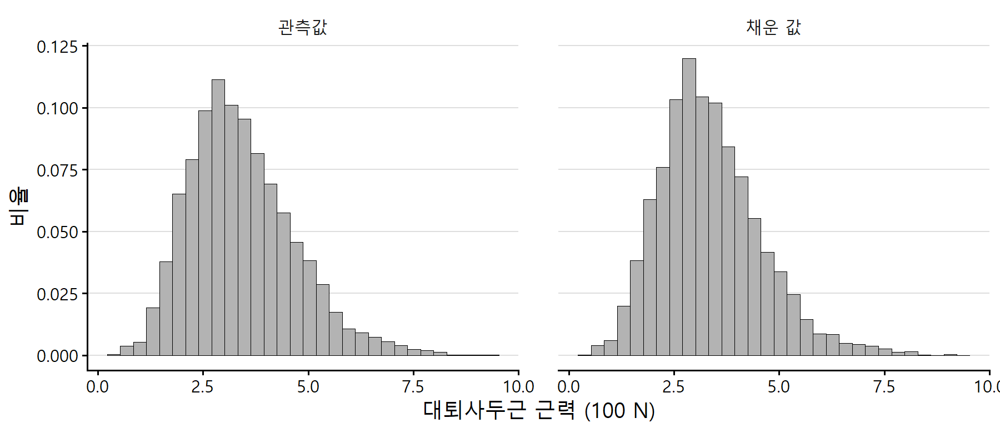

# 데이터 2장. 결측의 다중 대체 — 값이 빠진 사람을 빼고 분석해도 되는가

- [I. 질문과 자료](#i-질문과-자료)
- [II. 완전 사례 분석](#ii-완전-사례-분석)
- [III. 값을 하나로 채우는 방법](#iii-값을-하나로-채우는-방법)
- [IV. 참값을 아는 실험](#iv-참값을-아는-실험)
- [V. 다중 대체의 생각](#v-다중-대체의-생각)
- [VI. 연쇄 방정식](#vi-연쇄-방정식)
- [VII. Rubin의 규칙](#vii-rubin의-규칙)
- [VIII. 추정](#viii-추정)
- [IX. 대체 모형을 정하는 일](#ix-대체-모형을-정하는-일)
- [X. 해석과 한계](#x-해석과-한계)
- [XI. (선택) 점검](#xi-선택-점검)
- [XII. 이 방법을 쓴 연구](#xii-이-방법을-쓴-연구)
- [참고문헌](#참고문헌)

1장 IV장은 OAI의 결측을 살폈다. 방문을 거른 사람, 추적에서 빠진 사람, 검사를 하지 못한 사람이 있고, 빠지는 것은 무작위가 아니었다. 그 장은 결측의 기제를 셋으로 나누었다. 결측이 어떤 값과도 무관한 완전 무작위 결측(MCAR), 관측된 값으로 설명되는 무작위 결측(MAR), 빠진 값 자체에 달린 비무작위 결측(MNAR)이다. 이 장은 그다음 질문을 다룬다. 값이 빠진 자료를 실제로 어떻게 분석하는가.

가장 흔한 처리는 아무것도 하지 않는 것이다. 통계 소프트웨어는 회귀에 들어가는 변수 가운데 하나라도 빠진 관측을 말없이 뺀다. 이것을 완전 사례 분석이라 한다. 이 장은 완전 사례 분석이 무엇을 잃는지(I장, II장), 빠진 값을 하나의 값으로 채우는 방법이 왜 틀리는지(III장)를 보이고, 참값을 아는 실험으로 방법들을 비교한 뒤(IV장), 다중 대체의 절차를 설명하고 적용한다(V\~IX장). 이 장은 선형 회귀(회귀 1장)와 로지스틱 회귀(회귀 2장)를 쓴다. 두 장을 먼저 읽는 것이 좋다.

## I. 질문과 자료

### 1. 분석하려는 회귀

자료는 기준 방문이고 사람 하나가 한 줄이다. 등록자 가운데 통증 점수가 있는 4,796명이 대상이다. 분석하려는 것은 회귀 하나다. 더 아픈 쪽 무릎의 WOMAC 통증(0\~20)을 7개 설명변수에 회귀한다. KL 등급(두 무릎 가운데 높은 쪽), 나이, 성별, BMI, CES-D, 대퇴사두근 근력(두 다리의 평균, 100 N 단위), 가구 소득(다섯 구간)이다. 근력이 약한 사람, 소득이 낮은 사람이 통증을 더 많이 보고하는지를 다른 특성을 통제하고 보려는 회귀다.

### 2. 결측의 현황

표 1은 변수마다 값이 빠진 사람의 수와 비율이다. 아래 네 변수는 분석하려는 회귀에는 들어가지 않고 VI장의 대체에서만 쓰는 보조 변수다.

**표 1. 변수별 결측 (기준 방문)**

| 변수                    | 역할      | 결측 | 결측(%) |
|:------------------------|:----------|-----:|--------:|
| WOMAC 통증              | 결과      |    0 |     0.0 |
| KL 등급                 | 설명변수  |  290 |     6.0 |
| 나이                    | 설명변수  |    0 |     0.0 |
| 여성                    | 설명변수  |    0 |     0.0 |
| BMI                     | 설명변수  |    4 |     0.1 |
| CES-D                   | 설명변수  |   65 |     1.4 |
| 대퇴사두근 근력 (100 N) | 설명변수  |  569 |    11.9 |
| 소득 (1\~5)              | 설명변수  |  362 |     7.5 |
| 의자 일어서기           | 보조 변수 |  242 |     5.0 |
| 20m 보행 속도           | 보조 변수 |   21 |     0.4 |
| 동반질환 지수           | 보조 변수 |   66 |     1.4 |
| 교육 (0\~5)              | 보조 변수 |   41 |     0.9 |

표에서 결측이 가장 많은 설명변수는 대퇴사두근 근력이고 그 비율은 11.9%다. 변수 하나하나를 보면 결측이 크지 않다. 문제는 회귀에 변수 여럿이 함께 들어간다는 점이다. 설명변수 7개와 결과가 모두 관측된 사람은 3,720명이고, 완전 사례 분석은 4,796명 가운데 1,076명(22.4%)을 버린다. 버려지는 사람의 대부분은 변수 하나만 없다. 대퇴사두근 근력만 없는 사람이 452명, 소득만 없는 사람이 240명, KL 등급만 없는 사람이 188명이다. 변수 하나가 없다는 이유로 그 사람의 나머지 측정값 전부를 버리는 것이다. 결측이 변수마다 조금씩 있을 때 완전 사례 분석이 버리는 양은 변수가 늘어날수록 커진다.

### 3. 누가 빠지는가

결측이 무작위인지는 자료로 일부 확인할 수 있다. 어떤 변수가 빠졌는지를 1과 0으로 두고, 그것을 관측된 다른 변수에 로지스틱 회귀한다. 표 2는 결측이 많은 세 변수에 대해 그 회귀의 승산비를 제시한 것이다. 설명변수는 통증(1점), 나이(10세), 성별, CES-D(10점)다.

**표 2. 결측 여부의 승산비 (값이 빠졌으면 1)**

| 빠진 변수       | CES-D (10점) | 나이 (10세) | 여성 | 통증 (1점) |
|:----------------|-------------:|------------:|-----:|-----------:|
| KL 등급         |         1.26 |        1.06 | 1.24 |       1.08 |
| 대퇴사두근 근력 |         1.16 |        0.75 | 1.24 |       1.04 |
| 소득            |         1.23 |        1.31 | 1.71 |       1.02 |

표에서 통증의 승산비는 세 변수 모두에서 1보다 크다(대퇴사두근 근력 1.04, 소득 1.02, KL 등급 1.08). 통증이 1점 높을수록 그 변수가 빠져 있을 승산이 그만큼 높다는 뜻이다. 통증이 심한 사람일수록 검사 결과가 없다. 근력 검사는 무릎을 펴는 힘을 최대로 내야 하는 검사여서 무릎이 아픈 사람은 하기 어렵다. 결측은 완전 무작위가 아니고, 분석하려는 회귀의 결과 변수인 통증과 관련되어 있다. 이 점이 II장에서 문제가 된다.

## II. 완전 사례 분석

### 1. 언제 괜찮고 언제 틀리는가

완전 사례 분석은 값이 모두 있는 사람만으로 회귀를 한다. 표본이 줄어 표준오차가 커지는 것은 분명하다. 계수가 치우치는지는 결측이 무엇에 달려 있는지에 따라 다르다(Little and Rubin, 2019).

결측이 완전 무작위이면 남은 사람은 전체의 무작위 표본이므로 계수는 치우치지 않는다. 결측이 설명변수의 값에만 달려 있어도 회귀 계수는 치우치지 않는다. 회귀는 설명변수가 주어졌을 때 결과의 조건부 평균을 추정하는 것이고, 설명변수의 어떤 범위에서 사람이 더 많이 빠졌는지는 그 조건부 평균을 바꾸지 않기 때문이다. 나이가 많은 사람이 더 많이 빠졌다면 나이가 많은 범위의 정보가 줄어들 뿐이다.

문제는 결측이 결과 변수에 달려 있을 때다. 설명변수가 같은 사람들 가운데 통증이 심한 사람이 더 많이 빠지면, 남은 사람들의 통증 평균은 실제보다 낮다. 그 정도가 설명변수의 값에 따라 다르면 기울기도 틀린다. 표 2가 보인 것이 이 경우다. 종단 분석 1장에서 통증이 심해진 무릎이 치환술로 빠져나가 평균 궤적이 낮게 보인 것과 같은 원리다.

### 2. 추정

완전 사례 3,720명의 회귀 결과는 VIII장의 표 5에서 다중 대체의 결과와 함께 제시한다. 여기서는 이 추정이 버린 것만 적는다. 근력이 없어 빠진 사람들도 통증, KL 등급, 나이, BMI, 우울 점수는 모두 측정되어 있다. 그 사람들의 통증과 KL 등급의 관계는 KL 등급의 계수를 추정하는 데 쓸 수 있는 정보인데 완전 사례 분석은 그것을 쓰지 않는다.

## III. 값을 하나로 채우는 방법

빠진 값을 무언가로 채우면 사람을 버리지 않아도 된다. 가장 단순한 방법 둘을 본다.

평균 대체는 빠진 값을 그 변수의 관측된 평균으로 채운다. 채운 값이 모두 같으므로 그 변수의 분산이 줄어들고, 다른 변수와의 상관이 0 쪽으로 약해진다. 근력을 평균으로 채운 사람들에게서는 근력이 성별이나 나이와 무관한 값이 된다. 그 결과 근력과 상관된 다른 설명변수의 계수가 근력의 몫까지 떠안아 치우친다.

회귀 대체는 한 걸음 더 간다. 빠진 변수를 다른 변수에 회귀하고 그 예측값으로 채운다. 여성이고 나이가 많은 사람에게는 낮은 근력을, 젊은 남성에게는 높은 근력을 채운다. 변수 사이의 관계는 살아나지만 다른 문제가 생긴다. 채운 값이 모두 회귀선 위에 있어서, 실제 값이 회귀선 주위에 흩어져 있다는 사실이 사라진다. 그 변수와 다른 변수의 상관이 실제보다 강해진다.

두 방법에 공통인 문제가 하나 더 있고 이것이 더 근본적이다. 채운 값을 관측한 값과 똑같이 취급한다. 회귀는 4,796명의 값을 모두 관측한 것처럼 표준오차를 계산한다. 실제로는 그 가운데 일부는 추측이다. 추측한 값을 아는 값처럼 쓰면 표준오차가 실제보다 작게 나오고 신뢰구간이 좁아진다. 값을 하나로 채우는 어떤 방법도 이 문제를 피하지 못한다.

## IV. 참값을 아는 실험

### 1. 설계

실제 자료에서는 빠진 값을 모르므로 어느 방법이 맞는지 확인할 수 없다. 그래서 값을 일부러 지우는 실험을 한다. 분석에 쓰는 변수와 보조 변수가 모두 관측된 사람들을 완전한 자료로 삼는다. 이 자료로 I.1절의 회귀를 추정한 값을 참값으로 둔다. 그다음 대퇴사두근 근력의 값을 약 30%의 사람에게서 지우고, 지운 자료에 각 방법을 적용해 참값을 얼마나 되찾는지 본다. 지우는 규칙은 둘이다.

- 완전 무작위: 모든 사람이 30%의 확률로 지워진다.
- 통증에 따라: 통증이 높을수록 지워질 확률이 높다. 통증이 평균보다 1점 높으면 지워질 승산이 1.25배다. 통증은 관측되어 있으므로 이것은 무작위 결측(MAR)이다.

비교하는 방법은 넷이다. 완전 사례 분석, 평균 대체, 회귀 대체(통증을 뺀 나머지 설명변수에 회귀한 예측값으로 채움), 그리고 V\~VII장에서 설명할 다중 대체(대체 5개)다. 지우는 일을 20번 되풀이해 평균을 낸다.

**표 3. 지우기 실험: 대퇴사두근 근력의 계수와 표준오차 (20회 반복의 평균)**

| 방법 | 완전 무작위: 계수 | 완전 무작위: 표준오차 | 통증에 따라: 계수 | 통증에 따라: 표준오차 |
|:---|---:|---:|---:|---:|
| 완전한 자료(참값) | -0.567 | 0.055 | -0.567 | 0.055 |
| 완전 사례 분석 | -0.584 | 0.066 | -0.404 | 0.054 |
| 평균 대체 | -0.482 | 0.060 | -0.288 | 0.061 |
| 회귀 대체 | -0.584 | 0.066 | -0.404 | 0.067 |
| 다중 대체 | -0.581 | 0.062 | -0.595 | 0.080 |

**표 4. 지우기 실험: 여성의 계수와 표준오차 (20회 반복의 평균)**

| 방법 | 완전 무작위: 계수 | 완전 무작위: 표준오차 | 통증에 따라: 계수 | 통증에 따라: 표준오차 |
|:---|---:|---:|---:|---:|
| 완전한 자료(참값) | -0.485 | 0.135 | -0.485 | 0.135 |
| 완전 사례 분석 | -0.506 | 0.162 | -0.358 | 0.132 |
| 평균 대체 | -0.155 | 0.125 | 0.046 | 0.126 |
| 회귀 대체 | -0.514 | 0.145 | -0.248 | 0.147 |
| 다중 대체 | -0.513 | 0.143 | -0.522 | 0.159 |

완전한 자료는 3,529명이다. 표 3과 표 4는 두 계수에 대한 결과다. 첫 행이 완전한 자료의 추정인 참값이고, 아래 네 행이 값을 지운 뒤 각 방법으로 구한 추정이다. 왼쪽 두 열은 완전 무작위로 지운 경우, 오른쪽 두 열은 통증에 따라 지운 경우다. 표 3은 값을 지운 변수 자신의 계수이고 표 4는 그 변수와 상관된 다른 설명변수의 계수다.

### 2. 결과

표 3에서 완전 무작위로 지운 경우 완전 사례 분석의 계수는 -0.584이고 참값 -0.567에 가깝다. II.1절에서 말한 대로다. 표준오차는 0.066이고 참값의 표준오차 0.055보다 크다. 사람의 30%를 버린 대가다. 통증에 따라 지운 경우에는 완전 사례 분석의 계수가 참값에서 벗어난다(-0.404). 통증이 심한 사람이 더 많이 빠져서 남은 사람들의 통증 변동이 줄었고, 계수가 0 쪽으로 당겨졌다.

평균 대체는 완전 무작위로 지운 경우에도 틀린다. 표 3에서 지운 변수 자신의 계수가 -0.482까지 0 쪽으로 줄어들고, 표 4에서 여성의 계수는 참값이 -0.485인데 평균 대체에서는 -0.155이다. 평균으로 채운 사람들에게서는 지운 변수가 통제되지 않으므로, 그 변수와 상관된 설명변수의 계수가 그 몫을 떠안는다. 그런데도 표준오차는 0.125이고 완전한 자료의 0.135보다 작다. 값의 30%가 추측인데 값을 모두 아는 것보다 정밀하다고 보고하는 것이다.

회귀 대체는 완전 무작위로 지운 경우에는 두 계수가 참값에 가깝다. 통증에 따라 지운 경우에는 완전 사례 분석과 마찬가지로 벗어난다(표 3의 -0.404, 표 4의 -0.248). 통증을 쓰지 않고 채웠기 때문이다. 채운 값에는 그 변수와 통증의 관계가 들어 있지 않으므로, 채워 넣은 사람들은 그 관계를 추정하는 데 아무것도 보태지 못하고 결측이 통증에 달려 있어서 생긴 치우침도 그대로 남는다.

다중 대체는 두 규칙 모두에서 두 계수가 참값에 가깝다. 통증에 따라 지운 경우에도 표 3의 계수가 -0.595이고 참값 근처에 있다. 표준오차는 완전 무작위의 경우 0.062이며 완전한 자료(0.055)보다 크고 완전 사례 분석(0.066)보다 작다. 값을 지워서 잃은 정보만큼만 불확실성이 커진 것이다. 통증에 따라 지운 경우에는 완전 사례 분석의 표준오차(0.054)가 다중 대체(0.080)보다 작게 나온다. 이것은 완전 사례 분석이 더 정밀하다는 뜻이 아니다. 통증이 심한 사람이 빠져 남은 사람들의 통증이 덜 흩어져 있고, 그래서 잔차의 분산이 작게 계산된 것이다. 치우친 추정에 좁은 신뢰구간이 붙는 가장 나쁜 조합이다. 이 실험은 다중 대체가 잘 작동하는 조건에서 한 것이라는 점을 적어 둔다. 지우는 규칙이 관측된 변수인 통증에만 달려 있었고, 대체에 통증을 썼다. 지워질 확률이 근력 자체의 값에 달려 있었다면(비무작위 결측) 다중 대체도 치우친다.

## V. 다중 대체의 생각

III장의 방법들이 틀리는 이유는 빠진 값을 모른다는 사실을 계산에서 지워 버리기 때문이다. 다중 대체(Rubin, 1987)는 그 사실을 계산에 남겨 둔다. 빠진 값을 한 번이 아니라 여러 번, 매번 다르게 채운다. 채우는 값은 그럴듯한 값의 분포에서 무작위로 뽑는다. 근력이 빠진 60세 여성에게 “이런 사람의 근력은 평균 250 N이다”라고 250을 넣지 않고, 이런 사람들의 근력이 흩어져 있는 분포에서 값 하나를 뽑아 넣는다. 다음 번에는 다른 값을 뽑는다.

절차는 세 단계다.

1.  대체. 빠진 값을 채운 완전한 자료를 $m$개 만든다. 자료마다 채운 값이 다르다.
2.  분석. $m$개의 자료 각각에 원래 하려던 분석(여기서는 I.1절의 회귀)을 그대로 한다. 계수와 표준오차가 $m$벌 나온다.
3.  결합. $m$벌의 결과를 하나로 합친다. 계수는 평균하고, 표준오차는 자료 사이에서 계수가 얼마나 달랐는지를 더해 키운다.

$m$개의 자료 사이에서 계수가 서로 다르게 나오는 정도가 빠진 값을 몰라서 생기는 불확실성이다. 채운 값에 따라 결과가 크게 달라진다면 빠진 값이 결론에 중요하다는 뜻이고, 그만큼 표준오차가 커져야 한다. 다중 대체의 목적은 빠진 값을 맞히는 것이 아니다. 채운 값 하나하나는 그 사람의 실제 값과 다르다. 목적은 빠진 값이 있는 상태에서 회귀 계수와 그 불확실성을 바르게 추정하는 것이다.

## VI. 연쇄 방정식

### 1. 변수마다 차례로 채운다

대체 단계에서 그럴듯한 값의 분포를 어떻게 정하는가. 빠진 변수가 하나라면 그 변수를 다른 변수에 회귀한 모형에서 뽑으면 된다. 이 자료처럼 여러 변수가 서로 다른 사람에게서 빠져 있으면 한 변수를 채우는 데 쓸 다른 변수에도 결측이 있다. 연쇄 방정식(van Buuren and Groothuis-Oudshoorn, 2011)은 이 문제를 반복으로 푼다.

1.  모든 빠진 값을 관측값에서 무작위로 뽑은 값으로 임시로 채운다.
2.  첫 변수를 고른다. 그 변수가 관측된 사람들로 그 변수를 나머지 모든 변수에 회귀한다. 그 모형에서 뽑은 값으로 그 변수의 빠진 값을 다시 채운다.
3.  다음 변수로 넘어가 같은 일을 한다. 이때 앞에서 새로 채운 값을 설명변수로 쓴다.
4.  모든 변수를 한 바퀴 돌면 반복 한 번이다. 이것을 여러 번 되풀이한 뒤의 값을 대체 하나로 삼는다.

이 과정을 처음부터 $m$번 하면 대체 $m$개가 나온다. 변수마다 그 변수에 맞는 모형을 쓸 수 있다는 것이 이 방법의 장점이다.

### 2. 예측 평균 맞춤

각 변수를 채울 때 이 장은 예측 평균 맞춤(Little, 1988)을 쓴다. 근력이 빠진 사람이 있다고 하자. 회귀 모형으로 이 사람의 근력 예측값을 구한다. 근력이 관측된 사람들 가운데 예측값이 이 사람과 가장 가까운 몇 명을 찾고, 그 가운데 한 명을 무작위로 골라 그 사람의 실제 근력을 빌려 온다.

채우는 값이 언제나 누군가의 실제 관측값이라는 점이 이 방법의 쓸모다. 0\~20의 통증 점수에 음수나 소수가 채워지지 않고, 1\~5의 소득 구간에 3.7이 채워지지 않는다. 한쪽으로 치우친 분포나 바닥에 몰린 분포도 그대로 따른다. 회귀 모형은 비슷한 사람을 찾는 데만 쓰이므로 모형의 형태가 조금 틀려도 영향이 작다.

### 3. 대체에 무엇을 넣는가

대체에 쓰는 변수는 분석하려는 회귀의 변수보다 넓게 잡는다. 이 장의 대체에는 회귀의 결과와 설명변수 8개에 더해 보조 변수 4개(의자 일어서기, 20m 보행 속도, 동반질환 지수, 교육)를 넣는다. 보조 변수는 두 가지 일을 한다. 빠진 값을 더 잘 예측하게 한다. 근력이 빠진 사람도 의자에서 일어서는 속도가 있으면 근력을 더 좁게 짐작할 수 있다. 그리고 결측이 무작위 결측이라는 가정을 더 그럴듯하게 만든다. 결측과 관련된 변수를 대체에 넣을수록, 그 변수들이 같은 사람들 안에서는 결측이 무작위라는 가정이 성립하기 쉬워진다.

결과 변수인 통증도 대체에 넣는다. 설명변수를 채우는 데 결과 변수를 쓰는 것은 순환처럼 보이지만 반드시 그렇게 해야 한다. 그 이유는 IX.1절에서 수치로 보인다.

## VII. Rubin의 규칙

대체 $m$개에서 어떤 계수의 추정치 $\hat\theta_1, \ldots, \hat\theta_m$과 그 분산 추정치(표준오차의 제곱) $U_1, \ldots, U_m$을 얻었다고 하자. 이것을 다음과 같이 합친다(Rubin, 1987).

$$\bar\theta = \frac{1}{m}\sum_{l=1}^{m} \hat\theta_l, \qquad \bar U = \frac{1}{m}\sum_{l=1}^{m} U_l, \qquad B = \frac{1}{m - 1}\sum_{l=1}^{m} (\hat\theta_l - \bar\theta)^2$$

$$T = \bar U + \left(1 + \frac{1}{m}\right) B$$

결합한 추정치는 평균 $\bar\theta$이고 그 표준오차는 $\sqrt{T}$다. $\bar U$는 대체 안의 분산으로, 값이 하나도 빠지지 않았더라도 표본이 유한해서 남는 불확실성이다. $B$는 대체 사이의 분산으로, 빠진 값을 몰라서 더해지는 불확실성이다. 값을 하나로 채우는 방법은 $B$를 0으로 두는 것과 같다. III장에서 그 방법들의 표준오차가 작게 나온 이유가 여기 있다. $(1 + 1/m)$은 대체를 유한한 수만 했기 때문에 붙는 보정이다.

전체 분산 가운데 결측 때문에 생긴 몫을 결측 정보의 비율이라 하고 근사적으로 다음과 같다.

$$\lambda = \frac{(1 + 1/m) B}{T}$$

이 값은 변수의 결측 비율과 다르다. 근력이 12% 빠졌어도 근력을 다른 변수로 잘 예측할 수 있으면 잃은 정보는 12%보다 적다. 계수마다 값이 다르고, 결측이 많은 변수의 계수에서 크다.

## VIII. 추정

대체 20개를 만들고 각각에 회귀를 적합한 뒤 위의 식으로 직접 합쳤다. `mice` 패키지의 결합 함수가 낸 계수와 표준오차와 같다. 표 5는 완전 사례 분석과 다중 대체의 결과를 함께 제시한 것이다. 마지막 열은 VII장의 결측 정보의 비율이다.

**표 5. WOMAC 통증의 회귀: 완전 사례 분석(3,720명)과 다중 대체(4,796명, 대체 20개)**

| 항 | 완전 사례: 계수 | 완전 사례: 표준오차 | 다중 대체: 계수 | 다중 대체: 표준오차 | 결측 정보의 비율 |
|:---|---:|---:|---:|---:|---:|
| KL 등급 | 0.616 | 0.043 | 0.642 | 0.042 | 0.080 |
| 나이 | -0.054 | 0.006 | -0.063 | 0.006 | 0.023 |
| 여성 | -0.527 | 0.132 | -0.625 | 0.124 | 0.055 |
| BMI | 0.128 | 0.011 | 0.135 | 0.010 | 0.027 |
| CES-D | 0.099 | 0.008 | 0.099 | 0.007 | 0.031 |
| 대퇴사두근 근력 (100 N) | -0.614 | 0.054 | -0.681 | 0.052 | 0.116 |
| 소득 (1\~5) | -0.468 | 0.055 | -0.556 | 0.050 | 0.048 |

표에서 다중 대체의 표준오차는 완전 사례 분석의 0.90\~0.97배다. 버렸던 1,076명의 관측된 값이 추정에 쓰였기 때문이다. 계수도 달라진다. 가장 크게 달라진 것은 소득(-0.468에서 -0.556)과 여성(-0.527에서 -0.625)이다. 표 2에서 통증이 심한 사람이 더 많이 빠졌으므로, 완전 사례 분석이 통증의 변동을 줄여 계수를 0 쪽으로 당겼다는 해석과 방향이 맞는다. IV장의 실험에서 통증에 따라 값을 지웠을 때 본 것과 같은 방향이다.

결측 정보의 비율은 대퇴사두근 근력의 계수에서 가장 크다(0.12). 이 변수 자신의 결측이 가장 많기 때문이다. 이 값은 그 변수의 결측 비율(11.9%)과 비슷하고, 완전 사례 분석이 버린 22%보다는 훨씬 작다. 다른 계수에서는 훨씬 작다. 통증과 KL 등급, 나이처럼 거의 모든 사람에게서 관측된 변수 사이의 관계에 대해서는 잃은 정보가 거의 없다.

두 분석의 결론은 같다. 구조 손상이 크고, 우울 점수가 높고, 근력이 약하고, 소득이 낮은 사람이 통증을 더 많이 보고한다. 이 자료에서 다중 대체가 바꾼 것은 결론이 아니라 계수의 크기와 정밀도다. 결측이 더 많거나 결과와 더 강하게 관련된 자료에서는 결론이 달라질 수 있다.

## IX. 대체 모형을 정하는 일

### 1. 결과 변수를 넣어야 한다

설명변수를 채울 때 결과 변수를 쓰지 않으면 어떻게 되는지 본다. 같은 대체를 통증만 빼고 다시 한다. 통증은 다른 변수를 채우는 데 쓰이지 않는다.

대퇴사두근 근력의 계수는 통증을 넣은 대체에서 -0.681, 통증을 뺀 대체에서 -0.622이다. 통증을 빼면 계수의 절대값이 작아진다. 통증을 쓰지 않고 채운 근력은 나이와 성별 등으로는 설명되지만 통증과는 조건부로 무관한 값이다. 채운 값들 안에서는 근력과 통증의 관계가 0이므로, 그 사람들을 넣고 회귀하면 계수가 0 쪽으로 희석된다. 대체 모형은 분석 모형이 추정하려는 관계를 모두 담고 있어야 하고, 그러려면 분석 모형의 모든 변수가 결과 변수를 포함해 대체에 들어가야 한다(Moons et al., 2006; Sterne et al., 2009). 결과로 설명변수를 채우는 것이 결과를 부풀리는 것처럼 보일 수 있으나, 대체는 관계를 만들어 내는 것이 아니라 관측된 사람들에게 있는 관계를 빠진 사람들에게도 유지하는 것이다.

분석 모형에 교호작용이나 제곱항이 있으면 그것도 대체에 반영해야 한다. 대체 모형이 분석 모형보다 단순하면 같은 희석이 일어난다.

### 2. 대체의 수

대체 3\~5개면 충분하다는 것이 초기의 권고였다. 계수의 추정에는 지금도 맞는 말이다. 그러나 대체가 적으면 표준오차와 $p$값이 대체를 다시 할 때마다 눈에 띄게 달라진다. 지금은 대체의 수를 값이 빠진 사람의 비율(%)만큼 두라는 경험칙을 쓴다(White et al., 2011). 이 자료는 22%의 사람에게 결측이 있으므로 20개 안팎이 맞다. 계산 시간이 문제가 아니면 더 늘려서 잃을 것이 없다.

## X. 해석과 한계

다중 대체가 타당하려면 결측이 대체에 넣은 변수들로 설명되어야 한다. 무작위 결측 가정이다. 이 가정은 자료로 검증할 수 없다. 표 2는 결측이 통증과 관련된다는 것을 보였지만, 통증과 다른 변수가 같은 사람들 안에서 근력이 약한 사람이 근력 검사를 더 많이 걸렀는지는 알 수 없다. 걸렀다면 비무작위 결측이고, 채운 근력은 실제보다 높으며, 다중 대체의 계수도 치우친다. 할 수 있는 일은 결측과 관련될 만한 변수를 대체에 넉넉히 넣어 가정을 그럴듯하게 만드는 것, 그리고 채운 값을 일정한 크기만큼 낮추거나 높여 결론이 유지되는지 보는 민감도 분석이다. 뒤의 것은 이 장에서 하지 않았다.

완전 사례 분석이 언제나 나쁜 것은 아니다. II.1절에서 본 대로 결측이 설명변수에만 달려 있으면 완전 사례 분석의 계수는 치우치지 않는다. 결측이 몇 퍼센트뿐이면 어느 방법을 쓰든 결과가 같다. 다중 대체가 필요한 것은 결측이 결과와 관련될 때, 그리고 변수마다의 결측이 쌓여 버려지는 사람이 많을 때다. 이 자료가 그 경우였다.

보고할 때는 독자가 판단할 수 있는 정보를 함께 준다(Sterne et al., 2009). 변수별 결측의 수, 완전 사례의 수, 대체에 넣은 변수의 목록, 대체 방법과 대체의 수, 그리고 완전 사례 분석의 결과다. 두 분석의 결과가 다르면 왜 다른지를 설명한다.

## XI. (선택) 점검

대체가 이상한 값을 채우지 않았는지는 채운 값의 분포를 관측값의 분포와 비교해 본다. 그림 1은 대퇴사두근 근력의 관측값과 대체 20개에서 채운 값의 분포다.

두 분포가 같아야 하는 것은 아니다. 채운 값의 평균은 3.36이고 관측값의 평균 3.42보다 낮다. 근력이 빠진 사람들이 통증이 심하고 여성이 많았으므로 그 사람들에게 낮은 근력이 채워지는 것이 맞다. 무작위 결측이면 빠진 사람과 관측된 사람의 분포가 달라도 된다. 확인할 것은 채운 값이 관측값의 범위 안에 있고 분포의 모양이 터무니없지 않은지다.

연쇄 방정식의 반복이 충분했는지는 반복마다 채운 값의 평균이 어떻게 움직이는지로 본다. 평균이 한 방향으로 계속 움직이고 있으면 반복이 부족한 것이다. 이 대체에서 채운 값의 평균을 대체 20개에 걸쳐 평균하면 다섯 번의 반복에서 3.348\~3.374의 좁은 범위에 머문다.

## XII. 이 방법을 쓴 연구

다중 대체는 관찰 연구에서 결측을 다루는 표준적인 방법이 되었고, 대부분의 연구에서 본문의 한 문단과 부록의 표로만 나타난다. 인과 추론 3장에서 소개한 Jafarzadeh et al. (2022)가 그 예다. OAI에서 통증을 낮추는 가상의 중재가 치환술을 얼마나 줄이는지를 추정하면서, 방문마다 빠진 통증 점수와 공변량을 `mice` 패키지로 채웠다. 대체 모형으로는 이 장이 쓴 예측 평균 맞춤 대신 랜덤 포레스트를 썼다. 변수 사이의 비선형 관계와 교호작용을 따로 지정하지 않아도 대체에 반영하려는 선택이다.

논문을 읽을 때 확인할 것은 X장의 목록과 같다. 결측이 얼마나 있었는지, 대체에 결과 변수와 보조 변수를 넣었는지, 완전 사례 분석과 결과가 얼마나 다른지다. “결측은 다중 대체로 처리했다”는 한 문장만 있는 논문은 이 가운데 어느 것도 알려 주지 않는다.

## 참고문헌

Jafarzadeh, S. R., Neogi, T., White, D. K., and Felson, D. T. (2022). “The relationship of pain reduction with prevention of knee replacement under dynamic intervention strategies.” *Arthritis & Rheumatology* 74(10), 1668–1675.

Little, R. J. A. (1988). “Missing-data adjustments in large surveys.” *Journal of Business & Economic Statistics* 6(3), 287–296.

Little, R. J. A., and Rubin, D. B. (2019). *Statistical Analysis with Missing Data* (3rd ed.). Wiley.

Moons, K. G. M., Donders, R. A. R. T., Stijnen, T., and Harrell, F. E. (2006). “Using the outcome for imputation of missing predictor values was preferred.” *Journal of Clinical Epidemiology* 59(10), 1092–1101.

Rubin, D. B. (1987). *Multiple Imputation for Nonresponse in Surveys*. Wiley.

Sterne, J. A. C., White, I. R., Carlin, J. B., Spratt, M., Royston, P., Kenward, M. G., Wood, A. M., and Carpenter, J. R. (2009). “Multiple imputation for missing data in epidemiological and clinical research: Potential and pitfalls.” *BMJ* 338, b2393.

van Buuren, S., and Groothuis-Oudshoorn, K. (2011). “mice: Multivariate imputation by chained equations in R.” *Journal of Statistical Software* 45(3), 1–67.

White, I. R., Royston, P., and Wood, A. M. (2011). “Multiple imputation using chained equations: Issues and guidance for practice.” *Statistics in Medicine* 30(4), 377–399.
