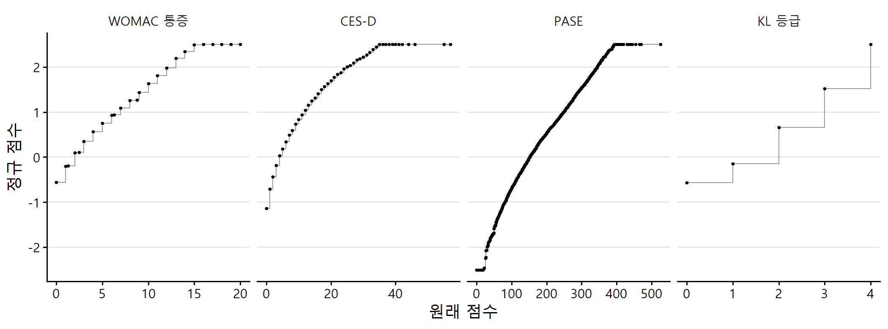
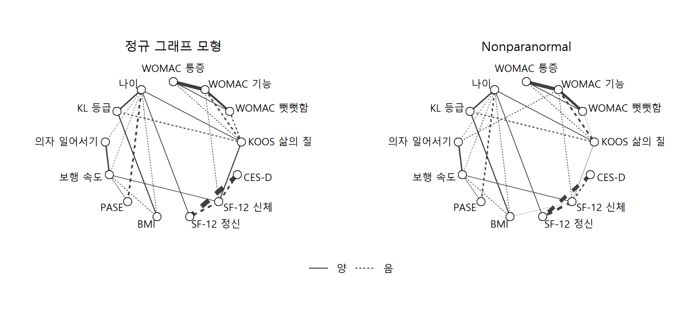

# Nonparanormal 그래프 모형 — 정규 가정을 풀면 증상의 네트워크가 달라지는가


- [I. 질문](#i-질문)
- [II. Nonparanormal](#ii-nonparanormal)
- [III. OAI에 적용한 결과](#iii-oai에-적용한-결과)
- [IV. 시뮬레이션](#iv-시뮬레이션)
- [V. 정리와 한계](#v-정리와-한계)
- [참고문헌](#참고문헌)

> 이 장은 교재의 구성에 넣지 않은 장이다. 그래프 모형 1장의 정규 그래프 모형을 Liu et al. (2009)의 nonparanormal로 바꾸어 다시 추정하고, 두 그래프를 비교한 분석이다.

그래프 모형 1장은 OAI 기준 방문의 13개 변수로 부분상관 그래프를 그렸다. 그 장의 방법은 변수들이 다변량 정규분포를 따른다고 가정한다. 실제 변수는 그렇지 않다. WOMAC 점수는 0점에 몰려 있고, CES-D는 오른쪽으로 길게 늘어져 있으며, KL 등급은 값이 다섯 가지뿐이다. 그 장의 IX.1절은 Spearman 순위상관으로 바꾸어도 그래프가 거의 같다는 것만 확인하고 넘어갔다.

이 장은 그 점검을 방법 하나로 세운다. Liu, Lafferty and Wasserman (2009)의 nonparanormal은 변수마다 알 수 없는 단조 변환을 하면 다변량 정규가 된다고 가정한다. 변환은 데이터에서 추정하고, 그래프는 변환한 변수의 정밀도 행렬로 정한다. 모형과 추정(II장), OAI에 적용한 결과(III장), 참 그래프를 아는 시뮬레이션(IV장)의 순서로 간다. 데이터와 노드는 그래프 모형 1장 I.2절과 같고 4,177명이다.

## I. 질문

### 1. 정규 가정이 하는 일

정규 그래프 모형에서 정규 가정은 두 곳에 쓰인다. 첫째, 정밀도 행렬의 원소가 0이라는 것이 조건부 독립과 같다는 해석이다. 정규분포가 아니면 부분상관이 0이어도 비선형 의존이 남을 수 있다. 둘째, 그래프 라쏘의 목적함수와 EBIC가 다변량 정규의 로그가능도다.

정규가 아닌 정도는 변수마다 다르다. 표 1은 노드마다 왜도, 가장 낮은 값에 있는 사람의 비율, 서로 다른 값의 수를 제시한 것이다. 왜도는 정규분포에서 0이다.

**표 1. 노드의 분포 모양 (기준 방문)**

| 노드          | 왜도 | 최저값의 비율(%) | 최고값의 비율(%) | 값의 수 |
|:--------------|-----:|-----------------:|-----------------:|--------:|
| WOMAC 통증    |  1.3 |             28.7 |              0.1 |      25 |
| WOMAC 기능    |  1.3 |             24.7 |              0.0 |     145 |
| WOMAC 뻣뻣함  |  0.6 |             29.7 |              0.3 |       9 |
| KOOS 삶의 질  | -0.5 |              0.4 |             12.4 |      23 |
| CES-D         |  2.0 |             12.8 |              0.0 |      47 |
| SF-12 신체    | -1.1 |              0.0 |              0.0 |   1,465 |
| SF-12 정신    | -1.3 |              0.0 |              0.0 |   1,551 |
| BMI           |  0.5 |              0.0 |              0.0 |     262 |
| PASE          |  0.6 |              0.1 |              0.0 |     392 |
| 보행 속도     |  0.0 |              0.0 |              0.0 |     945 |
| 의자 일어서기 |  1.0 |              0.0 |              0.0 |     105 |
| KL 등급       |  0.1 |             28.5 |              6.4 |       5 |
| 나이          |  0.1 |              1.5 |              0.9 |      35 |

표에서 왜도의 절대값이 가장 큰 노드는 CES-D(2.00)다. WOMAC의 세 점수는 왜도가 1 안팎이고 최저값인 0점에 25\~30%가 있다. SF-12의 두 점수, 보행 속도, BMI는 값의 수가 많은 연속 변수에 가깝다. 정규 가정이 깨지는 방식이 두 가지라는 점이 이 장의 결과를 정한다. 하나는 연속이지만 치우친 분포이고, 다른 하나는 같은 값에 사람이 몰린 분포다.

### 2. 이 장의 질문

질문은 셋이다. 정규 가정을 풀면 OAI의 그래프가 달라지는가. 달라진다면 어느 엣지가 왜 달라지는가. 그리고 그 차이가 방법의 차이인지, 데이터의 모양에서 오는 한계인지를 참 그래프를 아는 시뮬레이션으로 가려낸다.

## II. Nonparanormal

### 1. 모형

확률 벡터 $X = (X_1, \dots, X_p)$가 nonparanormal 분포를 따른다는 것은, 단조 증가 함수 $f_1, \dots, f_p$가 있어서 변환한 벡터가 다변량 정규라는 뜻이다(Liu et al., 2009).

$$f(X) = \big(f_1(X_1), \dots, f_p(X_p)\big) \sim N(\mu, \Sigma)$$

함수 $f_j$에는 단조라는 것 말고 제약이 없다. 그래서 각 변수의 주변 분포는 어떤 모양이든 될 수 있고, 변수들 사이의 의존 구조만 정규분포의 것을 따른다. 주변 분포와 의존 구조를 나누어 생각하는 이 방식을 코퓰라라 하고, nonparanormal은 정규 코퓰라(Gaussian copula)의 한 형태다(Sklar, 1959). 이름은 저자들이 정규분포(normal)를 넘어선다는 뜻으로 붙인 것이다.

회귀와 비교하면 이 모형의 위치가 분명하다. 선형 회귀의 직선을 변수마다 매끄러운 함수로 바꾼 것이 가법 모형이듯, 다변량 정규의 변수마다 단조 함수를 씌운 것이 nonparanormal이다. 그래프 라쏘가 정규 그래프 모형에 벌점을 준 것이듯, nonparanormal에도 같은 벌점을 줄 수 있다.

그래프가 어디에 들어 있는지가 핵심이다. $f_j$가 단조이므로 $X_j$를 아는 것과 $f_j(X_j)$를 아는 것은 같은 정보다. 따라서 $X$의 조건부 독립은 $f(X)$의 조건부 독립과 같고, $f(X)$는 정규이므로 그것은 $\Theta = \Sigma^{-1}$의 0과 같다.

$$X_j \perp X_k \mid X_{\mathrm{rest}} \iff \theta_{jk} = 0$$

정규 그래프 모형에서와 달리 이 등식은 변수의 주변 분포가 정규가 아니어도 성립한다. 대신 의존 구조가 정규 코퓰라라는 가정을 한다.

### 2. 변환의 추정

$f_j$를 알아야 하는 것은 아니다. $X_j$의 분포함수를 $F_j$, 표준정규의 분포함수를 $\Phi$라 하면 $\Phi^{-1}(F_j(X_j))$는 표준정규를 따르고, 이것은 $f_j(X_j)$를 평균 0, 분산 1로 표준화한 것과 같다. 그래서 변환은 분포함수를 추정해 표준정규의 분위수로 바꾸는 것으로 충분하다. 정밀도 행렬의 0의 위치는 표준화에 따라 바뀌지 않는다.

분포함수는 경험분포함수 $\hat F_j$로 추정한다. 다만 표본의 최댓값에서 $\hat F_j = 1$이 되어 $\Phi^{-1}(1) = \infty$가 되므로 양 끝을 잘라 낸다(Liu et al., 2009, 식 6).

$$\tilde F_j(x) = \min\big\lbrace\max\big(\hat F_j(x), \delta_n\big), 1 - \delta_n\big\rbrace, \qquad \delta_n = \frac{1}{4 n^{1/4}\sqrt{\pi \log n}}$$

$\delta_n$은 자르는 정도이고, 저자들이 이론적인 수렴 속도에 맞추어 정한 값이다. 이 데이터에서는 $n$ = 4,177이므로 $\delta_n$ = 0.0061이다. 변환한 값 $\Phi^{-1}(\tilde F_j(X_j))$의 상관행렬을 구하고, 그 다음은 그래프 모형 1장 V장과 동일하다. 그래프 라쏘로 적합하고 EBIC로 $\lambda$를 고른다. R로는 네 줄이다.

``` r
dl <- 1 / (4 * n^0.25 * sqrt(pi * log(n)))
Z  <- apply(X, 2, function(x) qnorm(pmin(pmax(ecdf(x)(x), dl), 1 - dl)))
S  <- cor(Z)
fit <- glasso(S, rho = lambda, penalize.diagonal = FALSE)
```

첫 단계에는 고를 파라미터가 없고 반복 계산도 없다. 변환을 데이터에서 추정한 대가는 표본이 작을 때의 정확도 손실이며, 데이터가 실제로 정규일 때 그 손실은 작다(IV장).

### 3. 순위 상관에서 바로 구하는 방법

변환을 거치지 않고 순위 상관에서 $\Sigma$를 바로 구하는 방법도 있다(Liu et al., 2012; Xue and Zou, 2012). 정규분포에서 Spearman 순위상관 $\rho^S$와 Pearson 상관 $\rho$ 사이에는 다음 관계가 있다.

$$\rho = 2\sin\left(\frac{\pi}{6}\rho^S\right)$$

순위는 단조 변환에 따라 바뀌지 않으므로, $X$의 Spearman 상관을 이 식에 넣으면 $f(X)$의 상관을 추정한 것이 된다. 이렇게 만든 행렬이 양의 정부호가 아닐 수 있어 그때는 가장 가까운 양의 정부호 행렬로 바꾼다. 이 장은 이것을 순위 기반 추정이라 부르고 셋째 방법으로 함께 적합한다.

그래프 모형 1장 IX.1절이 Spearman 상관을 그대로 쓴 것은 이 식의 보정을 생략한 것이다. 보정은 상관의 크기를 조금 키우는데, 이 데이터에서 가장 큰 차이는 0.018이다. 그래서 그 절의 결론은 그대로다.

### 4. 동점

II.1절의 모형은 변수가 연속이라고 가정한다. 경험분포함수는 같은 값을 가진 사람들에게 같은 값을 준다. WOMAC 통증이 0점인 29%는 모두 같은 정규 점수 하나를 받는다. 변환한 변수는 그 점에 사람이 몰린 분포가 되고, 정규가 되지 않는다. 동점이 많은 변수에서 nonparanormal의 변환은 분포를 정규로 만들지 못한다. 그 영향은 III.1절에서 보고 IV장에서 따로 점검한다.

## III. OAI에 적용한 결과

### 1. 추정한 변환

그림 1은 네 노드의 추정한 변환이다. 가로축은 원래 점수, 세로축은 변환한 정규 점수다. 점 하나가 값 하나다.



그림에서 PASE는 값의 수가 많아 변환이 매끄러운 곡선이고, 오른쪽 꼬리를 눌러 분포를 정규에 가깝게 만든다. CES-D의 변환은 낮은 점수 쪽에서 가파르고 높은 점수 쪽에서 완만하다. 높은 점수의 차이를 작게 만든다는 뜻이다. WOMAC 통증은 0점에 사람이 몰려 있어 그 점 하나에서 변환이 시작되고, KL 등급은 다섯 점이 전부다. 네 변환 모두 위쪽 끝이 평평한 것은 II.2절의 $\delta_n$으로 자른 곳이다. 표본의 위쪽 0.6%에 드는 값은 모두 같은 정규 점수를 받는다.

표 2는 변환 전후의 왜도다. 마지막 열은 최저값과 최고값 가운데 사람이 더 많이 몰린 쪽의 비율이다.

**표 2. 변환 전후의 왜도**

| 노드          | 변환 전 | 변환 후 | 한쪽 끝에 몰린 비율(%) |
|:--------------|--------:|--------:|-----------------------:|
| WOMAC 기능    |    1.31 |    0.77 |                   24.7 |
| WOMAC 통증    |    1.30 |    0.76 |                   28.7 |
| WOMAC 뻣뻣함  |    0.64 |    0.66 |                   29.7 |
| KL 등급       |    0.13 |    0.53 |                   28.5 |
| KOOS 삶의 질  |   -0.46 |    0.41 |                   12.4 |
| CES-D         |    2.00 |    0.38 |                   12.8 |
| 나이          |    0.14 |    0.13 |                    1.5 |
| PASE          |    0.58 |    0.02 |                    0.1 |
| 의자 일어서기 |    0.97 |   -0.01 |                    0.0 |
| SF-12 정신    |   -1.34 |   -0.01 |                    0.0 |
| SF-12 신체    |   -1.05 |    0.00 |                    0.0 |
| BMI           |    0.47 |    0.00 |                    0.0 |
| 보행 속도     |    0.05 |    0.00 |                    0.0 |

표에서 한쪽 끝에 몰린 사람이 5%보다 적은 7개 노드는 변환 후 왜도의 절대값이 0.13 이하로 줄어든다. 원래 왜도의 절대값이 1을 넘던 SF-12의 두 점수도 여기에 든다. 5\~20%가 몰린 노드(KOOS 삶의 질, CES-D)는 왜도의 절대값이 0.38\~0.41에 남고, 20% 넘게 몰린 4개 노드는 0.53\~0.77에 남는다. KL 등급처럼 원래 대칭에 가까웠던 노드는 오히려 왜도가 커진다. II.4절에서 말한 동점의 한계다. 이 데이터에서 nonparanormal의 변환이 분포를 바로잡는 것은 연속 변수에서이고, 증상 점수에서는 아니다.

### 2. 세 그래프

표 3은 세 방법으로 추정한 그래프를 요약한 것이다. 상관과 부분상관의 일치는 78쌍의 값을 정규 그래프 모형의 값과 상관시킨 것이다.

**표 3. 세 방법의 그래프 (EBIC로 고른 그래프 라쏘)**

| 방법 | λ | 0이 아닌 엣지 | 절대값 0.1 이상인 엣지 | 상관의 일치 | 부분상관의 일치 |
|:---|---:|---:|---:|---:|---:|
| 정규 그래프 모형 | 0.0145 | 58 | 24 | 1.000 | 1.000 |
| Nonparanormal | 0.0109 | 64 | 26 | 0.996 | 0.992 |
| 순위 기반 | 0.0047 | 66 | 26 | 0.996 | 0.981 |

표에서 세 그래프는 거의 같다(부분상관의 일치: nonparanormal 0.992, 순위 기반 0.981). 정규 그래프 모형의 엣지는 nonparanormal에도 모두 있고, nonparanormal에만 있는 엣지가 6쌍 더 있다. 그 엣지들의 부분상관은 절대값이 모두 0.011 이하여서 그림에는 나타나지 않는다. 절대값 0.1 이상인 엣지 24쌍은 nonparanormal에서도 모두 0.1 이상이다. 그래프 모형 1장 VIII.3절에서 그래프로 알아낸 것, 즉 증상 점수의 묶음, 수행 검사의 묶음, 우울과 정신 점수의 묶음은 세 방법에서 같다.

### 3. 달라진 엣지

표 4는 정규 그래프 모형과 nonparanormal의 부분상관이 가장 크게 다른 여섯 쌍이다.

**표 4. 두 방법의 부분상관이 가장 크게 다른 여섯 쌍**

| 두 노드 | 상관 (Pearson) | 상관 (정규 점수) | 부분상관 (정규) | 부분상관 (nonparanormal) | 부분상관 (순위 기반) |
|:---|---:|---:|---:|---:|---:|
| CES-D, SF-12 정신 | -0.70 | -0.58 | -0.71 | -0.61 | -0.61 |
| SF-12 신체, SF-12 정신 | -0.13 | -0.25 | -0.33 | -0.39 | -0.40 |
| WOMAC 뻣뻣함, KOOS 삶의 질 | -0.65 | -0.62 | -0.17 | -0.11 | -0.08 |
| KOOS 삶의 질, SF-12 신체 | 0.52 | 0.46 | 0.16 | 0.10 | 0.14 |
| WOMAC 기능, WOMAC 뻣뻣함 | 0.76 | 0.77 | 0.32 | 0.37 | 0.38 |
| WOMAC 기능, 의자 일어서기 | -0.35 | -0.39 | -0.09 | -0.11 | -0.10 |

표에서 가장 크게 다른 쌍은 CES-D, SF-12 정신이다. 부분상관이 정규 그래프 모형에서 -0.71, nonparanormal에서 -0.61이며, 차이는 상관 자체에서 이미 나타난다. Pearson 상관은 -0.70, 정규 점수의 상관은 -0.58이다.

CES-D와 SF-12 정신 점수의 경우 그 이유는 분포의 꼬리에 있다. CES-D는 16점 이상을 우울 증상의 선별 기준으로 쓰며, 이 표본에서 16점 이상인 사람은 9%다. 두 점수의 상관을 16점 이상인 사람들 안에서 구하면 -0.54, 16점 미만인 사람들 안에서 구하면 -0.47이어서 둘 다 전체의 Pearson 상관보다 약하다. 전체의 상관이 강한 것은 16점 이상인 소수가 CES-D에서도 SF-12 정신 점수에서도 나머지와 멀리 떨어져 있기 때문이다. Pearson 상관은 원래 점수의 크기를 그대로 쓰므로 멀리 떨어진 사람일수록 무게를 많이 받는다. 정규 점수는 그림 1에서 보았듯 CES-D의 높은 점수 사이의 간격을 줄이므로, 그 소수의 무게가 작아진다.

두 값 가운데 어느 것이 맞는지는 이 데이터가 정하지 않는다. 두 방법은 서로 다른 것을 추정한다. 정규 그래프 모형의 부분상관은 원래 점수의 척도에서 선형 관계의 강도이고, nonparanormal의 부분상관은 변수마다 단조 변환을 허락했을 때 정규 코퓰라의 파라미터다. CES-D의 점수가 우울의 정도에 비례하는 척도라고 본다면 앞의 것이, 점수의 순서만 의미가 있다고 본다면 뒤의 것이 질문에 맞다.

그림 2는 두 방법의 그래프를 함께 그린 것이다. 그래프 모형 1장 그림 1의 오른쪽과 같은 방식으로, 절대값 0.1 이상인 엣지만 그렸다.



그림에서 정규 그래프 모형의 엣지는 nonparanormal에도 모두 같은 부호로 있고, 굵기만 조금 다르다. Nonparanormal에는 절대값이 0.1을 조금 넘는 엣지가 2쌍 더 있다. 두 쌍은 SF-12 신체, BMI (-0.10); WOMAC 기능, 의자 일어서기 (-0.11)이고, 괄호 안은 nonparanormal의 부분상관이다. 정규 그래프 모형에서는 절대값이 0.1보다 작았다. 이 데이터에서는 정규 가정을 풀어도 그래프의 모양이 거의 바뀌지 않는다.

## IV. 시뮬레이션

### 1. 설계

III장의 결과만으로는 두 방법이 비슷한 이유를 알 수 없다. nonparanormal이 할 일이 없어서인지(데이터가 정규에 가까워서), 할 수 없어서인지(동점 때문에) 구분되지 않는다. 참 그래프를 정해 두고 데이터를 만들어 이것을 가려낸다.

참 그래프는 OAI 데이터에서 가져온다. III장의 정규 점수 상관에 큰 벌점($\lambda$ = 0.05)을 준 그래프 라쏘로 정밀도 행렬을 구하고, 부분상관의 절대값이 0.03보다 작은 원소는 0으로 둔다. 그렇게 정한 참 그래프는 78쌍 가운데 35쌍에 엣지가 있다. 이 정밀도 행렬로 다변량 정규 $Z$를 만들고, 세 가지 방식으로 관측값 $X$를 만든다.

- 정규: $X = Z$. Nonparanormal이 할 일이 없는 경우다.
- 치우친 연속 분포: 홀수 번째 노드는 $X_j = \exp(1.2 Z_j)$, 짝수 번째 노드는 $X_j = Z_j^3$이다. 단조 변환이므로 nonparanormal의 가정은 맞고 정규 그래프 모형의 가정은 틀린다.
- OAI와 같은 바닥과 순서 척도: 최저값에 5% 이상 몰린 노드는 OAI와 같은 비율이 최저값에 오도록 $Z_j$를 아래에서 자르고, KL 등급은 OAI의 등급별 비율대로 다섯 단계로 나눈다. 나머지 노드는 $X_j = Z_j$다.

표본 크기는 200명과 1,000명이고, 조건마다 100번 되풀이했다. 세 방법 모두 그래프 라쏘를 EBIC로 골라 적합했다. 평가 지표는 셋이다. 참 엣지 가운데 찾아낸 비율, 참 그래프에 없는 엣지를 그린 수, 그리고 부분상관이 참값에서 벗어난 정도(평균제곱오차의 제곱근)다. 마지막 지표의 참값은 $Z$의 부분상관이다.

### 2. 결과

표 5는 조건마다 세 방법의 평균이다. 없는 엣지를 그린 수가 1,000명에서 더 많은 것은 표본이 커지면 EBIC가 작은 벌점을 고르고, 그래프 라쏘가 참 엣지와 상관된 쌍에 작은 값을 남기기 때문이다. 세 방법에 공통이어서 방법의 비교에는 영향을 주지 않는다.

**표 5. 참 그래프를 아는 시뮬레이션 (100회 반복의 평균, 참 엣지 35쌍, 없는 엣지 43쌍)**

| 데이터 | 표본 | 방법 | 참 엣지를 찾은 비율(%) | 없는 엣지를 그린 수 | 부분상관의 오차 |
|:---|:---|:---|---:|---:|---:|
| 정규 | 200 | 정규 그래프 모형 | 65 | 5.4 | 0.060 |
| 정규 | 200 | Nonparanormal | 63 | 5.1 | 0.062 |
| 정규 | 200 | 순위 기반 | 63 | 5.4 | 0.062 |
| 정규 | 1,000 | 정규 그래프 모형 | 96 | 10.9 | 0.026 |
| 정규 | 1,000 | Nonparanormal | 96 | 11.3 | 0.027 |
| 정규 | 1,000 | 순위 기반 | 96 | 11.5 | 0.027 |
| 치우친 연속 분포 | 200 | 정규 그래프 모형 | 29 | 1.7 | 0.106 |
| 치우친 연속 분포 | 200 | Nonparanormal | 61 | 4.6 | 0.064 |
| 치우친 연속 분포 | 200 | 순위 기반 | 64 | 5.8 | 0.062 |
| 치우친 연속 분포 | 1,000 | 정규 그래프 모형 | 67 | 5.3 | 0.087 |
| 치우친 연속 분포 | 1,000 | Nonparanormal | 96 | 11.6 | 0.027 |
| 치우친 연속 분포 | 1,000 | 순위 기반 | 95 | 12.2 | 0.028 |
| OAI와 같은 바닥과 순서 척도 | 200 | 정규 그래프 모형 | 60 | 4.2 | 0.064 |
| OAI와 같은 바닥과 순서 척도 | 200 | Nonparanormal | 59 | 4.1 | 0.064 |
| OAI와 같은 바닥과 순서 척도 | 200 | 순위 기반 | 62 | 4.9 | 0.062 |
| OAI와 같은 바닥과 순서 척도 | 1,000 | 정규 그래프 모형 | 95 | 11.7 | 0.029 |
| OAI와 같은 바닥과 순서 척도 | 1,000 | Nonparanormal | 95 | 11.8 | 0.029 |
| OAI와 같은 바닥과 순서 척도 | 1,000 | 순위 기반 | 95 | 11.6 | 0.029 |

표에서 정규 데이터에서는 세 방법이 거의 같다. 1,000명일 때 참 엣지를 찾은 비율이 정규 그래프 모형 96%, nonparanormal 96%이고, 200명일 때는 nonparanormal이 1%포인트 낮다. 변환을 데이터에서 추정한 대가이며, 정규 가정이 맞을 때 nonparanormal을 써서 잃는 것은 이 정도다.

치우친 연속 분포에서는 결과가 갈린다. 정규 그래프 모형은 200명일 때 참 엣지의 29%만 찾고, 1,000명에서도 67%다. 1,000명일 때 부분상관의 오차는 정규 데이터일 때의 3.3배다. 없는 엣지를 그린 수가 적은 것은 장점이 아니라, 엣지를 전반적으로 적게 그린 결과다. Nonparanormal과 순위 기반 추정은 정규 데이터일 때와 거의 같은 성적을 낸다. 순위는 단조 변환에 따라 바뀌지 않으므로, 이 두 방법에게 치우친 데이터와 정규 데이터는 같은 데이터다. Liu et al. (2009)의 시뮬레이션이 보인 결과와 같다.

OAI와 같은 바닥과 순서 척도에서는 세 방법이 다시 비슷하다. 1,000명일 때 부분상관의 오차가 거의 같고(정규 그래프 모형 0.029, nonparanormal 0.029), 정규 데이터일 때보다 조금 크다. 동점은 세 방법 모두에게 같은 정보 손실이고, nonparanormal의 변환은 그것을 되돌리지 못한다. III장에서 두 방법이 비슷했던 이유가 여기에 있다. OAI의 연속 변수는 치우쳐 있어도 시뮬레이션의 지수 변환이나 세제곱만큼 심하지 않다. 정규에서 크게 벗어난 증상 점수는 동점 때문에 벗어난 것이어서 nonparanormal이 고칠 수 있는 종류가 아니다.

## V. 정리와 한계

이 장의 결과는 셋이다. 첫째, OAI 기준 방문의 13개 노드에서 nonparanormal은 정규 그래프 모형과 거의 같은 그래프를 준다. 두 방법의 부분상관은 거의 일치한다(표 3, 일치 0.992). 둘째, 가장 크게 달라진 엣지는 CES-D처럼 연속이면서 오른쪽 꼬리가 긴 변수에 붙은 것이고, 그 차이는 두 방법이 꼬리의 사람에게 주는 무게에서 온다. 셋째, 시뮬레이션에서 nonparanormal은 치우친 연속 분포에서 정규 그래프 모형보다 훨씬 낫고, 정규 데이터에서 잃는 것은 작으며, 바닥 효과와 순서 척도는 고치지 못한다.

분석의 관점에서 남는 교훈은 정규 가정이 깨지는 방식을 먼저 구분하라는 것이다. 연속이지만 치우친 변수가 많다면 nonparanormal이나 순위 기반 추정을 쓸 이유가 분명하고, 정규 그래프 모형 대신 써도 잃는 것이 적다. 같은 값에 사람이 몰린 변수가 문제라면 nonparanormal은 답이 아니다. 그때는 관측한 점수를 연속인 잠재 변수가 잘린 것으로 다루는 방법이 필요하다(Fan et al., 2017).

한계는 넷이다. 첫째, 동점이 많은 변수를 잠재 변수로 다루는 방법은 적합하지 않았다. 둘째, nonparanormal에서도 EBIC는 변환한 변수의 정규 가능도로 계산했다. 변환을 추정한 불확실성은 반영되지 않는다. 셋째, 엣지의 붓스트랩 신뢰구간은 구하지 않았다. 표본이 4,177명이어서 그래프 모형 1장 IX.2절처럼 구간이 좁을 것으로 보이지만 확인하지 않았다. 넷째, 시뮬레이션의 참 그래프는 OAI 데이터에서 가져온 하나뿐이고, 변환의 종류도 두 가지뿐이다.

## 참고문헌

Chen, J., and Chen, Z. (2008). “Extended Bayesian information criteria for model selection with large model spaces.” *Biometrika* 95(3), 759–771.

Fan, J., Liu, H., Ning, Y., and Zou, H. (2017). “High dimensional semiparametric latent graphical model for mixed data.” *Journal of the Royal Statistical Society: Series B* 79(2), 405–421.

Foygel, R., and Drton, M. (2010). “Extended Bayesian information criteria for Gaussian graphical models.” *Advances in Neural Information Processing Systems* 23, 604–612.

Friedman, J., Hastie, T., and Tibshirani, R. (2008). “Sparse inverse covariance estimation with the graphical lasso.” *Biostatistics* 9(3), 432–441.

Liu, H., Han, F., Yuan, M., Lafferty, J., and Wasserman, L. (2012). “High-dimensional semiparametric Gaussian copula graphical models.” *Annals of Statistics* 40(4), 2293–2326.

Liu, H., Lafferty, J., and Wasserman, L. (2009). “The nonparanormal: Semiparametric estimation of high dimensional undirected graphs.” *Journal of Machine Learning Research* 10, 2295–2328.

Sklar, A. (1959). “Fonctions de répartition à n dimensions et leurs marges.” *Publications de l’Institut de Statistique de l’Université de Paris* 8, 229–231.

Xue, L., and Zou, H. (2012). “Regularized rank-based estimation of high-dimensional nonparanormal graphical models.” *Annals of Statistics* 40(5), 2541–2571.
